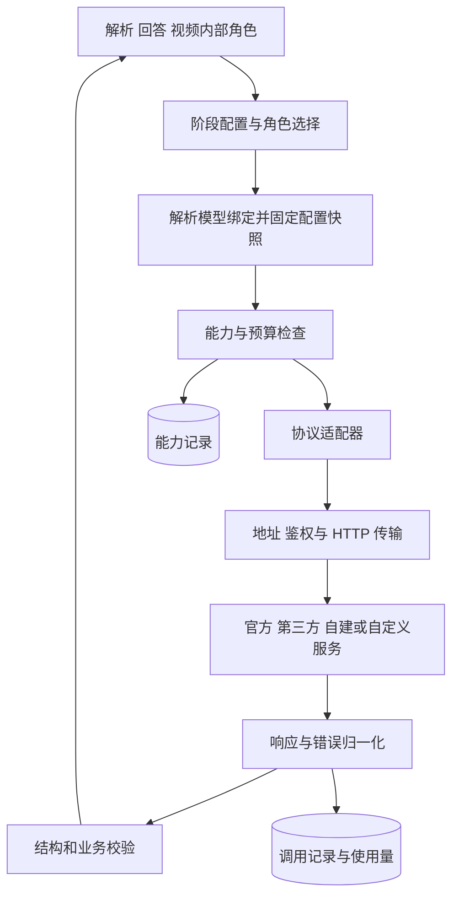

# LLM 接入与调用

更新日期：2026年10月29日

状态：当前 0.1.0 支持可配置的 Chat Completions；本文的多协议、连接管理和能力检测为待实现设计。当前实际配置见 [运行与配置](运行与配置.md)，跨模块规则见 [文档总览](index.md)。

本文统一维护设计思想、配置对象、调用契约、实施步骤与开源实现依据。上游实现通过固定提交和具体代码段链接引用，不直接复制源码。

## 1 职责与边界

用户应能选择提供商、模型及各阶段使用的配置，也能添加没有预设的服务。适配结果必须覆盖文本、图片、文件、结构化输出、错误及使用量，不能只让一条简单文本请求成功。

### 当前实现

当前实现已经支持按角色选择模型，但连接信息、模型参数和鉴权仍集中在同一条模型配置中：

| 当前代码 | 已有能力 | 下一步需要拆开的内容 |
|---|---|---|
| `src/manimagent/config.py` 的 `ModelConfig` | `base_url`、`model`、`api_key_env`、JSON 模式与 token 参数 | 连接、协议、鉴权策略、模型绑定与兼容规则 |
| `Settings.model_for()` | `roles` 引用模型配置，默认使用 text 或 vision | 保留业务角色，改为解析模型绑定 |
| `ChatProvider._post()` | 使用 httpx，统一超时，发送 Bearer 请求头 | 接收已解析的传输配置，不再固定一种鉴权 |
| `ChatProvider.complete()` | Chat 消息、图片 data URL、JSON 校验、预算与有限重试 | 把协议编码、响应解码与调用执行职责分开 |

当前 `base_url` 固定追加 `/chat/completions`，配置检查与请求执行均要求存在 API key。因此，当前能够配置第三方 Chat 兼容接口，但不能据此认定已支持 Responses、Messages、自定义鉴权或无鉴权服务。

### 主要设计思想

| 设计思想 | 在 ManimAgent 中的含义 | 解决的问题 |
|---|---|---|
| 服务来源与 API 协议分开 | `origin_type` 描述来源，`protocol` 选择适配器 | 第三方提供的 Claude 可以使用 Chat 协议，同一网关也可以提供多个协议 |
| 连接与模型分开 | `ProviderConnection` 管地址和凭据，`ModelBinding` 管远端模型和参数 | 多个模型共用一个连接；相同模型名通过不同网关时保持独立 |
| 业务角色只引用绑定 | `RoleProfile` 指定规划、编程、视觉检查等角色使用哪个绑定 | 更换厂商时不改业务流程，也不覆盖其他角色 |
| 鉴权与消息协议分开 | 同一协议允许 Bearer、指定 API Key 头或无鉴权 | 不要求所有 OpenAI 兼容服务都使用同一种凭据形式 |
| 地址按操作构造 | 根地址、自定义前缀与完整操作 URL 分别处理 | 避免重复版本和丢失租户路径 |
| 配置保存引用，调用时解析凭据 | 配置保存 `credential_ref`，发送前读取对应环境变量 | 凭据轮换不需要复制模型配置，任务快照与日志不保存密钥值 |
| 标准协议之外保留兼容规则 | 用版本化的 `compatibility_profile` 表达已验证差异 | 处理 token 参数、JSON、角色及流式行为差异 |
| 能力声明与验证结果分开 | 模型声明、探测与运行证据分别记录 | 文本成功不能证明视觉、文件或工具调用可用 |
| 失败与计量统一处理 | 归一化鉴权、限流、超时、截断及缺失用量 | 业务层执行一致的预算和失败策略 |
| 第三方与官方走同一配置流程 | 预设负责填默认值，自定义连接使用相同契约 | 新增兼容服务通常只需配置，无需增加厂商品牌分支 |

新增一种符合已有协议的服务，主要是增加连接和模型绑定。新增不兼容的协议、签名或令牌交换，才需要增加对应实现。厂商预设不作为可信模型身份或功能支持的证明。

### 模块边界

| 对象 | 负责的问题 | 不承担的职责 |
|---|---|---|
| ProviderConnection | 请求发送到哪里，用什么协议和凭据 | 不决定教材内容或教学策略 |
| ModelBinding | 通过该连接调用哪个模型，使用哪些参数 | 不把展示别名当成已验证模型身份 |
| RoleProfile | 本次阶段和角色选择哪些模型绑定 | 不修改全局默认连接或其他任务 |
| CapabilityRecord | 当前组合支持什么，有什么验证依据 | 不把一次文本成功推广成全功能成功 |
| ProtocolAdapter | 请求、响应、文件引用及错误如何转换 | 不吞掉图片、公式、来源或业务约束 |
| 调用执行器 | 传输、超时、预算、重试及调用记录 | 不重新生成教学内容或绕开上层校验 |

一条业务调用只经过一层实际协议适配：内部统一请求直接转换为目标协议。更换 SDK 可以作为适配器内部实现选择，不能改变上层 MaterialIR、Answer 或 VideoResult 的含义。

## 2 处理流程



## 3 输入输出

### ProviderConnection

一个连接表示一个具体服务端点、协议与凭据绑定。同一运营方同时提供 Chat Completions 和 Responses 时，可以建立两个连接并在界面分组展示。

| 字段 | 类型与默认值 | 约束 |
|---|---|---|
| provider_id | string，必填 | 本系统连接 ID，不作为厂商枚举 |
| revision | integer，必填 | 从 1 开始，配置修改后递增 |
| name | string，必填 | 用户可读名称 |
| origin_type | enum，必填 | official、cloud、gateway、self_hosted、custom，仅用于来源描述 |
| preset_ref | object 或 null，默认 null | 采用的预设 ID 与版本；自定义连接可为空 |
| protocol | enum，必填 | openai_chat、openai_responses、anthropic_messages、gemini_generate_content；后续按适配器扩展 |
| endpoint_mode | enum，默认 api_root | api_root 或 operation_urls |
| api_root | string 或 null，默认 null | api_root 模式必填，包含所需版本和路径前缀 |
| operation_urls | object，默认 {} | 完整 URL 模式逐项配置 generate、models、files_upload、files_get、files_delete |
| auth | object，必填 | mode 为 bearer、api_key_header 或 none；有凭据时使用 credential_ref，api_key_header 另需 header_name |
| headers | object，默认 {} | 固定非密钥请求头，例如 API 版本；不能覆盖 auth 生成的鉴权头 |
| compatibility_profile | object 或 null，默认 null | 已实现兼容规则的 ID、版本及受限参数 |
| proxy_ref | string 或 null，默认 null | 显式选择出站网络代理配置 |
| enabled | boolean，默认 true | 关闭后不接受新任务使用；已开始调用按快照处理 |

地址模式、鉴权头与凭据解析的具体行为见第 4 节。预设连接和自定义连接使用相同契约，不能从协议名称推断鉴权方式。

### ModelBinding

| 字段 | 类型与默认值 | 约束 |
|---|---|---|
| binding_id | string，必填 | 业务侧引用的模型绑定 ID |
| revision | integer，必填 | 从 1 开始，修改模型、参数或能力声明后递增 |
| provider_id | string，必填 | 指向 ProviderConnection |
| display_name | string，必填 | 页面展示名称 |
| upstream_model | string，必填 | 实际请求模型字符串，保留大小写、斜杠和前缀 |
| parameters | object，默认 {} | 统一参数，例如 max_output_tokens；适配器校验并转换 |
| declared_capabilities | object，默认 {} | 用户或预设声明的能力及限制，保留来源，不伪装成实测 |

同一个 upstream_model 通过不同 provider_id 调用时，是不同绑定。网关模型列表可作为选项来源，但列表接口不是接入前提，允许手动填写模型名；返回名称也不能证明上游实际使用了哪一个模型。

统一参数不直接等同于厂商参数。max_output_tokens 等字段由适配器转换；temperature、推理预算、JSON 约束或工具调用若未实现转换或未确认支持，应明确拒绝或使用配置中已经声明的兼容策略，不能静默删除。

### RoleProfile 与配置快照

阶段公开请求继续使用 parser_profile_id、answer_profile_id 或 video_profile_id，由服务端阶段配置解析到角色绑定。

| 阶段或角色 | 可选绑定 | 边界 |
|---|---|---|
| 材料解析 material_reader | 独立模型绑定，也可为空 | 本地文本解析不要求配置 LLM，原生文件或模型 OCR 路径才检查相应依赖 |
| 回答 answer_writer、answer_checker | 可共用一个绑定 | 只依赖本次材料、要求及允许使用的上下文 |
| 视频 planner、plan_checker、coder、execution_repair、visual_reviser、vision_checker | 按角色覆盖或采用阶段默认值 | 画面检查角色必须满足实际图片读取要求 |

RoleProfile 为 `{profile_id, revision, roles}`，revision 从 1 开始；roles 中的每个角色为 `{primary_binding_id, fallback_binding_ids, allow_failover}`，候选数组默认空，allow_failover 默认 false。阶段配置另维护该阶段业务预算和解析模式，不把厂商参数塞进 Answer 等内容结果。

任务接受时固定角色绑定、连接 revision、协议适配器版本、兼容规则版本、模型参数及能力记录引用。修改全局默认配置只影响新任务。凭据值在发送前解析且不进入日志；快照记录凭据引用，轮换凭据不改变该任务的目标服务或协议。凭据被撤销时允许任务明确失败，不能自动换成另一账户。

### 配置示例

下例为未来配置草案，域名、模型名和能力声明均为占位示例，当前 config.py 尚不接受这些字段。预设连接和自定义连接使用相同结构。

```yaml
provider_connections:
  gateway_a:
    provider_id: gateway_a
    revision: 1
    name: 我的网关 A
    origin_type: gateway
    protocol: openai_chat
    endpoint_mode: api_root
    api_root: https://gateway.example/team-a/v1
    auth:
      mode: bearer
      credential_ref:
        source: env
        name: MANIMAGENT_GATEWAY_API_KEY
    enabled: true

model_bindings:
  answer_primary:
    binding_id: answer_primary
    revision: 1
    provider_id: gateway_a
    display_name: 回答模型
    upstream_model: vendor/model-example
    parameters:
      max_output_tokens: 6000
    declared_capabilities:
      text: supported
      images: unknown
      file_inputs: unknown

role_profiles:
  answer_default:
    profile_id: answer_default
    revision: 1
    roles:
      answer_writer:
        primary_binding_id: answer_primary
        fallback_binding_ids: []
        allow_failover: false
```

### 内部调用对象

```text
LLMRequest:
  role
  instruction
  messages             # 本系统消息与 text/image/file 内容块
  output_schema        # 可为空，业务要求的 JSON Schema
  required_capabilities
  parameters

CallContext:
  job_id
  profile_snapshot_id
  resolved_binding_id
  deadline
  budget

LLMResponse:
  text
  structured_output    # 可为空，经过结构校验后的对象
  finish_reason        # stop/length/refusal/tool_call/error/unknown
  usage                # input/output/cache/reasoning 等已知值，未知为 null
  trace_id
```

适配层对外提供以下逻辑接口：

```text
resolve_binding(profile, role) -> ResolvedBinding
check_capabilities(binding, requirements) -> CapabilityDecision
generate(request, context) -> LLMResponse
prepare_file(file_id, binding, context) -> ProviderFileRef
release_file(provider_file_ref, context) -> ReleaseResult
probe(binding, scopes, context) -> ProbeReport
```

文本、图片与文件块保持显式类型。适配器遇到无法表达的内容块返回 capability_unsupported，不允许只保留文字后把请求标为成功。streaming 与工具调用的公共事件契约后续单独扩展，首版可以只实现非流式生成并明确拒绝对应功能要求。

JSON Schema 原生约束、JSON 对象模式与提示词后校验分别记录。业务需要结构化结果时，允许配置“提示词约束加校验”的执行路径；无论采用哪种路径，最终都通过本系统契约校验。截断、空输出、拒绝或工具调用未完成均不能直接作为完整 Answer 或检查报告。

调用失败统一抛出携带 LLMError 的异常，字段为 `{code, message, retryable, retry_after_seconds, trace_id, details}`，等待时间未知为 null，details 默认 `{}`。details 可含脱敏的上游状态码和请求标识，不能承载原始鉴权信息。首批分类包括 provider_auth_error、provider_quota_exceeded、provider_rate_limited、provider_unavailable、provider_timeout、model_unavailable、capability_unsupported、invalid_provider_response、output_truncated 与 budget_exceeded。材料解析模块将文件读取能力问题映射为既有 unsupported_file_input；其余分类按业务需要写入 v2 Error，不让业务层解析厂商原始错误体。

## 4 实现方案

### 协议家族

| 适配器 | 需要独立处理的内容 | 依据 |
|---|---|---|
| openai_chat | messages、choices、结构化输出参数及图像或文件消息 | [OpenAI 官方接口差异说明](https://developers.openai.com/api/docs/guides/migrate-to-responses) |
| openai_responses | input、分类型 output、结构化输出配置、文件和状态 | [OpenAI 官方接口差异说明](https://developers.openai.com/api/docs/guides/migrate-to-responses) |
| anthropic_messages | Messages 请求响应内容块、版本头及可配置鉴权 | [Claude API overview](https://platform.claude.com/docs/en/api/overview) |
| gemini_generate_content | contents、parts、候选结果和模型相关路径 | [Gemini generateContent](https://ai.google.dev/api/generate-content) |

上述为待实现的协议目录，不代表当前已经支持，也不代表协议名称保证所有扩展功能可用。官方协议版本和网关兼容范围需要在对应适配器实施时复核。文件输入的支持还依赖端点与格式，例如 [OpenAI 文件输入说明](https://developers.openai.com/api/docs/guides/file-inputs)明确区分接口和文件类型。

新增提供商若满足已支持协议，只新增连接和模型绑定。新增协议或特殊签名才扩展适配器。自定义配置只选择已注册的规则和受限参数，不在 YAML 中执行任意 Python、JavaScript 或请求改写脚本。

### 适配器组织与底层库选择

用注册表把 `protocol` 映射到应用已有的适配器；厂商预设只初始化连接和模型绑定。首版复用现有 httpx 实现，将 ChatProvider 包装为 openai_chat 适配器，逐步提取协议编码、传输和响应归一化职责。

若后续采用 LiteLLM 或厂商 SDK，仍由适配器封装，不让业务模块依赖其消息结构，也不要求另建代理服务器。引入前验证超时、内部重试、使用量、图片输入及错误映射。若缓存客户端，缓存必须区分目标地址、凭据作用域和配置版本。

### 地址构造

`api_root` 模式由所选协议适配器构造操作路径，`operation_urls` 模式使用逐项配置的完整地址。以下为待实现行为示例：

| 配置场景 | 输入 | 生成请求地址 |
|---|---|---|
| Chat API 根地址 | `api_root = https://gateway.example/v1` | `https://gateway.example/v1/chat/completions` |
| 含租户路径的 Chat 根地址 | `api_root = https://gateway.example/team-a/v1/` | `https://gateway.example/team-a/v1/chat/completions` |
| Responses API 根地址 | `api_root = https://gateway.example/team-a/v1` | `https://gateway.example/team-a/v1/responses` |
| 已指定完整生成地址 | `operation_urls.generate = https://gateway.example/custom/invoke` | 原样使用完整生成地址，不再追加路径 |

适配器定义各操作的相对路径；归一化只处理连接处斜杠，不丢弃已有路径，也不自动补第二个版本前缀。未配置的模型列表或文件操作不能从生成地址推断出来。HTTP 出站代理与模型服务地址分别配置。

涉及模型路径模板、区域、部署或 API 版本时，由对应实现校验并编码。当前通用配置不接受通过 URL 携带密钥；需要特殊 query 鉴权时另增明确契约，避免把秘密写入可导出的 URL。

### 鉴权与请求头

首版支持三种显式鉴权模式：

| `auth.mode` | 凭据要求 | 请求行为 |
|---|---|---|
| `bearer` | 必须解析 `credential_ref` | 生成 `Authorization: Bearer …` |
| `api_key_header` | 必须解析 `credential_ref` 并配置 `header_name` | 将 key 放入指定请求头，例如 `X-API-Key` |
| `none` | 不配置凭据引用 | 不生成鉴权头，不读取默认厂商 key |

普通 `headers` 只保存非秘密值，例如 API 版本和租户标识。鉴权头由鉴权策略统一生成，大小写不敏感地检查冲突，禁止普通 headers 覆盖鉴权头。上游也有允许调用选项覆盖默认 headers 的实现，见 [Pi 的客户端请求头合并](https://github.com/earendil-works/pi/blob/a92283056d915c758799fcd904948ff0cb42628c/packages/ai/src/api/openai-completions.ts#L749-L782)。本项目选择在配置阶段拒绝鉴权头冲突，避免请求实际使用的凭据与配置展示不一致。

同时要求 Bearer 和另一个秘密网关头的服务，超出首版单一主鉴权契约。后续应增加显式的多秘密头引用或专用鉴权策略；第二把 key 不能直接写入普通 headers。OAuth、AWS 签名与云身份也必须有各自的获取、刷新或签名实现，不能用一个静态 key 字段概括。

### 凭据解析与配置覆盖

凭据首版通过环境变量引用，例如 `{source: "env", name: "MANIMAGENT_GATEWAY_API_KEY"}`。只读取连接明确指定的变量，缺失即报错；现有 `.env` 加载继续遵守不覆盖已存在环境变量的规则。公共查询只返回已配置状态和脱敏引用，发送前再解析秘密。

连接选择属于配置解析，凭据解析只取得该连接指定的秘密。鉴权失败不能改用其他连接的 key、共享协议的默认登录状态或官方默认地址。客户端订阅登录、第三方 API Key 与本项目 API 凭据分别建模，首版不读取或搬用其他客户端的登录文件。

预设只在创建连接时提供默认值，之后以保存的连接 revision 为准；兼容规则不能改写目标地址或凭据来源。任务继续遵守第 3 节的固定快照：发送前可读取轮换后的凭据值，不能动态更换任务的连接和协议。

并发任务使用各自的已解析连接上下文，不通过修改进程级 `os.environ` 切换账户。以后若增加密钥存储或 OAuth，显式声明后端、查找或刷新规则，处理刷新并发与取消，不因一种来源失效而静默改用其他账户。不执行配置中的 shell 命令。

### 兼容规则

`compatibility_profile` 选择已经实现、带版本的受限规则。现有 `json_mode` 和 `token_parameter` 作为最早迁移的兼容选项；后续按实际需求增加角色、流式 usage、thinking 格式和工具行为的转换。每个选项都要有请求级验证，不能只有配置开关。

已知 provider 和 URL 的已验证默认值可以做成预设，自定义网关不能仅因模型名称相同就继承这些能力。上游能力尚未确认时保留未知，本项目尚未实现的功能明确标为不支持。

### 能力记录与实际验证

CapabilityRecord 以连接配置 revision、协议与适配器版本、模型绑定及其 revision、凭据作用域标识为范围。不同区域、套餐、网关、凭据或兼容规则的结果不直接共用；作用域标识只存服务端引用，不存密钥值。

| 能力 | 必须区分的内容 |
|---|---|
| text | 最小文本调用是否成功 |
| images | 是否保留并实际理解图片，支持的媒体类型与输入方式 |
| file_inputs | 接受的格式、传输方式、限制及所提取的内容类型 |
| files_api | 是否提供上传、查询、删除；与生成接口读取文件分别记录 |
| structured_output | native_schema、json_object、prompt_validated 分别支持到什么范围 |
| streaming / tools | 协议与本项目适配器是否均已实现 |
| limits | 文件字节数、页数、上下文和输出限制，未知为 null |
| usage | 哪些 token 或费用字段可以读取，其余保持未知 |

每项记录包含 `state: supported/unsupported/unknown`、`evidence_source: preset/manual/probe/runtime`、checked_at、expires_at 及证据引用。预设或手动声明保留其来源标签；实测记录保留测试范围与结果。测试过期或连接、凭据作用域、协议版本变化时，需要重新评估。一次上传成功只能支持上传能力结论，不能证明生成模型读懂了文件。

有效能力由适配器实现范围、服务声明或配置、有效测试证据以及本次限制共同决定。显式未支持或本项目尚未实现的操作不能被预设或手动开关覆盖成支持；unknown 需要按业务要求决定是否先做测试或退回其他处理方式。

材料解析的 auto 路由只有在所需格式、大小及内容类型满足条件时才选择原生文件输入。DOCX 或 PPTX 中的图示、扫描 PDF 中的文字和复杂数学公式都属于本次读取要求，不能仅按扩展名判断。未满足要求时交给解析模块选择可用的本地、转换或 OCR 路径；视频模块不参与该判断。

检测分为四类，结果分别展示：

1. 网络可达：检查连接和 HTTP 响应，不能据此确认鉴权或模型正确。
2. 文本调用：使用用户选定模型发送最小真实请求，验证鉴权、协议及响应解码。
3. 输出能力：按业务 schema 验证结构化输出及截断处理。
4. 图片或文件：使用明确的合成样例验证所选格式及内容保留，避免只看 2xx 状态。

检测范围由用户选择，真实调用计入检测预算；不自动向全部预设提供商发送用户学习材料。检测失败按网络、鉴权、模型不可用、功能不支持、内容未被保留等原因记录，而非统一显示“厂商不可用”。

### 原件、本系统文件与厂商文件引用

本系统 FileAsset 始终是可复用的原件与派生资产。原生调用需要文件上传时，由解析模块请求 prepare_file，记录上传、处理完成或失效状态，再用于目标调用。

ProviderFileRef 为内部对象，至少包含 provider_id、连接 revision、凭据作用域、原 file_id、远端引用、状态和可用的过期时间。远端引用只在其所属连接与作用域使用；切换提供商或凭据后，必须从原件重新准备文件，不能转发另一服务的远端 ID。

能力检查需要覆盖上传、等待处理、实际读取和结果提取，设置共同 deadline。上传成功但处理未完成、远端文件过期或读取失败时，不能直接进入回答生成。原件保留，清理远端临时文件单独记录失败，清理问题不改变已保存 MaterialIR 的内容。

原生文件读取成功后，仍必须转为本系统 MaterialIR 并校验，再进入独立回答模块。下游不持有厂商文件 ID、SDK 对象或需要继续存在的厂商会话。

#### 文件内容块与传输选择

材料模块提交本系统的 `{type: "file", file_id}` 内容块；页码范围已由材料模块应用到实际输入文件，必要时 file_id 指向带来源映射的派生文件。适配器根据 file_inputs 的格式、传输方式和限制决定使用字节编码、受控 URL 或 ProviderFileRef。只支持直接内容块的端点不需要实现远端上传；只支持 Files API 上传但生成模型无法读取的端点不能通过原生解析能力检查。

图像块以 `{type: "image", asset_id}` 引用本系统图像资产，文本块以 `{type: "text", text}` 表达正文。适配器内部从资产仓储读取字节、确认 MIME 并编码，不把任意宿主路径交给业务调用者。提供商不支持必要图像或文件块时返回 capability_unsupported，不以省略内容取得表面成功。

不同提供商的原生文档消息格式由适配器单独实现，参考 [LibreChat 按提供商与协议编码文档块](https://github.com/LibreChat-AI/LibreChat/blob/8d3da9bbb220a0a96be9330a2e1cbd385fb786d5/packages/api/src/files/encode/document.ts#L125-L235)。这段实现用于说明编码职责和格式差异，不作为任意网关能力的证明。每次 trace 另记实际传输方式、原件或派生 file_id、远端引用的内部关联及对应能力证据。

文件路由在实际绑定确定后检查，借鉴 [LibreChat 的回合文件交付解析](https://github.com/LibreChat-AI/LibreChat/blob/8d3da9bbb220a0a96be9330a2e1cbd385fb786d5/packages/api/src/agents/files/delivery.ts#L34-L80)。本项目的任务绑定固定为配置快照；允许故障转移时，每个候选重新校验文件能力、引用作用域和预算，并从本系统原件准备自己的输入。

本层不决定回答采用全文或检索，也不把文件自动降级为某段文本。解析回退和派生范围见 [材料输入与解析](02-材料输入与解析.md)，材料转成一次回答所需消息的规则见 [文本回答生成](03-文本回答生成.md)。

### 重试、解析回退与跨提供商切换

三种策略分别配置，避免一次异常引起整个任务重新生成或材料被转到未选定的服务。

| 策略 | 所属层 | 默认行为 |
|---|---|---|
| 同一连接重试 | 调用执行器 | 对明确暂时性错误在剩余预算内重试 |
| 原生文件转本地解析 | [材料解析模块](02-材料输入与解析.md) | auto 模式下仅对已识别的文件能力不支持进行回退 |
| 切换提供商或模型 | 角色路由 | 默认关闭；仅使用 profile 中明确列出的候选 |

| 错误类别 | 处理规则 |
|---|---|
| 鉴权失败、额度不足、模型配置错误 | 明确报告，默认不重试也不切换 |
| 限流、暂时服务异常 | 遵循可用的重试等待信息并退避，受截止时间与次数限制 |
| 超时或连接中断 | 允许有界重试；记录请求可能已到达上游，不能假定没有计费 |
| HTTP 400/404 | 由适配器结合错误体分类，不把状态码直接等同于能力不支持 |
| 文件能力不支持 | auto 可触发解析回退，native 返回明确问题 |
| 输出截断、无效 JSON、结构错误 | 区分输出预算与契约问题，按明确的修复预算处理 |
| 拒绝、关键内容缺失或识别不确定 | 返回业务可处理的问题，不作为网络健康故障轮换服务 |

候选提供商必须满足该角色全部能力要求。切换后以新 trace 重新执行完整的一次逻辑调用，丢弃上次的未完成输出，不能把两家模型的半份回答拼接为一个结果。文件引用、隐藏会话和推理状态不能跨服务直接复用；首版优先使用从本系统材料重建的完整无状态请求。

所有尝试共用阶段与任务的时间、调用次数和使用量预算。SDK 自带重试和执行器重试不能叠加成无界循环。已有成功 Answer 或视频产物不因后续失败而覆盖；模型切换不修改其他任务的默认配置。

按任务固定实验配置时关闭跨提供商切换。启用切换的任务保存实际使用的绑定、候选顺序和每次失败原因，评测按实际路径统计。

### 使用量、日志与可追溯性

每次调用记录 trace_id、job_id、阶段与角色、配置快照、连接与模型绑定、请求模型、上游报告模型、开始结束时间、HTTP 或业务错误码、重试与回退原因。上游报告模型标明为服务自报信息，不能写成已经验证的真实模型身份。

输入、输出、缓存及推理 token 分别记录已知值；厂商未返回时保持 null。另存估算值与估算方法，避免将缺失值记成 0。无法取得实际用量时，调用次数与时间上限继续强制执行，并保留未核实成本；预算耗尽时停止。

不同提供商的计费规则不能只套用模型官方价格。估算成本需要记录价格来源、币种、版本及是否包含网关倍率，作为估算展示；首版不实现任意额度查询脚本和全厂商余额抓取。

连接与能力诊断默认展示必要的脱敏元信息。API Key、鉴权头和远端临时访问令牌不进入公共 Job、错误消息、配置导出或渲染容器。模型响应原文如用于调试，按本项目产物访问规则保存。

### 用户选择与管理接口边界

用户可以从预设创建连接，也可以选择“自定义”，显式填写协议、地址、凭据引用和模型名称。预设只负责初始化，修改后生成实例新 revision，预设目录更新不覆盖已有实例。切换提供商时仅更新连接或角色引用，保留其他阶段的配置。

页面按连接展示来源类型、协议、模型绑定以及各项检测结果。选择时根据角色要求说明可用、能力未知或缺少能力，不用一个笼统的绿色状态代表全部功能。文件解析、回答生成及视频内部角色可以分别选择。

首版可以先用服务端 YAML 管理连接与绑定，业务 API 仍只提交阶段 profile_id。后续配置界面使用以下控制面契约，与内容生成 API 分开：

| 方法与路径 | 输入或用途 | 成功响应 |
|---|---|---|
| GET /api/v2/providers | 列出本用户可用连接 | 脱敏 ProviderConnection 列表 |
| POST /api/v2/providers | 新建预设实例或自定义连接 | 201，脱敏配置与 revision |
| PUT /api/v2/providers/{provider_id} | 完整替换可编辑配置，携带 expected_revision | 200，新 revision；并发冲突为 409 |
| GET /api/v2/model-bindings | 按 provider_id 可选过滤 | 本系统模型绑定列表 |
| POST /api/v2/model-bindings | 创建模型绑定 | 201，ModelBinding |
| PUT /api/v2/model-bindings/{binding_id} | 完整替换绑定，携带 expected_revision | 200，新 revision；并发冲突为 409 |
| GET /api/v2/llm-profiles | 查询角色配置 | RoleProfile 列表 |
| POST /api/v2/llm-profiles | 创建角色配置 | 201，RoleProfile |
| PUT /api/v2/llm-profiles/{profile_id} | 完整替换角色配置，携带 expected_revision | 200，新 revision；并发冲突为 409 |
| POST /api/v2/providers/{provider_id}/probes | binding_id、scopes、检测预算 | 202，probe 类型 Job |

以上管理端点均为后续接口设计，不是当前可用 API。credential_ref 必须引用服务端已有凭据，公共配置响应不返回秘密值；凭据录入界面及后续密钥存储后端另行设计。云签名或 OAuth 在专用适配器具备明确凭据来源后再接入，不从协议名称推断登录方式。

探测任务沿用 v2 Job 的状态及错误封装，扩展 kind 为 probe，完成时 result 为 `{type: "probe_report", id}`，增加 `GET /api/v2/probe-reports/{id}` 获取 ProbeReport。报告包含 binding_id、配置 revision、各 scope 的状态、证据与脱敏错误；不为每次连通检测创建业务 MaterialIR 或 Answer。

### 开源实现依据

下列实现依据使用固定提交链接，其中本次调研的五个 agent 源码同时标注行号；CC Switch 保留既有参考。各段分别说明上游实际做法和本项目的取舍，上游的灵活选项不自动成为本项目承诺。

#### OpenCode：提供商实例、协议实现和实际模型 ID 分开

OpenCode v1.19.5 的实现有三个直接相关的位置：

| 具体代码段 | 可观察到的实现 | 本项目采用方式 |
|---|---|---|
| [`BUNDLED_PROVIDERS` 适配器工厂表](https://github.com/anomalyco/opencode/blob/810c0eba1a7348036f8bdf61e6632d0c36c6876c/packages/opencode/src/provider/provider.ts#L148-L175) | 多种 provider 包映射到各自客户端工厂 | 建立协议适配器注册表，业务角色不判断厂商名称 |
| [从配置构建 provider 和 model](https://github.com/anomalyco/opencode/blob/810c0eba1a7348036f8bdf61e6632d0c36c6876c/packages/opencode/src/provider/provider.ts#L1532-L1567) | provider ID、显示名称、实际 API 模型 ID、实现包与地址分别解析 | 用连接 ID、展示名称、协议和 `upstream_model` 分别表达 |
| [`resolveSDK()` 解析连接选项并创建客户端](https://github.com/anomalyco/opencode/blob/810c0eba1a7348036f8bdf61e6632d0c36c6876c/packages/opencode/src/provider/provider.ts#L1813-L1864) | 先解析 URL、key、headers，再调用所选工厂；客户端缓存包含 provider ID、实现包和选项 | 在业务调用前形成完整连接上下文；后续若缓存客户端，必须隔离目标、凭据作用域和配置版本 |

本项目采用显式 `protocol`，首版不开放任意 npm 包或动态代码加载。OpenCode 的实现包可逐模型覆盖；本项目先让一个连接对应一个协议，同一服务的不同协议创建不同连接，减少隐式覆盖。

#### Pi：配置协议、模型元数据和兼容差异

| 具体代码段 | 可观察到的实现 | 本项目采用方式 |
|---|---|---|
| [`ProviderConfigSchema`](https://github.com/earendil-works/pi/blob/a92283056d915c758799fcd904948ff0cb42628c/packages/coding-agent/src/core/model-config.ts#L89-L115) | 独立声明 `baseUrl`、`api`、`apiKey`、`headers`、`authHeader` 和 `compat` | 明确协议、地址、鉴权与兼容规则，不靠 URL 或模型名推断全部行为 |
| [`ModelDefinitionSchema`](https://github.com/earendil-works/pi/blob/a92283056d915c758799fcd904948ff0cb42628c/packages/coding-agent/src/core/model-config.ts#L48-L69) | 模型包含实际 ID、输入类型、上下文、输出上限及兼容配置 | 把连接信息与模型能力分开，允许人工填写上游模型 ID |
| [Chat 兼容性字段定义](https://github.com/earendil-works/pi/blob/a92283056d915c758799fcd904948ff0cb42628c/packages/ai/src/providers/compat-schema.ts#L190-L263) | 对 developer role、流式 usage、token 字段及 thinking 格式分别配置 | 只增加本项目已经实现转换且可以验证的兼容选项 |
| [Chat 请求中的 usage 与 token 参数处理](https://github.com/earendil-works/pi/blob/a92283056d915c758799fcd904948ff0cb42628c/packages/ai/src/api/openai-completions.ts#L819-L838) | 兼容字段实际控制请求参数 | 每条兼容规则必须有请求级验证，不能只加配置开关 |

Pi 还包含按已知 provider 和 URL 推断兼容默认值的逻辑，见 [兼容默认值检测](https://github.com/earendil-works/pi/blob/a92283056d915c758799fcd904948ff0cb42628c/packages/ai/src/api/openai-completions.ts#L1583-L1668)。本项目可将已验证默认值做成预设，但自定义网关不能仅因模型名称相同就继承这些能力。

本项目的兼容规则和能力验证分别按本节前述约定实施。

#### Cline：先解析配置与凭据，再交给具体客户端

| 具体代码段 | 可观察到的实现 | 本项目采用方式 |
|---|---|---|
| [`AuthConfig` 与 `EndpointConfig`](https://github.com/cline/cline/blob/f817e59f698f01487920c00ede2dbecad5c0fa50/sdk/packages/llms/src/providers/config.ts#L70-L101) | 鉴权字段与地址、headers、超时分别定义 | 分开校验鉴权、端点与传输选项 |
| [`resolveApiKey()`](https://github.com/cline/cline/blob/f817e59f698f01487920c00ede2dbecad5c0fa50/sdk/packages/llms/src/providers/http.ts#L13-L35) | 显式 key、动态 resolver、环境变量有确定的查找顺序 | 凭据解析集中到一处；首版只解析连接明确指定的环境变量，不引入隐式多来源回退 |
| [`createOpenAICompatibleProviderModule()`](https://github.com/cline/cline/blob/f817e59f698f01487920c00ede2dbecad5c0fa50/sdk/packages/llms/src/providers/vendors/openai-compatible.ts#L226-L251) | 将已解析的 key、base URL、headers、fetch 传入兼容客户端，且不统一拦截缺失 key | 无鉴权是显式配置；不要继续用“必须有 key”作为所有连接的前置条件 |
| [Azure API 版本参数的请求包装](https://github.com/cline/cline/blob/f817e59f698f01487920c00ede2dbecad5c0fa50/sdk/packages/llms/src/providers/vendors/openai-compatible.ts#L47-L85) | 传输包装可以补充协议相关 query 参数 | 特殊版本、部署与签名由经过注册的实现处理，不向普通配置开放任意请求脚本 |

Cline 的缺失 key 处理是适配器策略。本项目在 `auth.mode` 为 bearer 或 api_key_header 时仍要检查指定凭据；只有 none 模式才允许省略。这样能区分配置缺失和确实无需鉴权。

#### Pi 与 OpenCode：区分凭据类型，明确失败与刷新行为

| 具体代码段 | 可观察到的实现 | 本项目采用方式 |
|---|---|---|
| [OpenCode 的 OAuth、API key 凭据联合类型](https://github.com/anomalyco/opencode/blob/810c0eba1a7348036f8bdf61e6632d0c36c6876c/packages/opencode/src/auth/index.ts#L10-L35) | OAuth 保存 access、refresh、expires，API key 使用另一类型 | 静态 key 与需要刷新的登录凭据分别建模，后续再扩展 OAuth |
| [OpenCode 按 provider 保存凭据](https://github.com/anomalyco/opencode/blob/810c0eba1a7348036f8bdf61e6632d0c36c6876c/packages/opencode/src/auth/index.ts#L69-L88) | 独立 JSON 文件按 provider 索引，并设置文件权限 | 借鉴凭据隔离；首版继续用环境变量引用。文件权限不等于内容加密 |
| [Pi 的覆盖值、已存凭据与环境来源解析](https://github.com/earendil-works/pi/blob/a92283056d915c758799fcd904948ff0cb42628c/packages/ai/src/auth/resolve.ts#L27-L92) | 已存凭据优先；其刷新失败或类型不匹配时不静默回退环境凭据 | 固定凭据来源，鉴权失败明确报告，避免意外切换账户 |
| [Pi 的 OAuth 刷新与凭据存储锁](https://github.com/earendil-works/pi/blob/a92283056d915c758799fcd904948ff0cb42628c/packages/ai/src/auth/resolve.ts#L105-L189) | 在锁内重新判断是否需要刷新并保存结果 | 引入 OAuth 时同时处理刷新并发、取消和持久化，而非只增加一个 token 字段 |

Pi 的配置允许命令输出作为密钥来源，入口见前述 `ProviderConfigSchema`。本项目首版保持环境变量引用，不执行配置中的 shell 命令；若以后需要密钥管理器，新增明确的凭据后端。

#### OpenHands 与 Aider：统一调用层，避免进程级状态串用

| 具体代码段 | 可观察到的实现 | 本项目采用方式 |
|---|---|---|
| [OpenHands 的 `provider_connection_id` 与连接字段](https://github.com/OpenHands/software-agent-sdk/blob/46b1fa5cb91ada17e6ec938c7e8624a4fa19fa98/openhands-sdk/openhands/sdk/llm/llm.py#L289-L333) | LLM profile 可以引用共享连接；字段约定在加载时解析共享 key 与 URL | 用连接管理可复用的地址与鉴权，角色及模型绑定保存引用 |
| [OpenHands 的逐调用 OpenRouter 请求头](https://github.com/OpenHands/software-agent-sdk/blob/46b1fa5cb91ada17e6ec938c7e8624a4fa19fa98/openhands-sdk/openhands/sdk/llm/llm.py#L851-L864) | 通过每次请求的 headers 传递，明确避免修改 `os.environ` 导致多会话串用 | 并发任务使用各自的已解析连接上下文，不通过修改全局环境切换账户 |
| [OpenHands 的 LiteLLM 参数准备与调用](https://github.com/OpenHands/software-agent-sdk/blob/46b1fa5cb91ada17e6ec938c7e8624a4fa19fa98/openhands-sdk/openhands/sdk/llm/llm.py#L2489-L2541) | 在统一层构造参数，再调用 LiteLLM；关闭其内部重试，由 SDK 层负责 | 调用预算与重试由本项目统一执行，避免外层与 SDK 内层重试相乘 |
| [Aider 的 `send_completion()`](https://github.com/Aider-AI/aider/blob/5dc9490bb35f9729ef2c95d00a19ccd30c26339c/aider/models.py#L985-L1037) | 合并模型参数后调用进程内的 `litellm.completion()` | 多厂商适配库可以作为内部实现选择，不要求另建代理服务器 |

OpenHands 字段中的加载时解析不等于本项目运行中的任务可以动态换连接；ManimAgent 仍在任务接受时固定连接 revision，只在发送前解析指定凭据。

#### CC Switch：连接管理、适配与诊断

既有设计参考 [farion1231/cc-switch](https://github.com/farion1231/cc-switch)，固定参考提交为 [d8983bb10b82a1ccc15ae5f44ab070902623e990](https://github.com/farion1231/cc-switch/commit/d8983bb10b82a1ccc15ae5f44ab070902623e990)。以下是对该提交的观察与本项目的设计选择，不能当作对任意网关兼容性的保证。

| 已查阅的实现或说明 | 得到的启发 | ManimAgent 的采用方式 |
|---|---|---|
| [提供商与元信息](https://github.com/farion1231/cc-switch/blob/d8983bb10b82a1ccc15ae5f44ab070902623e990/src-tauri/src/provider.rs)、[预设配置](https://github.com/farion1231/cc-switch/blob/d8983bb10b82a1ccc15ae5f44ab070902623e990/src/config/codexProviderPresets.ts) | 预设、自定义实例、API 格式与完整 URL 等信息可以分别表达 | 预设是可编辑的起点，实例使用同一配置结构，能力另行验证 |
| [ProviderAdapter](https://github.com/farion1231/cc-switch/blob/d8983bb10b82a1ccc15ae5f44ab070902623e990/src-tauri/src/proxy/providers/adapter.rs) | URL、鉴权和请求响应转换有统一接口 | 业务请求先归一化，再由协议适配器编码和解码 |
| [鉴权策略](https://github.com/farion1231/cc-switch/blob/d8983bb10b82a1ccc15ae5f44ab070902623e990/src-tauri/src/proxy/providers/auth.rs) | API 格式与鉴权方式需要分别处理 | 同一种协议允许配置不同鉴权策略及必要版本头 |
| [模型映射](https://github.com/farion1231/cc-switch/blob/d8983bb10b82a1ccc15ae5f44ab070902623e990/src-tauri/src/proxy/model_mapper.rs) | 展示模型与实际请求模型需要区分 | 使用显式绑定，保留请求模型与上游报告模型 |
| [路由器](https://github.com/farion1231/cc-switch/blob/d8983bb10b82a1ccc15ae5f44ab070902623e990/src-tauri/src/proxy/provider_router.rs)、[故障转移说明](https://github.com/farion1231/cc-switch/blob/d8983bb10b82a1ccc15ae5f44ab070902623e990/docs/user-manual/zh/4-proxy/4.3-failover.md) | 候选顺序、健康状态与熔断可以单独维护 | 首版固定主连接和有界重试，跨提供商切换由配置明确开启 |
| [连通检测说明](https://github.com/farion1231/cc-switch/blob/d8983bb10b82a1ccc15ae5f44ab070902623e990/docs/user-manual/zh/4-proxy/4.5-model-test.md) | 该检测只验证地址可达，不验证密钥和模型 | 分开呈现网络可达、文本调用、结构化输出、图片和文件测试结果 |

CC Switch 面向多个客户端的配置切换与本地路由，ManimAgent 直接发起业务 API 请求。本项目优先采用其配置分层、适配接口和诊断思路；客户端配置改写、账号登录接管、完整代理服务与所有协议互转不作为本项目的前置条件。参考代码与手册，预设目录中的商业宣传不作为服务质量或模型能力证据。

#### 参考版本

| 项目 | 本文核对版本 | 参考范围 |
|---|---|---|
| OpenCode | [v1.19.5 / 810c0eba](https://github.com/anomalyco/opencode/commit/810c0eba1a7348036f8bdf61e6632d0c36c6876c) | 稳定版 provider 与 auth；不混用 v2 开发版配置结构 |
| Pi | [a9228305](https://github.com/earendil-works/pi/commit/a92283056d915c758799fcd904948ff0cb42628c) | 模型配置、协议兼容与凭据解析；仓库原名 badlogic/pi-mono，当前为 earendil-works/pi |
| Cline | [f817e59f](https://github.com/cline/cline/commit/f817e59f698f01487920c00ede2dbecad5c0fa50) | 当前主分支 SDK 的配置与兼容客户端，不以旧目录结构为依据 |
| OpenHands SDK | [46b1fa5c](https://github.com/OpenHands/software-agent-sdk/commit/46b1fa5cb91ada17e6ec938c7e8624a4fa19fa98) | 共享连接字段、逐调用参数与 LiteLLM 调用 |
| CC Switch | [d8983bb1](https://github.com/farion1231/cc-switch/commit/d8983bb10b82a1ccc15ae5f44ab070902623e990) | 既有连接管理、适配器、路由与诊断设计参考 |
| Aider | [5dc9490b](https://github.com/Aider-AI/aider/commit/5dc9490bb35f9729ef2c95d00a19ccd30c26339c) | 调研时主分支的模型参数合并与进程内 LiteLLM 调用 |

固定引用便于复核本文结论。后续实施时，若升级参考版本或替换底层库，重新核对所依赖的 URL、鉴权合并、重试及兼容行为，再更新相关依据。

## 5 当前状态与待办

实施顺序由 [开发计划](开发计划.md) 统筹。本模块按以下步骤迁移，保留现有 MVP 配置与调用行为：

### 迁移步骤

| 步骤 | 落点 | 完成条件 |
|---|---|---|
| 1. 提取配置对象与 Chat 适配器 | `config.py`、`providers.py` | 引入 ProviderConnection、ModelBinding 和固定快照；旧 `models/roles` 转换为等价对象，保留默认角色行为 |
| 2. 拆分地址、鉴权与调用执行 | 地址和鉴权模块、调用执行器 | 自定义 Chat 端点、Bearer、指定 key 头与 none 可用；保留图片和 JSON 校验，统一响应、错误、使用量及重试预算 |
| 3. 增加兼容规则与诊断 | 兼容规则、探测和调用记录 | token 字段和 JSON 模式可追踪，文本调用及结构化输出可独立检测，缺失用量保持未知 |
| 4. 按需求实现新协议 | Responses、Messages、Gemini 适配器 | 各自请求响应样例验证通过后标记支持，不提前声称全部兼容 |
| 5. 联通材料解析与文件能力 | 文件能力记录、远端文件生命周期、解析回退 | 分格式验证上传和实际读取，与独立材料解析模块联通 |
| 6. 增加配置管理与按需扩展 | 配置管理界面、后续鉴权和路由策略 | 支持连接与角色选择；实际需要时再增加 OAuth、云身份、跨提供商切换、熔断和复杂代理 |

### 验收重点

| 验收情形 | 需要确认的行为 |
|---|---|
| 官方与第三方暴露同一协议 | 复用协议适配器，连接和凭据分别隔离 |
| 同一提供商有多个协议 | 显式选择协议，响应按对应规则解码 |
| 自定义根路径或完整 URL | 保留路径前缀，没有重复版本或多余端点拼接 |
| Bearer、自定义 API Key 头与无鉴权 | 只发送对应配置，密钥不被响应或日志回显 |
| 相同模型名称通过不同网关调用 | 地址、凭据、模型绑定、能力与调用记录互相区分 |
| 凭据缺失或请求头冲突 | 在明确阶段失败，无鉴权连接不发送残留凭据 |
| 鉴权或 OAuth 刷新失败 | 不改回官方地址，不静默切换账户或未配置候选 |
| 并发任务与客户端复用 | 不通过全局环境变量影响彼此，按目标和凭据作用域隔离客户端 |
| 模型列表接口缺失 | 手动模型绑定仍可测试和使用 |
| 文本可用但图片被忽略 | 不能把视觉检查角色标为可用 |
| 文件上传成功但模型不能读 | files_api 与 file_inputs 结果分开，正确回退或报告 |
| 未实现的参数或输入块 | 明确返回不支持，不能静默丢弃 |
| 后续流式与工具调用 | 分别验证流式事件与完整工具调用回合，普通文本成功不能替代 |
| SDK 内部重试与外层重试 | 单一执行层控制，不叠加突破调用次数和时间预算 |
| 原生 JSON、JSON 对象模式及提示词后校验 | 实际执行路径可追踪，最终统一校验 |
| 限流、鉴权、额度、超时、拒绝与截断 | 分别分类，不触发不相干的解析或提供商回退 |
| 用量缺失或失败请求可能已计费 | 保留未知或估算，仍执行调用与时间预算 |
| 任务运行中修改默认连接 | 已接受任务保持快照，新任务采用新配置 |
| 显式跨提供商切换 | 候选满足能力要求，文件重新准备，累计预算且不混合半份输出 |
| 旧 MVP 与独立阶段 | 旧配置和接口可用，上传或本地解析不依赖全套模型与渲染服务 |

[返回文档总览](index.md) · [材料输入与解析](02-材料输入与解析.md)
