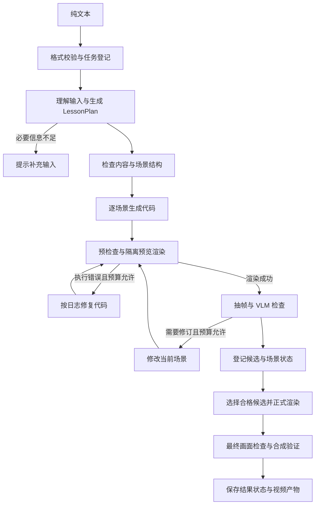

# 动画生成

更新日期：2026年10月24日

状态：0.1.0 已有纯文本到动画的 MVP 代码，历史验证范围见 [MVP 验证记录](MVP验证记录.md)。消费独立 Answer 的接口、VideoResult、配音、字幕和局部重建仍为后续设计。本次迁移不修改代码与当前 API。

## 1 职责与边界

本模块负责分镜与视觉表达、Manim 代码、隔离执行、执行纠错、VLM 检查、候选选择、正式渲染与视频合成。后续配音、字幕与时间线也归本模块。

| 版本 | 输入与职责 | 状态 |
|---|---|---|
| 当前 0.1.0 | GenerationRequest(text) 经讲解规划直接生成动画，内容与分镜尚在同一流程 | 现有实现基线 |
| 后续模块边界 | 消费确定版本的 Answer，组织视觉表达并输出 VideoResult | 待实现设计 |

后续回答中的题设、公式含义与结论由 [文本回答生成](03-文本回答生成.md) 维护。视频可以调整表达顺序和场景划分，发现内容错误或无法完整覆盖时返回待核对问题，由上层显式修订回答并产生新版本。

当前 MVP 面向二维数学概念和简单题目，先围绕向量、投影和矩阵变换建立基线。用户不需要提供分镜、代码或结构化场景字段。当前不含配音、文件上传、学习者记忆或跨任务经验检索；当次运行记录用于检查与复现。

## 2 处理流程

### 当前 0.1.0 流程



各场景顺序执行，先不做并发。失败、待检查和预算耗尽的分支均更新任务状态并保留已有产物，不无限循环。

#### 讲解规划

Planner 从输入中提取目标、题设、必须覆盖的知识点和本次要求，输出结构化 LessonPlan。用户文本不直接变成 Manim 代码。

规划需区分题设事实与新建演示例子。必要条件缺失时终止并提示补充；存在足够信息的概念解释，可以自行选择例子并明确它是演示例子。

PlanChecker 检查题设是否被保留、关键条件与步骤是否完整，以及场景数量和可执行范围。规则校验还需保证场景与步骤标识唯一、引用有效，所有 required_points 至少分配到一个场景。结构问题通过规则校验，语义一致性由文本模型检查；修正规划最多一次，仍无法满足要求时结束任务。

#### 场景生成与执行纠错

Coder 根据单个 SceneSpec 和整体符号约定生成完整 Manim 场景。Renderer 先做语法与场景结构检查，再隔离执行。ExecutionReviewer 区分 Python、Manim、LaTeX、资源缺失和超时等问题，给出针对性修复。

环境缺少字体或 LaTeX 等配置错误应报告环境问题，不能靠反复改写讲解内容掩盖。生成代码的运行环境不包含模型密钥，也不共享 API 进程。

#### 视觉检查与修订

VLM 输入包括场景目标、题设与关键点、四张带时间标签的采样画面。初始采样取场景时长的 12.5%、37.5%、62.5% 和 87.5%；截图尺寸应保留公式和文字的可辨识度。

检查逻辑呈现、布局遮挡和画面内容与规划的一致性。问题尽量关联 scene_id、step_id 和采样时间；无法可靠定位时允许为空，不能编造坐标。

修订优先修改布局、可读性与表现顺序，保留题设、公式含义和教学目标。若发现规划本身不成立，标记内容问题并终止自动修订；MVP 不增加无界的重新规划循环。

静态采样无法覆盖全部动态过程，数学正确性也不能只由 VLM 评分保证。验收需要人工检查完整视频。

### 后续 Answer 到动画流程

读取完整 Answer 与视频配置 → 生成场景规划并关联回答步骤 → 检查覆盖与表达一致性 → 复用逐场景代码、执行纠错和视觉检查循环 → 正式渲染与合成 → 保存 VideoResult。

一个回答步骤可以拆成多个场景，场景内部步骤保留对 Answer.step_id 的映射。视频重试或更换配置复用原回答，不自动重新解析材料或重新推理回答。

## 3 输入输出

### 当前 0.1.0 用户输入

#### 唯一必填字段

对用户呈现一个纯文本输入框。内容可以是知识点名称、一道完整题目、一段学习材料，也可以同时包含本次讲解要求。例如：

```text
请用动画解释二维向量投影。
用 a=(3,2)、b=(1,0) 举例，先展示两个向量，
再展示 a 在 b 方向上的投影，并说明投影系数和投影向量的区别。
面向刚接触这个概念的学生，尽量少堆公式。
```

数学表达支持自然语言、常见数学符号与 LaTeX 源文本。LaTeX 在输入中仍是普通文字，由规划阶段识别其数学含义。用户无需选择输入类型或遵守固定模板。

用户可以只写“解释二维向量投影”，系统补充一个明确标注的演示例子。解具体题目时，题设中的数据、条件与结论要求必须保留。

#### 输入规则

| 项目 | MVP 决定 |
|---|---|
| 类型 | UTF-8 字符串，仅一个 text 字段 |
| 长度 | 去除首尾空白后 1 至 3000 个 Unicode 码点；保留内部换行和数学符号 |
| 本次要求 | 深浅、步骤、视觉偏好等写在同一段文字里，只影响本次任务 |
| 链接 | 作为文字处理，不自动打开网页或下载材料 |
| 文件与图片 | 无上传入口，接口不接收文件或图片 |
| 模型、分辨率与预算 | 由应用配置控制，不作为用户必填项 |
| 超长内容 | 明确提示缩短或选取一个主题，不静默截断 |
| 必要条件缺失 | 返回 needs_input 和具体补充提示，不编造题设 |

空白、超长或非字符串输入在创建任务前返回校验错误。长度合格但语义不足的输入，先创建任务，再由规划阶段返回 needs_input。例如“求这个矩阵的特征值”缺少矩阵，应提示提供矩阵。

默认规划目标约 60 秒、允许 1 至 4 个场景，面向约 30 至 90 秒的简短动画。目标时长是规划参考，不承诺精确时长。内容无法在场景和预算限制内完整讲清时，提示缩小范围，不省略关键条件后直接输出。

### 当前 0.1.0 输出与页面

正常结果为可播放的 MP4，默认交付规格为 1280×720、30 fps、H.264 与 yuv420p 像素格式。页面显示本次讲解标题、视频、实际时长与下载入口。

页面同时显示真实任务阶段和已完成场景数；失败或待检查时显示简短原因及可用预览。自动检查通过是系统状态，不代表数学内容已经得到形式化证明。

开发产物保留讲解规划、场景描述、每次候选代码、渲染日志、抽帧、检查报告与产物清单。页面不必展示全部开发日志。

| 最终状态 | 含义 | 页面行为 |
|---|---|---|
| completed | 所有必需场景与最终视频均完成规定检查 | 播放并下载正式视频 |
| needs_input | 输入缺少必要信息或范围无法处理 | 指明缺少的内容，用户修改后重新提交 |
| needs_review | 存在可用视频，但仍有未完成检查或未解决的质量问题 | 标记待检查，提供适用预览 |
| failed | 在预算内无法取得可用结果或发生必要服务、环境错误 | 显示失败原因与重试入口 |
| interrupted | 进程中断或重启导致任务未完成 | 保留已有记录，允许重新提交 |

部分场景成功不能标记整段讲解完成。无合格完整视频时，不将拼接出的残缺片段命名为 final.mp4。

### 当前 0.1.0 内部数据契约

以下为最小数据边界，字段类型在实现时使用 Pydantic 定义并校验。

| 对象 | 必需信息 | 作用 |
|---|---|---|
| GenerationRequest | text | 唯一外部生成输入 |
| LessonPlan | title、goal、given_facts、example_notes、required_points、scenes | 固定题设、目标与场景顺序 |
| SceneSpec | scene_id、class_name、goal、covered_point_ids、steps、formulas | 约束单场景内容与画面 |
| SceneStep | step_id、explanation、visual_action | 关联文字解释和视觉动作，为后续配音留依据 |
| RenderResult | status、error_category、video_path、frames、timestamps、duration | 记录执行结果；候选保存 attempt_id，产物由任务清单登记 |
| ReviewReport | review_status、decision、scores、issues、required_point_coverage | 记录检查有效性与具体问题 |
| RunManifest | job_id、status、stage、plan_revision、scene_results、artifacts、usage | 对应当前任务、候选和最终结果 |

required_points 与 covered_point_ids 使用稳定标识。每个候选绑定 plan_revision、scene_id、代码与检查报告，不允许把某版视频与另一版代码或评分混用。

GenerationRequest 拒绝未知字段，text 必须是字符串，不将数字等值自动转换为文本。API 请求示例是内部传输格式，用户仍只操作文本框：

```json
{
  "text": "请用动画解释二维向量投影，用 a=(3,2)、b=(1,0) 演示，并区分投影系数与投影向量。"
}
```

### 当前 0.1.0 任务状态与接口

任务生命周期使用 queued、running 以及上文定义的最终状态。运行中的 stage 使用 planning、coding、rendering、reviewing、finalizing、assembling，界面显示对应中文说明。

| 接口 | 用途 |
|---|---|
| POST /api/jobs | 接收仅含 text 的 JSON，校验后返回 202 与 job_id |
| GET /api/jobs/{job_id} | 返回状态、当前阶段、完成场景数、提示和可用产物引用 |
| GET /api/jobs/{job_id}/artifacts/{artifact_id} | 播放或下载该任务已登记的产物 |

输入校验失败返回 422。等待队列已满返回 429。必要模型配置缺失等可在任务创建前确认的问题返回 503；执行过程中发生的问题写入任务的最终状态。

浏览器约每两秒查询一次任务状态。MVP 使用一个后台 Worker，最多一个活动任务和三个等待任务；任务清单与结果落盘，等待队列保存在进程内。服务重启后将未结束任务标为 interrupted，不宣称自动恢复执行。

任务标识由服务端生成。产物通过任务和产物标识访问，不接受任意文件路径。MVP 面向本地单用户使用。

### 后续 VideoRequest

| 字段 | 类型 | 规则 |
|---|---|---|
| answer_id | string | 必填，只能引用已保存的完整回答 |
| video_profile_id | string \| null | 可选，默认 `null`，使用应用默认视频配置 |

视频配置包含渲染质量、预算及可选的配音与字幕设置，也可以引用该阶段使用的模型配置。具体参数由配置契约维护，文件解析厂商配置不传入视频请求。

### 后续 VideoResult

| 字段 | 类型 | 规则 |
|---|---|---|
| schema_version | string | 必填，`"1.0"` |
| video_id | string | 必填，不可变视频结果标识 |
| answer_id | string | 必填，本次消费的回答版本 |
| video_asset_id | string | 必填，已检查并登记的完整视频资产 |
| subtitle_asset_id | string \| null | 必填，无字幕时为 `null` |
| duration_seconds | number | 必填，实际时长，大于 0 |
| step_mapping | object[] | 必填，每项为 `{step_id, scene_ids, start_seconds, end_seconds}` |
| report_asset_ids | string[] | 必填，检查报告等资产引用 |
| created_at | string | 必填，结果创建时间 |

VideoResult 只在完整视频生成成功时创建，任务状态统一由 Job 表达。失败场景、预览和日志可列在 Job 的诊断资产中，不伪装成完整视频。

step_mapping 必须覆盖 Answer.steps 中的所有 step_id，不能引用不存在的步骤；每项 scene_ids 非空，且 `0 <= start_seconds < end_seconds <= duration_seconds`。一个步骤对应不连续片段时，可以记录多项映射。

视频模块内部仍可使用 LessonPlan、SceneSpec、Timeline 和 ReviewReport。内部场景步骤增加对 Answer.step_id 的映射，允许一个回答步骤拆成多个场景；讲稿与画面可以调整表达，但必须保留题设、公式含义和结论。发现回答错误或无法完整覆盖时，返回待核对问题；如需修订回答，由上层显式调用回答模块并生成新版本。

### 后续 HTTP 接口

以下端点尚未实现，Job 与 Error 使用 [总览中的公共规则](index.md)，不改变上文当前 API。

| 方法与路径 | 请求 | 成功响应 |
|---|---|---|
| POST /api/v2/videos | VideoRequest JSON | 202，Job |
| GET /api/v2/videos/{video_id} | 无 | 200，VideoResult |

```json
{
  "answer_id": "answer_demo",
  "video_profile_id": "video_default"
}
```

完成后的 Job 返回 `result: {"type": "video", "id": "video_demo"}`。同一个 answer_id 可以通过不同视频配置生成多个结果，各自保存对原回答版本的引用。

## 4 实现方案

### 当前修订预算与结果选择

| 项目 | 初始配置 |
|---|---|
| 场景数 | 1 至 4 |
| 规划修正 | 最多 1 次 |
| 执行修复 | 每场景合计最多 2 次，跨视觉修订版本累计 |
| 视觉修订 | 每场景合计最多 2 次 |
| 预览候选渲染 | 每场景最多 5 次，初始候选计入 |
| 正式渲染 | 每个选中的场景最多 1 次，与预览候选分别统计 |
| 单次渲染时限 | 180 秒 |
| 单场景候选搜索时限 | 5 分钟 |
| 整体任务时限 | 15 分钟，含规划、渲染与合成 |
| 预览规格 | 480p、15 fps |
| 正式视频规格 | 720p、30 fps |

这些数值是实现起点，不是已验证的性能承诺；任一更严格的上限达到时停止相关工作。模型服务超时或检查结果解析失败最多额外重试一次，仍受总时间与使用量预算约束，不能因此重置代码修复计数。

合格候选需可播放、覆盖该场景的必需步骤、获得有效且通过的检查结果，并无未解决的 major 或 critical 问题。评分只在同一规划版本的合格候选间排序；并列时选较早版本，后续失败不丢弃已有合格候选。

有效报告的 review_status 为 valid，decision 为 pass、revise 或 fail；逻辑呈现、布局遮挡和内容一致性三项评分均为 0 至 100 的数值。问题严重程度为 info、minor、major 或 critical。

检查 JSON 缺失必要字段、评分无效或服务失败时，review_status 标为 unavailable 或 invalid，不能伪造低分或记为通过。VLM 的 pass 与严重问题冲突时按未通过处理。

选择候选后按正式规格重新渲染，并检查最终画面和产物。正式检查不通过或未完成时，将任务标为 needs_review；不沿用预览结果直接宣称正式视频合格。最终合成再检查视频可解码、场景齐全、尺寸与帧率一致及实际时长。

### 当前技术与执行隔离

核心使用 Python 3.12、Pydantic 和 LangGraph 组织任务与场景循环，FastAPI 与简单 HTML/JavaScript 提供页面，Manim、FFmpeg 和 ffprobe 在固定 Linux 渲染镜像执行。代码位置见 [文档总览](index.md)，运行方式见 [运行与配置](运行与配置.md)。

渲染容器不获得模型密钥，不共享 API 服务进程，仅挂载当前渲染工作目录和只读驱动脚本；默认禁网、非 root，并限制 CPU、内存、进程数和运行时长。静态预检查不能替代执行隔离。

### 参考流程

既有设计以 [Paper2Manim 固定提交](https://github.com/jwj1342/Paper2Manim/tree/16191b602e98dc3cc6172014ba6290bef337d1e8) 为参考，采用逐场景生成、隔离渲染、日志纠错、抽帧、视觉检查和候选版本管理的思路。参考位置包括 [场景子图](https://github.com/jwj1342/Paper2Manim/blob/16191b602e98dc3cc6172014ba6290bef337d1e8/paper2manim/graphs/scene_graph.py)、[VLM 检查](https://github.com/jwj1342/Paper2Manim/blob/16191b602e98dc3cc6172014ba6290bef337d1e8/paper2manim/agents/vlm_scene_reviewer.py) 和 [依赖声明](https://github.com/jwj1342/Paper2Manim/blob/16191b602e98dc3cc6172014ba6290bef337d1e8/pyproject.toml)。当前不接入其 EMB。

本项目以硬约束筛选合格候选，再比较有效评分。执行检查、内容检查、画面检查和音画检查分别承担职责；静态截图与内部 VLM 评分不能代替完整视频的人工核对。

### 后续采样改进

当前四帧是基线。固定开发样例暴露遗漏后，再增加关键变换前、中、后画面或局部高分辨率截图，避免将过多小图缩成不可辨识的拼图。场景目标或时间线变化后必须重新检查，旧报告不能跨版本直接使用。

后续更细的问题定位可包含 scene_id、step_id、frame_time、object_id、issue_type、severity、evidence、suggested_fix 和 repair_scope；没有可靠依据的定位允许为空。

### 后续配音、字幕与时间线

配音属于后续扩展，不作为当前模块拆分的前提。采用 NarrationPlanner、SpeechProvider、TimelineBuilder 和 AVAssembler 的逻辑边界，语音服务通过适配器替换。步骤如下：

1. 固定回答到场景的步骤映射、符号和每步讲稿。
2. 分别保存展示公式与适合朗读的文本，保留对应关系。
3. 按句或短步骤合成语音，记录实际时长与可用边界。
4. 根据实际音频安排对象出现、高亮、变换和停顿。
5. 检查时间线并合成场景、字幕与最终视频。

Timeline 关联 step_id、句子、音频范围、动画事件和字幕范围。没有可靠语音边界时，先按句合成并用 ffprobe 测量时长；动作过多时增加停顿或调整讲稿，不能无限压缩动画。旧设计中的 Azure Speech 仅为候选，实际服务与时间边界能力待实现时验证。

VLM 负责画面，Timeline、音频边界和动画事件日志负责音画对应；语音或讲稿变化后重新验证相关时间线与视频。

### 后续局部重建

局部重建暂以场景为主要单位，保存“SceneSpec → 讲稿 → 音频 → 时间线 → 代码 → 视频 → 合成清单”的依赖。更改讲稿重建音频与时间线；只改布局可以复用音频，但仍检查时长和画面。修改共享符号、教学目标或跨场景状态时扩大重建范围。

新结果通过检查后再更新合成清单，保留旧版本。复用依据包含输入结果、规划与步骤、模型与提示词、语音、渲染环境和质量配置的版本；与 [总览](index.md) 的公共复用规则一致。当前不承诺局部更新 API、自动缓存或断点恢复。

## 5 当前状态与待办

### 当前产物与验收

每个任务在 runs/{job_id}/ 保存 request.json、lesson_plan.json、manifest.json，以及 scenes/ 下按场景和候选区分的代码、日志、预览、抽帧与报告。清单采用原子替换写入，避免状态查询读到半份 JSON。正式场景和 final.mp4 记录到清单；仅在完整合格时登记 final.mp4。

验收分为输入与状态规则、生成链路和视频质量三部分。确定性规则需要全部通过；模型生成部分报告固定预算下的成功与失败情况，人工核对内容和画面，不把目标成功率写成实测结果。

样例与检查方式见[输入与验收样例](mvp/输入与验收样例.md)。当前已具备上述基础流程；真实模型实测和后续模块迁移顺序见 [开发计划](开发计划.md)。

### 后续迁移与验收

先固定纯文本的真实模型基线，再将 GenerationEngine 封装为消费 Answer 的视频模块，建立回答步骤到内部场景的映射。保持旧页面、CLI 和 API 可用，随后由新页面独立发起视频任务。配音、字幕与局部重建在基础解耦稳定后推进。

- 视频失败和更换视频配置时复用 Answer，失败重试不覆盖已成功结果。
- step_mapping 覆盖全部回答步骤，所有时间落在实际视频范围内，内容问题能定位到 answer_id 和 step_id。
- 场景齐全、正式视频检查有效后才登记完整结果；部分成功、检查不可用和预算耗尽状态准确。
- 代码、视频、截图、报告与规划版本一致，后续修订失败保留已有合格候选。
- 后续音画测试核对公式朗读、讲稿覆盖和关键事件；局部重建测试同时证明新片段正确与无关片段确实复用。

[返回文档总览](index.md) · [文本回答生成](03-文本回答生成.md) · [运行与配置](运行与配置.md)
