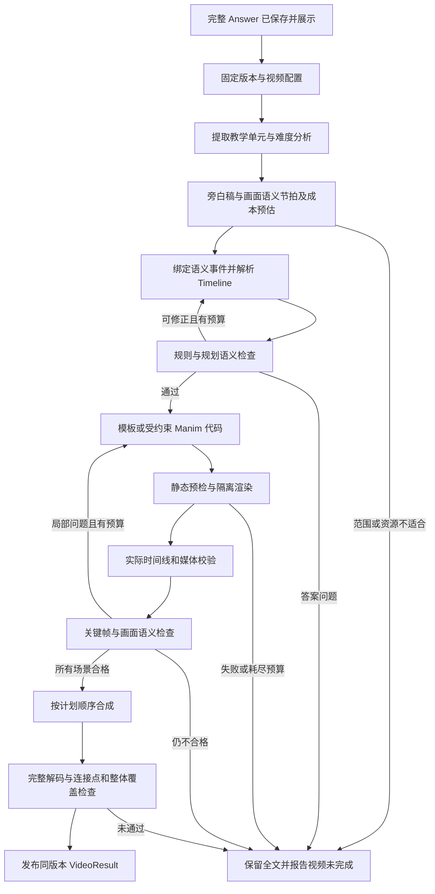

# 动画生成：正式版 Pipeline

更新日期：2026年10月29日。本文是正式版接入方案，本轮只整理文档，不接入动画或改动运行配置。真实 TTS 合成暂缓，但旁白稿、语义锚点、画面事件绑定和共同时间线现在就需要设计；无声预览保留完整屏幕讲解。方法依据及实现边界见[音画对齐调研](research/音画对齐开源项目与论文调研.md)。

## 1 当前成果与正式版边界

| 层次 | 已有内容 | 本轮结论 |
|---|---|---|
| 当前 0.2.0 | 问题／文件 → MaterialIR → 完整 Markdown → 内容检查 → 不可变 Answer；阅读、下载、修订 | 作为正式版内容基础，详见[文字链路实现与覆盖检查](文字链路实现与覆盖检查.md)和[真实测试报告](../testresult/测试报告.md) |
| 历史 0.1.0 | 文本 → LessonPlan → 逐场景代码 → 预览与纠错 → 四帧 VLM → 正式渲染检查 → 合成 | 冻结在 [legacy_mvp](../legacy_mvp/README.md)，独立环境和端口；不是当前服务能力 |
| 正式版下一阶段 | 固定 Answer → 教学分析／旁白与画面节拍 → 事件绑定与时间解析 → 代码／模板 → 渲染 → 检查 → VideoResult | 待实现，不直接恢复旧入口或整包导入历史工程 |

正式版沿用“一次提交、先交付完整文字、自动接续动画”的目标。动画失败保留全文；双输出整体为 `partial`。只有完整文字与合格视频都就绪、且引用同一 `answer_id`，才是 `completed`。当前 `output_mode: text` 的成功仍是 `completed`，不应用双输出的 partial 规则。公共编排和版本契约见[总览](index.md)。

动画负责把既定解答讲清楚，可以分屏、拆步骤、调整视觉顺序；不能重新解题或静默修改题设、公式与结论。发现答案错误时返回定位，修订由回答模块产生新 `answer_id`。缺少必要图示或超出二维表达能力时，报告具体限制。

## 2 旧 demo 为什么容易短、慢

以下是代码审阅发现的机制缺口，尚未对用户提到的每条 30 秒视频逐一复盘，不能据此归因所有历史产物。

| 旧实现证据 | 对成片或耗时的影响 | 正式版处理 |
|---|---|---|
| [config.py](../legacy_mvp/src/manimagent/config.py) 默认 `target_seconds=60`，可配置上限 120；最多 4 个场景 | 产品基线原本就是短演示，不能作为完整教学时长策略 | 按教学内容和受众分配时长，首版正式交付配置为 2～6 分钟 |
| [agents.py](../legacy_mvp/src/manimagent/agents.py) 的 PLAN 明确写“目标时长仅作参考” | 给出目标并不约束模型生成的动作时长 | 总时长、场景、教学节拍和代码使用同一 Timeline |
| [schemas.py](../legacy_mvp/src/manimagent/schemas.py) 有 `SceneSpec.duration_seconds`；[workflow.py](../legacy_mvp/src/manimagent/workflow.py) 没有把它和渲染实测时长作门槛比较 | 分镜填了时长也可能只播放几个很快的动作 | 每场景与最终 MP4 均校验计划／实际时长 |
| CODE 没有明确阅读停留、每步时间与无声说明要求 | 默认短动画加少量画面，步骤虽出现却来不及读 | 每步有屏幕解释、观察动作和阅读区间 |
| 四帧只按场景四等分取样，画面被缩到 360p | 可漏掉推导、变换及瞬时遮挡，也无法证明阅读时间足够 | 按关键节拍取证，实际显示区间和媒体时长另由程序检查 |
| 每场景串行预览、VLM、正式重渲染与再次 VLM；最多 5 个预览候选 | 质量循环放大模型与渲染开销 | 常规场景优先只渲染一次交付规格，局部有限修复 |
| [renderer_driver.py](../legacy_mvp/src/manimagent/renderer_driver.py) 禁用缓存，合成再次编码 | 存在重复计算，长视频迁移时尤其需要量化 | 先做计时；验证兼容性后评估受控缓存和无重编码拼接 |

旧流程已经有执行隔离、候选绑定、累计修复预算和 900 秒任务时限，应保留这些约束思想。现有 smoke 的 5 秒渲染只证明组件可用，不能证明正式教学视频时长、质量或性能。

## 3 正式版处理流程



逻辑阶段不等于必须新增一个模型 Agent 或请求。教学分析、旁白派生稿与初始分镜可以由一次 planner 调用给出，程序先验结构，再由一次 plan_checker 检查；不增加独立“打难度分”“选择时长”“美化”模型回合。内容检查复用已发布 Answer 的有效报告；对未经检查的人工修订或关闭检查的答案，视频开始前必须完成检查，该调用计入视频预算。旧报告必须匹配正文摘要与检查策略版本。

| 阶段 | 必要输入 | 产物与完成门槛 | 失败归属 |
|---|---|---|---|
| 版本固定 | Answer、检查状态、受众要求、video profile、deadline | 配置与正文摘要固定；不重新解析材料／重答 | 版本或配置 |
| 教学分析 | 原问题、完整正文、来源、受众 | 单元、推理依赖、新概念与易错点；每项定位正文 | 内容或范围 |
| 时间与分镜 | 教学单元、旁白稿、阅读要求、复杂度上限 | 有依据的时长档位、语义锚点与对象绑定、逐步计划；估计时间明确标记 | 规划 |
| 规划检查 | 正文、分析、分镜、Timeline | 覆盖、数学一致性、阅读节奏、成本均合格 | 规划；答案错则退回 |
| 代码与渲染 | 单场景计划、共享符号／样式、受控素材、预算 | 自包含代码；隔离执行、时间线日志与视频 | 代码或环境 |
| 场景检查 | 计划、视频实测、事件记录、关键帧 | 时长合格、屏幕说明可读、画面与数学含义一致 | 局部修复或待核对 |
| 合成与发布 | 全部合格场景与确定顺序 | 解码、时长、连接点、覆盖及版本全部通过 | 合成或待核对 |

首版采用自包含场景，跨场景只共享明确的符号、颜色和坐标约定。每段开场恢复必要上下文，避免依赖上一个 Python Scene 中的隐式对象状态。场景粒度按教学单元划分，不能为了减少进程启动而堆成一个巨大场景，也不能每个公式单独开容器。

## 4 从题目到教学时长

### 4.1 先分析，再给时长范围

难度是参考变量，视频长度更直接取决于“对这位受众需要解释多少内容”。不能只按题目字数、学科标签、答案 token 数或模型自评难度映射分钟数。没有受众信息时，默认具备该主题前置基础、首次学习本题方法，并记录该假设，不推断用户长期能力。

分析至少包含：

- 任务类型：概念解释、计算、证明、比较、综合多问；具体题不能被概念泛讲替代。
- 必需条件与目标、解题依赖链、关键推理转换、需区分的符号或单位。
- 对当前受众的新概念、需要补充的前置知识，以及正文已包含的例子／易错点。
- 必需教学单元、可合并的重复计算、仅供参考的旁支；每项均给出正文范围。
- 视觉复杂度：对象数量、动态更新、公式排版、图形密度；它单独影响生产成本，不等同于学习难度。
- 难度标签与理由、置信度。无法可靠判断时保守估计并在分镜中验证，不多开一个投票模型。

首版档位为工程假设，需用人工观看和真实耗时校准：

| 教学范围 | 建议播放时长 | 典型组织 | 正式版首阶段 |
|---|---|---|---|
| 单一概念／短题，含必要解释与辨析 | 120～180 秒 | 约 3～4 个场景 | 支持 |
| 多步计算、概念加例题、短证明 | 180～360 秒 | 约 4～8 个场景 | 主要范围 |
| 多概念综合、长证明、多问 | 360～540 秒或更多 | 约 8～12 个场景或按主题拆段 | 先建议拆成多个完整子主题；不承诺单段支持 |

正式配置 `standard_silent` 暂定区间为 **120～360 秒、最多 8 个场景**，通常 3～6 分钟。不是给所有题固定 3 分钟：实际选择由教学单元和阅读时间确定。超出支持范围时，给出拆分建议并保留全文；不自动交付只覆盖前半题的合格视频。

若题目极简单，完整讲清确实不需要两分钟，不能硬加无关例子或重复内容。记录范围冲突并提示调整讲解目标；当前正式配置不把 30 秒片段视为完整交付。未来如提供短片 profile，应显式区分用途，不能作为生产失败时的自动降级。

### 4.2 旁白、动作与阅读共同排程

每个教学节拍只引入一个主要认知变化，同时保存 spoken_text、显示短句／公式、图形状态、语义 cue、对象引用及动作关系。旁白是既定 Answer 的表达派生物，与 screen_text 分开，公式需要保留显示形式和规范读法。无配音预览时，“为什么取点积”“这个系数乘的是谁”仍需在画面说明；不能因此省略现在就应确定的旁白稿。

事件先绑定“讲到什么时，哪个对象应出现／高亮／保持”，具体秒数由时间解析层提供。当前按规范化旁白、语言／受众语速区间和显式停顿估算，时间来源标记 estimated；未来接入音频实测边界，重算同一事件的时间。没有音频时不能声称实际音画同步已通过。结构及来源比较见[音画对齐调研](research/音画对齐开源项目与论文调研.md)。

对节拍 i 估计：

```text
节拍起点记为 0；a_i 为动作结束，n_i 为旁白结束，s_i 为内容稳定可读的起始时刻。
最低教学用时_i = max(a_i, n_i, s_i + 必要阅读与理解用时_i)
                + 尚未在以上区间安排的独立观察／思考用时_i
当前 n_i 只能估计；未来使用同版音频的实测时间，并校验 cue 关系。
场景计划用时 = 按依赖排布后的节拍并集 + 场景切换
视频计划用时 = 顺序场景用时之和（首版不使用重叠转场）
```

文本在变换结束后才可读，`s_i=a_i`，该节拍至少需要动作时间加阅读时间；如果动作期间文字已稳定，则可以合理重叠。旁白与动作可并行，不机械相加；有先后依赖时仍顺序排布。文字量可做初始估计，但公式、证明转换和图示比较需额外分配理解时间，不能用汉字／秒代替全部判断，也不能对中文套用英文 words/min。建议普通短说明稳定可见 3～6 秒、关键推导 6～12 秒作为初始检查阈值，实际按密度、受众和试看片反馈调整；这些不是已验证的学习规律。

时长不足先检查有没有跳步、解释是否只写在分镜里、结论是否一闪而过。修复应补齐缺失教学单元或合理阅读时间。禁止循环动作、长片头、整段重复、全片降速，或结尾追加大段 `wait` 来凑分钟数。

### 4.3 贯通计划、代码和实测

1. planner 输出视频范围、理由、旁白稿、cue 与事件依赖；时间解析层给出当前估计秒数，未来根据实际音频再解析，模型不编造实测时间。
2. 规则检查节拍依赖、场景和总时长加总；计划不得超出 profile。
3. 受控执行器提供带 `beat_id` 的播放／停留接口，把动作时长写入执行记录。任意代码文本的正则相加无法可靠计算并发与循环，不能作为最终证据。
4. 渲染后读取实际事件区间与 ffprobe 时长。程序核对关键教学单元是否有画面／解释区间，模型核对这些内容是否真正讲清；旁白 cue 与对象关系另查。实际视频时长合格不代表估计旁白已经变为音频实测。
5. 每场景实测与计划偏差暂定不超过 `max(2 秒, 计划时长 × 5%)`；最终偏差不超过 `max(3 秒, 总计划 × 5%)`，并同时满足 profile 的 120～360 秒硬范围。两种限制取更严格者。
6. 不满足时长或覆盖即不发布合格 VideoResult。预算足够才局部修订；否则视频阶段 `needs_review` 或 `failed`，整体双输出 `partial`。

运行日志是程序证据，生成代码自报“已展示”不是语义证明。受控接口需要核对对象实际存在与可见状态，关键帧与人工观看仍是补充。

## 5 内部数据与版本绑定

以下都是待实现的内部设计，不是当前 `schemas.py` 已有字段，也不是可直接写入当前 config.yaml 的配置。

| 对象 | 最小内容 | 约束 |
|---|---|---|
| TeachingAnalysis | answer_id、正文摘要、受众假设、题型、难度与理由、单元与依赖、视觉成本 | 每个单元定位正文，区分必需／参考内容 |
| TeachingUnit | unit_id、answer_step_id、正文范围、目标、必需论据与公式 | 范围落在固定版本正文；不另造答案 |
| VideoPlan | plan_id／revision、分析、目标与上下限、场景顺序、符号表、成本估计 | 覆盖所有必需单元且总时长可实现 |
| SceneSpec | scene_id、单元引用、布局、对象／公式、节拍、目标与时长 | 场景自包含，最多 8 个；不继承旧 schema 的 4 场景硬限制 |
| NarrationUnit／Cue | narration_id、unit_ids、spoken_text、规范读法、cue_id 与文本范围／出现次序 | 与 Answer 等价；所指对象明确，时间来源可追溯 |
| TimelineBeat | beat_id、unit_ids、screen_text、visual_action、cue／object 引用、前置依赖、解析时间、阅读区间、停留理由 | 事件与时间分离；estimated 不冒充 measured，稳定可见内容与推理一致 |
| RenderEvidence | 实际节拍区间、媒体时长、代码／环境摘要、抽帧时间 | 与当前候选唯一绑定 |
| CheckReport | 范围、有效性、逐项判定、问题、证据、修复范围 | 缺证据为 unknown，不能算 pass |

当前 Answer.steps 通常只有一个完整正文步骤；直接验证“这个 step 出现过”会让漏掉大半答案也通过。迁移时在视频侧建立细粒度 TeachingUnit，以固定正文的 Unicode 码点半开区间 `[start, end)` 和内容摘要定位；公式、表格不在内部切断。它是派生索引，不修改正文或重写 Answer。必需推理、条件、结论必须逐项覆盖；原始来源标记和重复标题不必逐字烧录上屏，但仍保留可追溯映射。任何归为参考旁支的段落都必须有理由，不能把难讲部分标成“可选”绕过检查。

每个候选绑定 `answer_id + answer_hash + plan_revision + narration_hash + timing_revision + scene_id + code_hash + render_profile + renderer_digest + prompt_version`；未来还有 audio_hash 和边界来源。有效检查必须指向同一候选；局部改动使相关报告失效，共享符号或教学依赖变化时扩大重建范围。只有时间改变时优先重新解析／渲染相关场景，不重写数学逻辑。

### VideoRequest 与 VideoResult 草案

独立阶段请求仍为 `{answer_id, video_profile_id?}`；默认双输出由编排器自动调用。`POST /api/v2/videos`、`GET /api/v2/videos/{video_id}` 尚未实现。视频配置由服务端管理，不接受模型输出自行放宽预算。

VideoResult 保存：`schema_version`、`video_id`、`answer_id`、`video_asset_id`、`duration_seconds`、`step_mapping`、`report_asset_ids`、`created_at`。为兼容已有长期草案保留 `subtitle_asset_id: null`；本轮不实现字幕文件和语音接口。画面中的教学短句属于场景内容。

`step_mapping` 沿用 `{step_id, scene_ids, start_seconds, end_seconds}`，时间依据实测且全部落在视频范围。另在报告资产保存细粒度 `unit_mapping` 和 plan 引用，避免顶层 step 覆盖过于粗糙。只在所有必需场景、单元和最终检查通过后创建不可变 VideoResult；失败片段通过诊断资产提供。

## 6 渲染、检查与有限修复

逐阶段 prompt 与检查清单见[动画 Prompt 与检查规范](动画Prompt与检查规范.md)，耗时限额和回归样例见[动画时长与生产验收](动画时长与生产验收.md)。这里固定执行原则：

- 模板优先，支持向量、坐标轴、公式推导、矩阵变换等稳定元素；只有表达需要时生成定制代码。模板不能限制原题含义。
- 常规场景先做静态与资源预检，再按最终 720p／30 fps、H.264／yuv420p 规格渲染，检查通过即可复用该视频参与合成。避免常规路径固定做两次完整渲染。
- 高风险复杂场景可以先做低规格预览，但必须在成本预估中登记两次渲染；最终仍检查交付规格画面。不得把低清预览升级为正式通过。
- 初版先串行，用固定机器评测；仅在证明峰值资源与 P95 耗时改善后，启用至多两个场景并发。共享资源、模型限流和合成顺序仍受控制。
- 最多一次全局规划修正；每场景一次执行修复、一次视觉修订、合计最多三个渲染候选。规划修正、执行修复、视觉修订共享全视频最多两次修复生成调用，重检另计总调用上限，局部和全局限制同时生效。网络重试也计入总预算。
- 取得合格候选即停止美化。环境缺失、答案错误、范围不适合不走代码重试；没有足够剩余时间完成修复、重检和合成时，不启动修复。
- 保留执行隔离：固定镜像、禁网、非 root、最小挂载、CPU／内存／进程数限制、无模型密钥；渲染超时终止容器与相关子进程。

检查分为内容、规划、执行、画面、最终媒体五类。程序负责引用、秒数、解码等确定项；模型检查数学与表达一致性；发布前人工基线评审完整视频。VLM 不能通过四张截图证明全部动态过程、时长或学习效果。所有必需单元必须有有效证据；无法覆盖关键动态时补短片／事件证据或转待核对。

抽帧按新概念出现、关键变换前中后、推导完成、最终结论选择，每场景初始 4～8 帧并去重。超过证据额度应简化／拆分场景或在明确预算内补证，不以固定四帧强行通过。画面保留足够分辨率，公式难辨时提供局部原始截图；合成后另查场景连接点与最后结论。

## 7 时间成本与降级边界

分别管理 **视频播放秒数** 和 **从接受任务到结果可用的墙钟秒数**。2～6 分钟成片不意味着必须制作半小时；实际是否能达标需真实机器和模型测量。

初始目标是常规样例视频阶段 P95 不超过 8 分钟，整体 P95 不超过 10 分钟；视频阶段硬限 10 分钟，包含排队的整次提交硬限 15 分钟。具体口径、阶段预算和分母见[生产验收](动画时长与生产验收.md)。这些是待验证的产品与工程目标，不是当前性能承诺。

预算不足时依次减少装饰、取消不必要镜头、使用已有合格模板与场景、停止非必要修订；不得削掉推理、缩短阅读、跳过必要检查或自动放宽 deadline。仍不满足则保留全文与诊断，明确视频未完成。显式动画重试只复用 Answer，独立计费／计时；历史用量和用户总等待不能被重置掩盖。

对只读停留可以评估静态帧复用；必须确认没有 updater 或动态对象需要继续运行。Manim 固定版本源码说明 `run_time` 控制动画时长、`Wait.frozen_frame` 控制静态等待，参见 [Manim v0.20.1 animation.py](https://github.com/ManimCommunity/manim/blob/v0.20.1/manim/animation/animation.py)。这说明可研究的机制，不证明当前流水线已经因此提速。

合成可评估兼容编码参数下的 stream copy，失败回退和完整解码必须计入预算。官方说明此路径绕过解码／编码，同时有格式兼容限制，参见 [FFmpeg n7.1 文档的 Stream copy](https://github.com/FFmpeg/FFmpeg/blob/n7.1/doc/ffmpeg.texi)。启用前须验证所有片段的 codec、time base、像素格式、尺寸、帧率、时间戳和边界播放，不能只检查扩展名。

## 8 迁移与完成条件

先做可观测的最小接入，再考虑视觉复杂度：

1. 用固定 Answer 样例复盘旧时长／耗时，记录阶段计时与失败原因。
2. 实现教学单元、旁白派生稿、cue／对象／事件绑定、估计时间解析和规则校验；用错误指代、错过 cue、30 秒伪通过、结尾凑时长等反例检验门槛。
3. 提取旧渲染、日志纠错和候选绑定能力；接入有限模板／代码，按最终规格渲染一次并检查。
4. 增加同版本 VideoResult、双输出编排、partial 与仅重试视频。文字入口及历史独立项目继续各自工作。
5. 固定真实模型、机器和预算，在 2～6 分钟样例上同时验证教学完整度、生成耗时和失败状态，再决定扩大到长视频或有限并发。

交付证据包含正文与单元映射、旁白与 cue 绑定、估时依据、计划／实际 Timeline、所有候选、检查报告、媒体元数据、阶段耗时与模型用量。TTS 服务以后接入，旁白与音画契约现在完成；当前不能依赖未生成的声音补充缺失解释，也不能报告真实音频同步通过。

[返回总览](index.md) · [Prompt 与检查规范](动画Prompt与检查规范.md) · [时长与生产验收](动画时长与生产验收.md) · [开发计划](开发计划.md)
