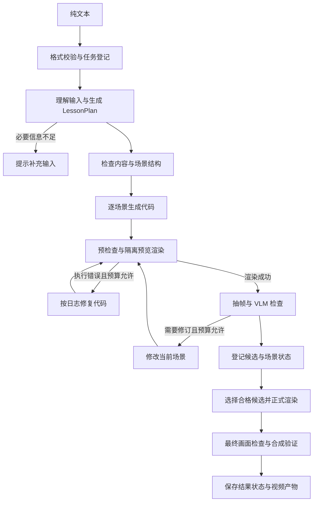

# 第一版 MVP 设计

更新日期：2026年10月17日

本文确定总体计划第一阶段的 MVP 实施边界。核心体验是：用户在一个文本框中输入学习内容，系统自动规划、生成、渲染并检查动画，最后提供可播放的视频。

当前为设计文档，尚未实现或测得实际生成效果。本文的接口、默认值与任务规则作为首轮实现基线；涉及性能和质量的参数在样例验证后调整。

## 1 产品范围

用户只输入纯文本。MVP 不要求用户提供结构化字段、分镜或代码。网页仅提供文本框、生成按钮、任务进度、结果播放与下载；CLI 复用同一生成服务用于调试和批量验收。

首批内容面向二维数学概念和简单题目，以向量、投影、矩阵变换等有限领域建立基线。动画包含图形、公式与必要的画面文字，不包含配音。

文件解析与语音在第二阶段加入，学习记忆在第三阶段加入，完整个性化规划与交互按总体计划推进。MVP 保存本次任务记录，不检索其他任务作为生成经验。

## 2 用户输入

### 唯一必填字段

对用户呈现一个纯文本输入框。内容可以是知识点名称、一道完整题目、一段学习材料，也可以同时包含本次讲解要求。例如：

```text
请用动画解释二维向量投影。
用 a=(3,2)、b=(1,0) 举例，先展示两个向量，
再展示 a 在 b 方向上的投影，并说明投影系数和投影向量的区别。
面向刚接触这个概念的学生，尽量少堆公式。
```

数学表达支持自然语言、常见数学符号与 LaTeX 源文本。LaTeX 在输入中仍是普通文字，由规划阶段识别其数学含义。用户无需选择输入类型或遵守固定模板。

用户可以只写“解释二维向量投影”，系统补充一个明确标注的演示例子。解具体题目时，题设中的数据、条件与结论要求必须保留。

### 输入规则

| 项目 | MVP 决定 |
|---|---|
| 类型 | UTF-8 字符串，仅一个 text 字段 |
| 长度 | 去除首尾空白后 1 至 3000 个 Unicode 码点；保留内部换行和数学符号 |
| 本次要求 | 深浅、步骤、视觉偏好等写在同一段文字里，只影响本次任务 |
| 链接 | 作为文字处理，不自动打开网页或下载材料 |
| 文件与图片 | 无上传入口，接口不接收文件或图片 |
| 模型、分辨率与预算 | 由应用配置控制，不作为用户必填项 |
| 超长内容 | 明确提示缩短或选取一个主题，不静默截断 |
| 必要条件缺失 | 返回 needs_input 和具体补充提示，不编造题设 |

空白、超长或非字符串输入在创建任务前返回校验错误。长度合格但语义不足的输入，先创建任务，再由规划阶段返回 needs_input。例如“求这个矩阵的特征值”缺少矩阵，应提示提供矩阵。

默认规划目标约 60 秒、允许 1 至 4 个场景，面向约 30 至 90 秒的简短动画。目标时长是规划参考，不承诺精确时长。内容无法在场景和预算限制内完整讲清时，提示缩小范围，不省略关键条件后直接输出。

## 3 系统输出与页面

正常结果为可播放的 MP4，默认交付规格为 1280×720、30 fps、H.264 与 yuv420p 像素格式。页面显示本次讲解标题、视频、实际时长与下载入口。

页面同时显示真实任务阶段和已完成场景数；失败或待检查时显示简短原因及可用预览。自动检查通过是系统状态，不代表数学内容已经得到形式化证明。

开发产物保留讲解规划、场景描述、每次候选代码、渲染日志、抽帧、检查报告与产物清单。页面不必展示全部开发日志。

| 最终状态 | 含义 | 页面行为 |
|---|---|---|
| completed | 所有必需场景与最终视频均完成规定检查 | 播放并下载正式视频 |
| needs_input | 输入缺少必要信息或范围无法处理 | 指明缺少的内容，用户修改后重新提交 |
| needs_review | 存在可用视频，但仍有未完成检查或未解决的质量问题 | 标记待检查，提供适用预览 |
| failed | 在预算内无法取得可用结果或发生必要服务、环境错误 | 显示失败原因与重试入口 |
| interrupted | 进程中断或重启导致任务未完成 | 保留已有记录，允许重新提交 |

部分场景成功不能标记整段讲解完成。无合格完整视频时，不将拼接出的残缺片段命名为 final.mp4。

## 4 核心生成流程



各场景顺序执行，先不做并发。失败、待检查和预算耗尽的分支均更新任务状态并保留已有产物，不无限循环。

### 讲解规划

Planner 从输入中提取目标、题设、必须覆盖的知识点和本次要求，输出结构化 LessonPlan。用户文本不直接变成 Manim 代码。

规划需区分题设事实与新建演示例子。必要条件缺失时终止并提示补充；存在足够信息的概念解释，可以自行选择例子并明确它是演示例子。

PlanChecker 检查题设是否被保留、关键条件与步骤是否完整，以及场景数量和可执行范围。规则校验还需保证场景与步骤标识唯一、引用有效，所有 required_points 至少分配到一个场景。结构问题通过规则校验，语义一致性由文本模型检查；修正规划最多一次，仍无法满足要求时结束任务。

### 场景生成与执行纠错

Coder 根据单个 SceneSpec 和整体符号约定生成完整 Manim 场景。Renderer 先做语法与场景结构检查，再隔离执行。ExecutionReviewer 区分 Python、Manim、LaTeX、资源缺失和超时等问题，给出针对性修复。

环境缺少字体或 LaTeX 等配置错误应报告环境问题，不能靠反复改写讲解内容掩盖。生成代码的运行环境不包含模型密钥，也不共享 API 进程。

### 视觉检查与修订

VLM 输入包括场景目标、题设与关键点、四张带时间标签的采样画面。初始采样取场景时长的 12.5%、37.5%、62.5% 和 87.5%；截图尺寸应保留公式和文字的可辨识度。

检查逻辑呈现、布局遮挡和画面内容与规划的一致性。问题尽量关联 scene_id、step_id 和采样时间；无法可靠定位时允许为空，不能编造坐标。

修订优先修改布局、可读性与表现顺序，保留题设、公式含义和教学目标。若发现规划本身不成立，标记内容问题并终止自动修订；MVP 不增加无界的重新规划循环。

静态采样无法覆盖全部动态过程，数学正确性也不能只由 VLM 评分保证。验收需要人工检查完整视频。

## 5 数据契约

以下为最小数据边界，字段类型在实现时使用 Pydantic 定义并校验。

| 对象 | 必需信息 | 作用 |
|---|---|---|
| GenerationRequest | text | 唯一外部生成输入 |
| LessonPlan | title、goal、given_facts、required_points、scenes | 固定题设、目标与场景顺序 |
| SceneSpec | scene_id、class_name、goal、covered_point_ids、steps、formulas | 约束单场景内容与画面 |
| SceneStep | step_id、explanation、visual_action | 关联文字解释和视觉动作，为后续配音留依据 |
| RenderResult | attempt_id、status、error_category、artifact_ids、duration | 记录执行结果与产物 |
| ReviewReport | review_status、decision、scores、issues、required_point_coverage | 记录检查有效性与具体问题 |
| RunManifest | job_id、status、stage、plan_revision、scene_results、artifact_ids、usage | 对应当前任务、候选和最终结果 |

required_points 与 covered_point_ids 使用稳定标识。每个候选绑定 plan_revision、scene_id、代码与检查报告，不允许把某版视频与另一版代码或评分混用。

GenerationRequest 拒绝未知字段，text 必须是字符串，不将数字等值自动转换为文本。API 请求示例是内部传输格式，用户仍只操作文本框：

```json
{
  "text": "请用动画解释二维向量投影，用 a=(3,2)、b=(1,0) 演示，并区分投影系数与投影向量。"
}
```

## 6 任务状态与接口

任务生命周期使用 queued、running 以及上文定义的最终状态。运行中的 stage 使用 planning、coding、rendering、reviewing、finalizing、assembling，界面显示对应中文说明。

| 接口 | 用途 |
|---|---|
| POST /api/jobs | 接收仅含 text 的 JSON，校验后返回 202 与 job_id |
| GET /api/jobs/{job_id} | 返回状态、当前阶段、完成场景数、提示和可用产物引用 |
| GET /api/jobs/{job_id}/artifacts/{artifact_id} | 播放或下载该任务已登记的产物 |

输入校验失败返回 422。等待队列已满返回 429。必要模型配置缺失等可在任务创建前确认的问题返回 503；执行过程中发生的问题写入任务的最终状态。

浏览器约每两秒查询一次任务状态。MVP 使用一个后台 Worker，最多一个活动任务和三个等待任务；任务清单与结果落盘，等待队列保存在进程内。服务重启后将未结束任务标为 interrupted，不宣称自动恢复执行。

任务标识由服务端生成。产物通过任务和产物标识访问，不接受任意文件路径。MVP 面向本地单用户使用。

## 7 修订预算与结果选择

| 项目 | 初始配置 |
|---|---|
| 场景数 | 1 至 4 |
| 规划修正 | 最多 1 次 |
| 执行修复 | 每场景合计最多 2 次，跨视觉修订版本累计 |
| 视觉修订 | 每场景合计最多 2 次 |
| 预览候选渲染 | 每场景最多 5 次，初始候选计入 |
| 正式渲染 | 每个选中的场景最多 1 次，与预览候选分别统计 |
| 单次渲染时限 | 180 秒 |
| 单场景候选搜索时限 | 5 分钟 |
| 整体任务时限 | 15 分钟，含规划、渲染与合成 |
| 预览规格 | 480p、15 fps |
| 正式视频规格 | 720p、30 fps |

这些数值是实现起点，不是已验证的性能承诺；任一更严格的上限达到时停止相关工作。模型服务超时或检查结果解析失败最多额外重试一次，仍受总时间与使用量预算约束，不能因此重置代码修复计数。

合格候选需可播放、覆盖该场景的必需步骤、获得有效且通过的检查结果，并无未解决的 major 或 critical 问题。评分只在同一规划版本的合格候选间排序；并列时选较早版本，后续失败不丢弃已有合格候选。

有效报告的 review_status 为 valid，decision 为 pass、revise 或 fail；逻辑呈现、布局遮挡和内容一致性三项评分均为 0 至 100 的数值。问题严重程度为 info、minor、major 或 critical。

检查 JSON 缺失必要字段、评分无效或服务失败时，review_status 标为 unavailable 或 invalid，不能伪造低分或记为通过。VLM 的 pass 与严重问题冲突时按未通过处理。

选择候选后按正式规格重新渲染，并检查最终画面和产物。正式检查不通过或未完成时，将任务标为 needs_review；不沿用预览结果直接宣称正式视频合格。最终合成再检查视频可解码、场景齐全、尺寸与帧率一致及实际时长。

## 8 模块与技术

核心采用 Python 3.12、Pydantic、LangGraph、Manim、FFmpeg 与文本及视觉模型适配器；简单页面使用 FastAPI 和 HTML/JavaScript。具体模型通过同一小型样例集验证后固定配置。

```text
src/manimagent/
  cli.py                 调试与批量输入入口
  api.py                 本地网页和任务 API
  config.py              模型角色、质量与预算配置
  schemas.py             输入、规划、检查与任务契约
  providers/             文本与视觉模型适配
  planning/              规划与内容一致性检查
  generation/            场景编码与修订
  rendering/             隔离渲染、错误分类和抽帧
  review/                执行与视觉检查
  workflows/             主流程和场景循环
  artifacts/             候选、任务清单和视频合成
```

这是拟实施目录，本次不创建空实现。MVP 不引入数据库、向量检索、独立消息队列或学习者模块。模型密钥只存在于服务配置中，渲染容器不获得密钥、宿主目录或网络访问能力。

## 9 产物与验收

每个任务在 runs/{job_id}/ 保存 request.json、lesson_plan.json、manifest.json，以及 scenes/ 下按场景和候选区分的代码、日志、预览、抽帧与报告。清单采用原子替换写入，避免状态查询读到半份 JSON。正式场景和 final.mp4 记录到清单；仅在完整合格时登记 final.mp4。

验收分为输入与状态规则、生成链路和视频质量三部分。确定性规则需要全部通过；模型生成部分报告固定预算下的成功与失败情况，人工核对内容和画面，不把目标成功率写成实测结果。

样例与检查方式见[输入与验收样例](mvp/输入与验收样例.md)。首轮先验证环境和一个纯文本样例，再加入修复与 VLM 循环，最后联通网页。具体任务拆分见[第一阶段任务清单](第一版开发计划.md)。

[返回文档目录](README.md) · [第一阶段概览](stages/01-基础动画生成.md)
