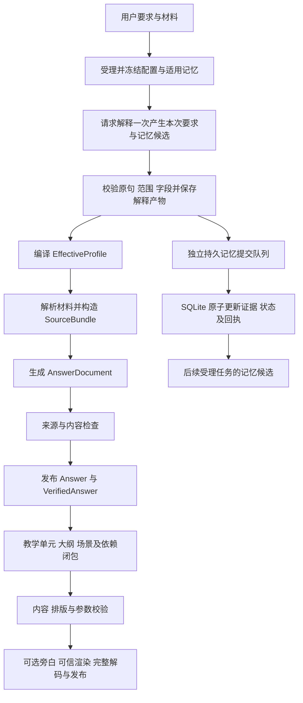
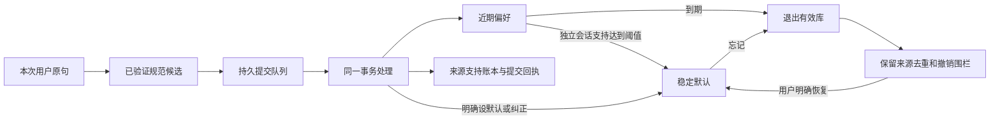

# 当前代码架构与迁移

更新：2026-11-13。本文对应固定请求解释、结构化教学产物和类型化记忆重写后的工作树。完整目标见[架构设计](../design/00-固定教学流水线架构.md)，实施与验收边界见[开发计划](开发计划.md)。

## 固定 pipeline

主执行顺序由 `jobs/execution.py` 固定管理。没有工具规划循环、历史对话拼接、自动总摘要或向量检索。请求解释在材料生成之前执行，只读取当前用户要求与产品合同；上传材料、生成答案和渲染结果不会成为用户画像证据。

受理快照和本次参数分开：后台提交不会修改当前快照；当前明确要求及撤销从 RequestIntent 进入编译，因此“忘记蓝金并解题”在本轮就不再使用蓝金。合法候选在解释通过后即可保存，不等待材料、Answer、视频或 TTS 成功。

## 职责与代码入口

| 职责 | 主要入口 | 边界 |
|---|---|---|
| 固定编排 | `jobs/manager.py`、`execution.py`、`learning.py`、`state.py` | 接收、冻结、执行、独立提交、部分完成、停机与恢复 |
| 个性化合同 | `personalization.py` | 支持字段、请求解释、当前排除、确定性优先级和有效参数 |
| 教学产物 | `schemas.py`、`teaching.py`、`answers/` | SourceBundle、教学单元、同源 Markdown、来源检查与校验凭据 |
| 记忆 | `memory/models.py`、`database.py`、`store.py`、`learning.py` | 受理序号、证据、时效、晋升、撤销围栏和事务回执 |
| 视频 | `video/planning.py`、`units.py`、`review.py`、`timeline.py` | 经检查的正文事实、依赖闭包、有限修复、排程与覆盖 |
| 可信执行 | `video/capabilities.py`、`renderer/`、`narration.py`、`tts.py` | 语义颜色、受支持数学图形、实测音频、参数校验和媒体验证 |
| LLM | `llm/client.py`、`settings.py`、`credentials.py`、`usage.py` | 实际请求构造、预算、追踪、传输、有限修复和配置 |
| 用户入口 | `api/`、`cli.py`、`web/` | 调用同一任务流程；记忆管理和只读导出 |

这些是责任边界，不是独立服务。ContentStore 管理不可变教学资源与执行记录，SQLite 管理可变化的记忆状态；二者通过保存解释产物、幂等提交和恢复逻辑衔接。

## 上下文和提示词

`personalization.py` 的解释提示词输出受控字段，`answers/prompts.py` 维护正文生成与事实检查规则，`video/prompts.py` 维护大纲、场景和视频检查规则。`memory/service.py` 仅保留生成侧的参数解释说明，已删除旧的后台自由文本提取函数。

`memory/projection.py` 按阶段投影 EffectiveProfile：正文生成取得 TeachingSpec；大纲和场景取得教学及视觉参数；材料读取、请求解释和事实检查不注入历史偏好。原句、会话 ID、条目 ID、时间和支持计数留在审计记录中。

正文和教学单元来自同一个 AnswerDocument；Markdown 是展示形式。VerifiedAnswer 将检查结果绑定文档、来源和规则摘要，模型配置保存为检查来源信息。场景模型取得分配单元及依赖闭包，不接收累积的全部历史请求。当前题目原文仍保留为明确要求。

ChatProvider 构造最终请求后统一预算和追踪，包含输出 schema 及修复候选。JSON 语法和结构修复保留原请求、失败候选与具体反馈；预算不足直接失败。请求记录不含鉴权头，图像数据以摘要记录。

## 记忆沉淀与清退

后台仅执行代码归并，模型用量计入前台请求解释，不存在第二次提取调用。来源撤回按真实支持关系重算；读取、模型复述和成片成功不增加支持。并发操作按受理顺序裁决；旧候选不能越过后续显式设置、纠正、忘记或恢复的围栏。

解释产物写入后、队列插入前发生崩溃，启动时从 pending 记录恢复已验证候选，不重新解释。已经提交的回执幂等恢复；已经取消的提交不得复活。主 worker 与记忆 worker 都退出后才释放私有目录租约。

SQLite 为唯一生效依据。Markdown 条目、索引和任务快照用于查看、导出及调试，不可导入改写偏好。本地编辑副本可保留，但不会进入模型上下文或自动学习。

## 旧版本与迁移

记忆数据库升级到 schema 3。旧自由字段、临时条目和提取队列先完整导出到同目录 `memory-migration-v3.json`，旧有效条目隔离，旧待处理提取任务取消，不猜测规范值。迁移先取得目录独占租约；旧服务仍持有租约时明确拒绝迁移。

已有 Answer、视频和评测证据不改写。旧 Markdown Answer 或人工修订版本保留无结构化校验状态；生成视频前以完整原文单元重新检查，检查侧车标明 legacy 身份，不伪造历史教学单元。旧 Answer 缺少有效偏好时显式采用 legacy 默认视觉参数，不从今天的记忆补写历史。

已有视频续跑绑定正文、提示词、能力版本和视觉参数；参数不兼容时拒绝复用。任意阶段的自动恢复与精确增量重算尚未全部实现，不能将场景续跑等同于完整通用恢复器。

[返回文档导航](../README.md)
