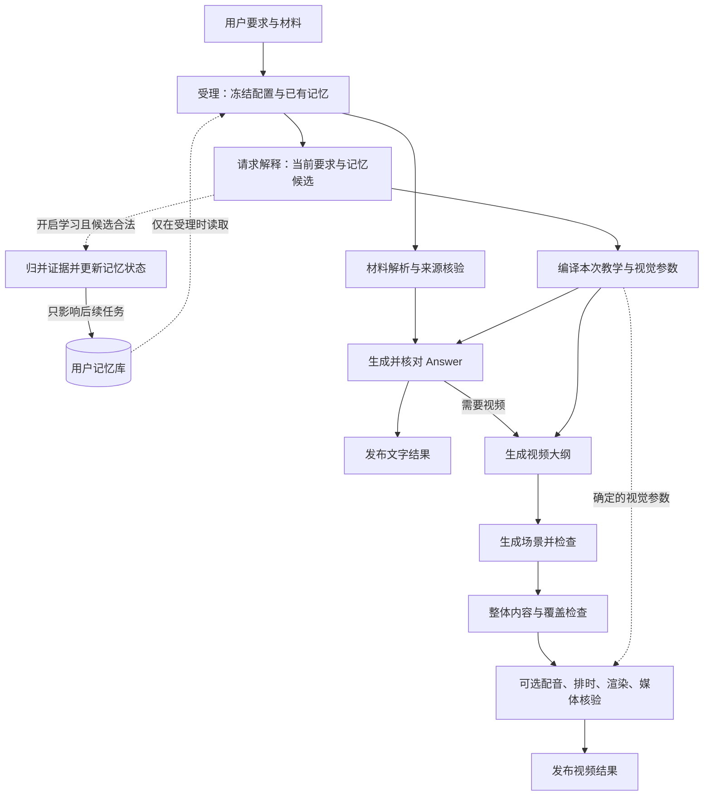

# 固定教学流水线：目标架构与上下文

更新：2026-11-13。状态：**核心闭环已实现，完整目标仍含待完成项**。请求解释、阶段领域产物、偏好编译、记忆状态与真实视觉参数已进入代码；任意阶段恢复、完整管理体验及真实语义/生产验收尚待完成。现有代码、API 和运行行为见[当前代码架构](../current/代码架构与迁移.md)；实施顺序见[开发计划](../current/开发计划.md)。本页是固定 pipeline、阶段合同和上下文的设计入口，记忆状态机以[用户记忆设计](05-长期记忆与个性化.md)为准。

## 设计定位

目标是：固定编排器推进流程，阶段合同决定上下文，个性化编译器落实偏好，记忆状态机管理跨任务信息。阶段顺序、输入、产物、检查与恢复位置由程序预先定义；模型承担受限的理解和生成工作。

本版服务于材料到完整解答、再到可选教学视频的固定流程。用户记忆只保存可复用的明确偏好与自述背景。运行记录保存调用、候选、错误和检查证据；生成器经验通过离线评测改进规则和模板。继续已有内容时显式引用材料或 Answer，不通过检索整段聊天历史重建任务。

不纳入本次架构：通用工具规划循环、动态工具发现、MCP 注册、多 agent 调度、会话树、任意世界状态增量、LLM 会话压缩、向量记忆库、用户总画像摘要、自动掌握度与教学经历推断。未来增加连续课程或测验，应先定义学生作答证据和产品需求。

## 主流程与记忆支线

下图表示新目标。所有模型阶段均包含受预算约束的校验与局部修复；图中省略失败出口。记忆支线不会改变当前任务的冻结输入。

材料解析和请求解释是明确的独立准备步骤，可以并行，仍共享任务预算。既有材料可复用已核验的材料产物；从已有 Answer 生成视频时保留其教学事实版本。是否重新应用偏好必须通过显式的新视频修订表达，不能悄悄改写原 Answer 的上下文记录。

## 三类数据分开

| 对象 | 内容 | 边界 |
|---|---|---|
| 领域产物 | 材料、正文、教学单元、大纲、场景、音频、视频及验证凭据 | 已提交版本不可变；下游引用明确版本 |
| 阶段输入 | 本阶段需要的领域产物、原始要求、有效偏好、本次修复反馈 | 由固定合同构建；不携带无关阶段记录 |
| 执行上下文 | run/stage/call/attempt 标识、配置、预算、取消状态、版本和用量 | 供程序使用；不把数据库状态和重试账本整体交给模型 |

每次受理保存不可变的 `RunSpec`：原始要求与来源标识、材料或 Answer 引用、模型配置及凭据引用、能力与规则版本、输出模式、记忆读写开关、会话与范围、受理时的记忆快照或内部提交围栏。原始密钥不得进入记录。

`RequestIntent`、`EffectiveProfile` 和后续阶段产物分别提交并引用 `RunSpec`，不通过原地修改受理快照表达进展。当前输入、新记忆写入、人工修改和任务修订各有明确版本。

## 固定请求解释

自然语言个性化需要一个同步解释位置。新增受限的请求解释阶段，一次产出：

- `RequestIntent`：本次任务要求、规范化的本次偏好、对旧偏好的本轮排除/重置、时间与范围限制、尚无法执行或存在歧义的要求。
- `MemoryProposal[]`：可供跨任务沉淀的类型化观察，含用户原句、来源、范围与意图；具体合同见[记忆设计](05-长期记忆与个性化.md#规范字段与原句证据)。

输入只包括用户本次表达、允许的偏好字段与值、用户选择的课程/主题范围和能力说明。教材、模型答案、检查报告与旧记忆不能成为新的用户证据。原始用户输入完整保留，生成和检查仍可核对它；解析结果不能替代原题或删除未被规范化的任务要求。

例如“这次直接证明，以后数学分析的视频默认用蓝金配色”：本次解释顺序为证明优先，当前视频采用受支持的蓝金主题，跨任务候选仅包含课程范围的主题默认。“这次直接证明”不入跨任务记忆。

结构化表单可直接构造同样的合同。自由文本路径增加一次前台模型调用；启用学习时复用其候选，后台不再进行第二次模型提取。关闭学习时仍需要解释本次要求，但不保存记忆候选。关闭读取和关闭学习是独立控制。

请求解释必须通过字段、取值、原句定位、范围和意图合同校验。影响必要要求的歧义或不支持能力进入 `needs_input`；协议失败受限重试后明确失败。合法结构不等于语义解释必然正确，语义误读需单独评测。

已验证的解释产物提交后，偏好编译与合法记忆候选提交独立推进。例如候选“以后使用蓝金主题”合法，但同次视频要求的三维图不受支持，视频可以进入 needs_input，合法默认仍可独立保存。无法确认含义的候选不得因另一候选合法而一起提交。

## 编译有效偏好

代码将 `RequestIntent` 与受理时冻结的记忆编译为 `EffectiveProfile`。本次要求不必先写入数据库才能生效。

编译先应用本次明确的记忆排除/重置，再逐字段采用当前明确值；否则依次查主题、课程、全局范围，最后采用产品默认。同一范围先使用有效的稳定默认，再使用有效的近期候选。近期冲突不静默覆盖同范围稳定默认；本次明确要求仍直接覆盖当前执行。范围来自有效课程/主题标识，不能仅因题目涉及某知识点就扩大或改写用户偏好的适用范围。

“忘掉蓝金偏好并生成视频”应从本轮冻结候选中排除该偏好，同时产生独立的持久忘记操作；不能等待后台删除才决定当前配色。“这次忽略已有配色”只作本轮排除，不删除数据库默认。两种操作都记录原始依据，保留受理快照本身不变。

| 编译结果 | 内容 | 消费者 |
|---|---|---|
| `TeachingSpec` | 讲解顺序、展开程度、例子倾向、带自述属性和必要时间限定的背景 | Answer 生成、视频规划及对应表达检查 |
| `VisualSpec` | 主题、语义颜色映射、字号范围、动画强度等已校验参数 | 场景规划、可信渲染器 |
| 应用记录 | 来源、请求值、有效值、覆盖关系、不适用原因及后续执行证据 | 运行审计与结果界面 |

冻结的是有界候选依据，各阶段只得到合同需要的编译字段，不先让视觉条目挤占回答模型的记忆预算。字段有限、范围明确，直接查询和编译即可，无需相关性模型或总摘要。

编译后各阶段不再读取最新记忆、不重复裁决冲突、不重新解释配色。当前硬要求不支持时在昂贵生成前报告；历史软偏好不适用时明确记录原因，不能声称已经应用。教学顺序等模型生成行为与配色等可确定执行参数分别验证。

## 阶段合同

下列名称是目标领域对象，不是当前 API 已提供的类型。逻辑阶段不要求每个阶段都增加一次模型调用。

| 阶段 | 主要输入 | 提交产物 | 放行条件 |
|---|---|---|---|
| 材料解析 | 原件、选定范围 | `SourceBundle` | 必要内容完整，来源可追溯，未决问题已按策略处理 |
| 请求解释 | 用户原始要求、受支持字段及能力 | `RequestIntent`、合法记忆候选 | 契约与原句校验通过，关键歧义可见 |
| 偏好编译 | 当前要求、冻结记忆、能力版本 | `EffectiveProfile` | 覆盖规则确定，必要要求可执行 |
| Answer 生成 | SourceBundle、原始要求、TeachingSpec | `AnswerDocument` 候选 | 结构与引用有效 |
| Answer 检查 | 原始材料、要求、候选正文 | `VerifiedAnswer` | 数学、题设、来源、必要推理通过既定检查 |
| 视频大纲 | VerifiedAnswer、教学参数、视频能力 | `VideoOutline` | 教学单元覆盖及场景预算通过 |
| 场景生成 | 当前场景、相关单元及依赖、全局符号、VisualSpec | `ScenePlan` | 内容、图形、布局和时间合同通过 |
| 整体检查 | VerifiedAnswer、完整视频计划 | 已核对视频计划 | 全局覆盖、跨场景约定和内容通过 |
| 可选 TTS | 已核对旁白、语音配置 | 音频及实测时长 | 音频可用，时间重排通过 |
| 渲染与发布 | 已核对计划、VisualSpec、必要音频 | 媒体及核验记录 | 完整解码、时长与对象/内容映射核验通过 |

`VerifiedAnswer` 表示通过既定检查，不是形式化数学证明。它是视频唯一的教学事实源。正文由具有稳定 ID、来源、依赖和必要性标记的教学单元组成；Markdown 是同源展示。场景输入必须带上所用单元的必要依赖，不能仅截取失去前提的片段。

用户的简洁、节奏等偏好不能降低数学检查标准。材料读取不接受个性化事实；内容检查保留原题和必要推理；视频只在已核对内容范围内改变教学呈现。

## 提示词与实际请求

每个模型阶段拥有固定的角色规则、明确输入和输出 schema。规则归对应教学功能维护，内容数据与记忆不取得系统指令权限。渲染能力说明与程序校验共用同一版本的能力定义，不能在 prompt 中承诺未实现能力。

LLM 层先构建最终请求，然后用同一份请求进行预算估算、审计和发送。修复产生新请求版本：保留原阶段输入、失败候选和具体错误，重新计算预算。固定 pipeline 不跨阶段累积一段聊天历史，也不引入通用 compaction。

每次调用关联 run/stage/call/attempt、上一次修复来源、领域输入摘要、有效偏好摘要、规则/schema/能力版本及非敏感模型配置。请求日志只保存一份；图片等按既定脱敏与摘要规则记录。预算方法仍须说明是估算，不能冒充提供商实际 token 数。

稳定字段采用确定顺序；当前场景和反馈放在变化部分。前缀稳定可验证，但缓存收益必须由提供商实际回报证明。超预算时按领域依赖拆分或停止，不能删除题设、必要推理或失败候选来伪装可继续。

## 视觉参数与数学图形

场景模型指定对象的 `primary/accent/secondary/warning/text/muted` 语义角色。渲染器依据 `VisualSpec` 映射为合法颜色，记录实际执行参数；模型不自由选择最终颜色。

数学图形使用语义不同的合同：离散点集、受支持函数曲线、割线、切线、数轴、矩阵等。点集默认不连线；割线由指定两点确定；切线绑定受支持函数与切点；函数曲线受表达式、定义域和采样策略约束。可信图形编译器负责生成几何对象，参数或类型不支持时明确失败，不用视觉近似替代数学关系。

能力定义同时服务于模型说明、参数校验、几何编译和布局检查。颜色、对象范围等可以程序核验；数学内容与教学直观性仍需内容评估，不能把所有画面质量描述成已获得硬保证。具体职责见[动画设计](04-动画生成.md)和[Prompt 与检查合同](动画Prompt与检查规范.md)。

## 失败、产物与恢复

本节包含完整恢复目标。当前教学产物及编排记录由原子 JSON 文件发布，SQLite 管理记忆、证据与队列；已实现候选提交恢复和视频场景续跑，尚未把全部阶段产物迁入统一数据库或实现任意阶段增量恢复。

每个阶段执行“输入校验 → 生成/处理 → 输出校验 → 提交产物”。只有完整提交且验证有效的产物可交给下游；失败候选仅作为诊断。原件和大媒体存文件，SQLite 记录版本、引用、提交状态与记忆事务。文件先完整写入再登记可见产物；文件写入失败不得登记成功，数据库提交失败后的孤立文件可清理，恢复时重新核验引用。

网络暂态重试使用同一准备好的请求；内容修复带失败证据生成新候选。二者受共同预算限制，不能跳过检查或改变成功标准。恢复依据已提交产物及其依赖，不靠模型总结聊天历史。

| 变化或故障 | 恢复/失效范围 |
|---|---|
| 修改讲解内容 | Answer 检查及依赖内容的视频阶段重做 |
| 仅修改主题颜色 | 受影响的视觉编译、渲染和核验重做 |
| 修改声音 | 配音、时间线及受时长影响的渲染/封装重做 |
| 网络中断 | 从未提交阶段重试；不得复用未知完成状态 |
| schema、能力或检查规则变化 | 对依赖它们的产物重新验证或重建 |

生成模型配置用于追溯；模型更换本身不必否定仍满足当前合同的已验证产物。复用需要明确的内容、合同和能力版本依据，不能仅依赖手工 prompt 版本字符串。

Answer 已发布而视频失败时可以返回 `partial`，保留完整文字。有声要求的 TTS 失败不能把静音视频当完整成功。记忆提交有独立状态，既不决定媒体是否成功，也不能在尚未提交时宣称已经记住。

## 目标模块职责

| 模块 | 主要职责 |
|---|---|
| Pipeline | 固定阶段推进、预算、取消、产物提交与恢复 |
| Teaching | 请求解释、正文、大纲、场景及内容检查 |
| Personalization | 字段合同、有效偏好编译、记忆状态与证据 |
| Rendering | 数学图形编译、布局、配音、时间线、媒体核验 |
| LLM | 最终请求构建、统一预算估算、调用与记录 |

这些是职责边界，不要求机械地按每个概念建立服务、类或独立包。存储提供共享 SQLite 事务与不可变产物文件操作，API/CLI/UI 调用同一固定流程。旧 `jobs/answers/memory/video` 的文件布局可以整体替换，不为保持现有拆分添加转发层。

## 本轮替换的旧实现

| 重写前 | 本轮已接入 |
|---|---|
| 原始 instruction 直接进入生成，另在发布后后台模型提取 | 固定同步请求解释同时产出本次要求与候选，后台只执行确定性提交 |
| 读取与学习耦合，需先发布 Answer | 读取/学习独立，合法用户候选与教学产物发布解耦 |
| 自由字段/文本值按精确匹配累计支持 | 受控字段/类型化值作为身份，原句独立留证 |
| 临时要求作为库中短期条目 | 单任务要求只进入本次输入；会话级要求需另有明确会话合同 |
| 正文 Markdown 再划分单元 | 同源结构化教学单元与 Markdown 展示 |
| 模型选择颜色，偏好主要靠提示词遵循 | 编译 VisualSpec，可信渲染器执行并核验 |

切换需要显式 schema/policy 版本和迁移检查。旧自由文本条目无法可靠映射时保留可读导出，列为待用户处理；不得猜测为受支持的新默认。旧 Answer 和运行证据保留其版本，不伪造新合同或检查凭据。详细迁移与验收顺序由[开发计划](../current/开发计划.md)维护。

## 验收要求

- 当前自然语言例外立即生效，不污染下一个任务；关闭读取仍可使用当前要求，关闭学习不产生写入。
- 同义表达归入同一规范值，反向或有条件的表达不误并；无法支持的要求明确报告。
- 配色、字号等实际执行参数与 VisualSpec 一致，不能仅凭请求中出现偏好判定成功。
- 原题、必要推理、教学单元依赖和场景覆盖不会因简洁、节奏或预算被静默删去。
- 每阶段能还原自己的实际输入、能力版本、候选、修复原因和检查结果。
- 渲染失败不丢失合法默认设置；记忆失败不冒充保存成功；后台写入不能改变本次冻结上下文。
- 人工纠正、删除与后台迟到结果的竞争由事务保证；跨版本恢复不复用失效产物。
- 同次撤销旧偏好立即影响本轮编译；并发默认设置按受理顺序裁决，迟到旧请求不能覆盖较新的决定。
- 用户没有作答证据时，不生成“已掌握”的记忆；运行成功不增加用户事实支持。

本页保留完整设计约束；具体已落地范围以当前架构与开发计划为准。程序回归、真实模型语义评测、原生渲染和完整人工看片分别提供证据，历史通过数字不自动适用于重写后的系统。

[返回文档导航](../README.md)
