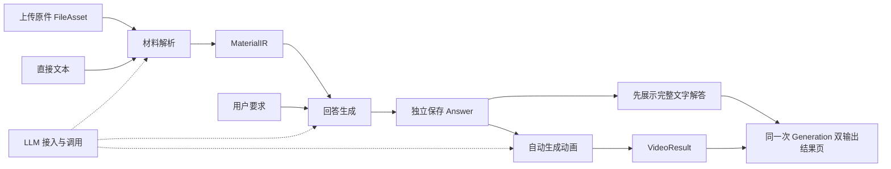

# ManimAgent 文档总览

更新日期：2026年10月29日

**本轮实施范围：文字链路。** 当前默认网页和 `POST /api/v2/generations` 使用 `output_mode: text`，完整文字保存即 completed，不调用视频、不使用 partial。已实现上传、独立解析、回答、修订、来源与诊断读取；下文“双输出主入口与编排”保留为后续动画接入设计。当前可用接口、字段差异、配置、验证与待办以[文字链路实现与覆盖检查](文字链路实现与覆盖检查.md)为准。

ManimAgent 的后续双输出主流程是一次提交学习材料与问题，同时交付完整文字解答和基于该解答的动画。文字完成后先展示，动画自动接续生成；两种结果使用同一回答版本。近期围绕 LLM 接入、材料解析、文本回答、动画生成及整体编排推进，长期记忆与个性化暂缓。

代码保留 0.1.0 纯文本到动画 MVP，另已增加文字模式的 Generation、材料、回答与 `/api/v2`。完整文字与动画双输出仍待实现。历史验证范围见 [MVP 验证记录](MVP验证记录.md)，不能据此认定新流程已通过验证。

当前模型配置可直接在网页设置，操作和凭据保存说明见[LLM 界面配置](LLM界面配置.md)。

## 当前版本与历史边界

当前开发版本为 0.2.0，根目录只提供文字链路。0.1.0 动画 MVP 已独立冻结到 [legacy_mvp](../legacy_mvp/README.md)，拥有自己的源码、配置、锁文件、环境、测试与端口。当前项目不再加载旧 API 或 LangGraph；下文历史 MVP 描述与双输出编排是背景和后续设计，不代表当前运行入口。真实 DeepSeek 文件链路、版本隔离和审查结论见[测试报告](../testresult/测试报告.md)。

## 文档入口

| 主文档 | 维护内容 | 当前状态 |
|---|---|---|
| [01 LLM 接入与调用](01-LLM接入与调用.md) | 连接、协议、模型与角色配置、能力检测、统一调用和错误 | 当前为可配置 Chat Completions；多协议接入待实现 |
| [02 材料输入与解析](02-材料输入与解析.md) | 上传、格式处理、解析路由、来源与统一材料结果 | 已实现本地文本、PDF、DOCX 与上传；图像／原生解析待实现 |
| [03 文本回答生成](03-文本回答生成.md) | 内容组织、检查、来源引用、独立回答与修订 | 已实现独立 Markdown 回答、检查、来源及人工修订 |
| [04 动画生成](04-动画生成.md) | 分镜、Manim、执行纠错、视觉检查、渲染、合成与后续配音 | 当前 MVP 已有基础流程；消费 Answer 的边界待迁移 |
| [05 长期记忆与个性化](05-长期记忆与个性化.md) | 长期目标和基本原则 | 暂缓，近期不展开 |

使用项目从 [运行与配置](运行与配置.md) 开始；实施顺序见 [开发计划](开发计划.md)；当前验证证据见 [MVP 验证记录](MVP验证记录.md)，回归输入见 [输入与验收样例](mvp/输入与验收样例.md)。

LLM 配置的设计思想、字段与调用契约、开源源码依据及实施验收统一维护在 [LLM 接入与调用](01-LLM接入与调用.md)。

文件上传与模型输入的正式设计分别维护在 [材料输入与解析](02-材料输入与解析.md)、[文本回答生成](03-文本回答生成.md)和 [LLM 接入与调用](01-LLM接入与调用.md)，具体细节旁附固定版本源码链接。逐项目比较与源码快照见 [开源 Agent 文件上传与 LLM 输入调研](research/开源Agent文件上传与LLM输入调研.md)。

前四份主文档按“职责与边界、处理流程、输入输出、实现方案、当前状态与待办”组织。总览维护跨模块规则，各模块维护自己的数据契约与验收；开发计划集中维护实施顺序。

## 模块关系与完整流程



LLM 接入为各业务模块提供公共调用能力。材料解析决定读取路径，回答模块决定完整讲解内容，动画模块将确定版本转成画面。GenerationService 负责串联阶段、发布中间结果和汇总状态，不接管各模块的内容判断。默认主入口不要求用户在文字完成后再次提交视频请求；独立阶段接口保留用于调试、复用与针对性重试。

用户提交原始材料后的第一阶段交付完整 Markdown 解答：材料准备形成可复用的 MaterialIR，首轮内容生成主调用直接回答材料与问题，保存为 Answer。网页、调试下载与自动分镜使用同一 answer_id 的正文；步骤和来源是正文的派生索引，不先要求模型生成分镜或 Answer JSON 再拼出阅读版答案。

“同时交付”表示同一次请求具有文字与动画两种目标产物，执行仍按材料 → 文字 → 动画的依赖顺序推进。文字可读性不等待视频完成，回答也不因场景数量、二维渲染范围或视频失败而被删减。只有文字与合格视频均完成且版本一致，整体任务才是 completed。

| 结果 | 定义归属 | 下游用途 |
|---|---|---|
| FileAsset、MaterialIR | [材料输入与解析](02-材料输入与解析.md) | 原件与派生资产登记、带来源的统一材料 |
| Answer | [文本回答生成](03-文本回答生成.md) | 独立展示、人工修订、动画输入 |
| VideoResult | [动画生成](04-动画生成.md) | 视频、字幕及回答步骤到画面的映射 |
| Generation | 本总览 | 同一次提交的来源、阶段状态、文字和动画引用，以及重试历史 |
| LLMRequest、LLMResponse、配置与能力记录 | [LLM 接入与调用](01-LLM接入与调用.md) | 各模块的模型调用 |
| Job、Error | 本总览 | 跨模块执行状态与错误 |

上传原件只保存文件，不调用模型；向模型提供商上传临时文件由解析模块通过 LLM 模块完成。厂商文件 ID、SDK 对象和会话状态保留在适配层，下游使用本系统的材料与回答。

## 双输出主入口与编排

### GenerationRequest

默认入口为 `POST /api/v2/generations`。本节 GenerationRequest 是 v2 草案，与当前 0.1.0 的 GenerationRequest(text) 分开。请求使用 `{source, video_profile_id}`，video_profile_id 可省略或为 null，采用服务端默认视频配置；source 为带 type 的互斥联合：

| source.type | 字段 | 行为 |
|---|---|---|
| inputs | inputs、instruction，及可选 parser_profile_id、input_mode、answer_profile_id | inputs 沿用 ParseRequest.inputs；解析材料、生成完整文字后自动生成动画 |
| materials | material_ids、instruction，及可选 answer_profile_id | 复用完成的 MaterialIR，生成文字与动画 |
| answer | answer_id | 复用已保存的完整 Answer 并展示其全文，直接生成对应动画；适用于编辑答案后的新任务 |

inputs 和 materials 模式的 instruction 必须非空。source 的不同形式不能混传；提供商凭据与模型参数不放入业务请求。所有模式都以双输出为完成目标，复用已有 Answer 不重复调用回答模型。

```json
{
  "source": {
    "type": "inputs",
    "inputs": [{"type": "text", "text": "给定 a=(3,2)、b=(1,0)，求 a 在 b 方向上的投影。"}],
    "instruction": "给出完整解答，并用动画解释投影系数与投影向量的区别。"
  },
  "video_profile_id": null
}
```

### Generation 汇总资源

Generation 是可更新的编排资源，内容产物 Answer 与 VideoResult 仍不可变。任务接受时创建 generation_id 和 Job，返回 202 Job；Job.resource_ref 从接受时起指向该 Generation，客户端据此读取逐步就绪的结果。

| 字段 | 类型与规则 |
|---|---|
| schema_version | string，必填，初始为 `"1.0"` |
| generation_id | string，必填，服务端生成的编排资源标识 |
| source | object，必填，本次请求的来源形式与输入引用；不保存秘密值 |
| material_ids | string[]，必填，已完成材料引用；尚无结果时为空，复用 Answer 时继承其材料引用 |
| answer_id | string 或 null，完整文字保存后立即登记且不再替换；候选或截断正文不在此发布 |
| video_id | string 或 null，仅在完整合格视频保存后登记 |
| stages | object，必填，包含 material、answer、video 三个 StageState |
| active_job_id | string，必填，当前或最近一次整体尝试 |
| job_ids | string[]，必填，按接受顺序保留全部整体尝试，包含 active_job_id |
| created_at / updated_at | string，必填，带时区的 ISO 8601 时间 |

StageState 为 `{status, error, diagnostic_asset_ids}`。status 为 pending、running、completed、blocked、needs_input、needs_review、failed 或 interrupted；error 使用公共 Error 或 null，diagnostic_asset_ids 默认为 `[]`。复用的材料或 Answer 阶段直接标为 completed，并通过对应结果 ID 表明来源。Generation 的整体状态取 active_job_id 对应的 Job，不另维护一套状态枚举。

发布顺序为：原子保存并校验 Answer → 登记 Generation.answer_id → 展示文字并执行视频阶段 → 原子保存 VideoResult → 核对 VideoResult.answer_id 等于 Generation.answer_id → 登记 video_id 并完成 Job。Answer 的材料引用必须与本次完成或复用的材料一致；版本不匹配的视频以 result_version_mismatch 记录阶段错误，不登记到本次 Generation。阶段提交记录用于启动时核对引用，不能通过重新调用模型修补一份丢失的正文。

### 整体状态与部分完成

| 情形 | 整体 Job | 已发布结果与后续行为 |
|---|---|---|
| 材料或回答阶段运行中 | queued 或 running | 显示阶段进度，候选答案仅作为诊断资料 |
| 文字完整，动画运行中 | running | answer_id 可立即读取和下载，页面继续显示动画进度 |
| 文字与合格动画均完成且版本一致 | completed | result 指向 Generation，两种结果同时保留 |
| 文字完整，动画失败、待核对、预算耗尽或被中断 | partial | 保留 answer_id 和阶段错误，不登记失败候选为 video_id，允许只重试动画 |
| 材料或答案缺少关键条件、待核对或失败 | needs_input、needs_review 或 failed | 视频阶段 blocked；完整文字尚未发布，不视为部分交付 |

partial 只用于双输出整体任务，是终态，表示已有完整文字但没有本次要求的合格动画。独立 parse、answer、video 与 probe 任务继续使用各自原有状态。服务重启不自动续跑：generation 有完整文字而视频未完成时置为 partial，视频阶段为 interrupted；没有完整文字时置为 interrupted。若两种结果均已持久化，通过阶段提交记录核对后可以标记 completed。

### 主流程接口与动画重试

| 方法与路径 | 输入或用途 | 成功响应 |
|---|---|---|
| POST /api/v2/generations | GenerationRequest | 202，含 resource_ref 的 Job |
| GET /api/v2/generations/{generation_id} | 读取阶段状态、answer_id、video_id 与尝试历史 | 200，Generation |
| POST /api/v2/generations/{generation_id}/video-retries | `{expected_job_id, video_profile_id}`；video_profile_id 可省略或为 null，沿用上次配置 | 202，新整体 Job，继续关联同一 Generation |

动画重试只接受已有完整 Answer 且 active Job 为 partial 的 Generation；expected_job_id 必须等于当前 active_job_id，并原子拒绝并发重试，冲突返回 409。新 Job 复用原 answer_id 和 material_ids，固定本次视频配置，只重新执行视频阶段；历史 Job 的终态、错误和诊断资产不覆盖。新尝试按明确预算执行，资源级历史统计保留全部已发生用量。

编辑正文产生新 answer_id，使用 source.type=answer 创建新的 Generation；旧任务和旧视频仍对应旧回答。已 completed 任务如需另一个视频版本，也创建新 Generation，不在原有完整交付中替换视频。

### 页面、依赖与预算

默认页面只有一次“生成文字与动画”的主提交操作，同一结果页包含完整文字、来源与修订入口，以及动画播放器、阶段进度和失败后的“重试动画”。文字完成后立即可读、可复制或下载 Markdown；视频未完成或失败时，文字区域保持可用。界面明确提示动画对应哪个回答版本，修订答案不会让旧视频看起来已经更新。

请求接受前检查输入格式、引用权限、配置引用和队列容量，排队失败不得发布悬空的 Generation 或 Job。动画所需 Docker、字体或视觉服务不可用，不应阻止可以完成的文字生成；进入视频阶段再记录对应依赖错误并形成 partial。独立视频接口仍可在接受前报告其依赖不可用，旧 MVP 的 readiness 规则不在文档中冒充已修改。

GenerationService 使用任务级与各阶段的有限预算：文字完成前不启动分镜，阶段完成后即持久化结果；视频耗尽预算不撤销文字。主流程阶段、自动重试与检查均累计计数，复用已有结果不重复记作新模型调用。单 Worker 首版可以直接按阶段推进，不能占住唯一 Worker 等待另行排入同一队列的子任务，造成无法继续执行。

## 公共数据约定

- 公共结果均为可序列化 JSON，携带 `schema_version`，初始值为 `"1.0"`。破坏性字段或语义变化需要新契约版本，未知版本明确拒绝。
- `file_id`、`material_id`、`answer_id`、`video_id`、`generation_id` 和 `job_id` 由服务端生成，为不透明字符串。材料、文字和视频结果 ID 对应不可变内容，修改或重新生成产生新 ID；Generation 与 Job 是可以更新状态的编排资源。
- 文件及派生图片、音视频通过本系统的资产 ID 引用。公共契约不包含宿主机路径、厂商文件 ID、访问密钥或完整模型配置。
- 时间采用带时区的 ISO 8601 字符串。可选字段省略时使用声明的默认值；没有默认值的可选结果字段使用 `null`。数组无内容时为 `[]`。
- 每次执行保存输入引用、配置快照、实现版本、实际处理路径及使用量。用户配置通过服务端的 `profile_id` 引用，执行时解析为固定快照。
- 所有引用均由服务端检查存在性与可访问性。来源位置无法可靠确定时允许为空，不补造页码、坐标或时间戳。

## 后续任务与 HTTP 通用规则

本节定义公共 v2 规则；上传、解析、回答和文字 Generation 已实现，视频／probe 仍待实现。当前文字字段差异见本轮覆盖检查。各模块文档分别维护业务端点；公共任务查询为 `GET /api/v2/jobs/{job_id}`。当前 `/api/jobs` 的输入、状态和队列规则见 [动画生成](04-动画生成.md)，继续服务旧动画 CLI 与 API；默认页面使用文字 v2。

上传成功同步返回 201；整体生成、独立解析、回答、视频和能力检测等长任务返回 202 与 Job。各模块独立检查依赖：上传不要求模型，回答不要求 Docker、字体或 TTS。默认主流程自动执行到文字与动画双输出，阶段接口用于调试、复用、修订和错误处理。

### Job 与 Error

Job 字段：

| 字段 | 类型 | 规则 |
|---|---|---|
| schema_version | string | 必填，`"1.0"` |
| job_id | string | 必填，执行标识 |
| kind | enum | 整体任务为 `generation`，独立内容任务为 `parse`、`answer`、`video`，提供商检测为 `probe` |
| status | enum | `queued`、`running`、`completed`、`partial`、`needs_input`、`needs_review`、`failed`、`interrupted`；partial 只用于 generation |
| stage | string | 必填，模块内当前阶段；用于显示，不控制下游业务 |
| message | string | 必填，可直接展示的说明 |
| resource_ref | object \| null | 必填，默认 null；generation 从接受时即为 `{type: "generation", id}`，用于读取中间交付，不表示整体已完成 |
| result | object \| null | 必填；completed 时为 `{type, id}`，type 为 `generation`、`material`、`answer`、`video` 或 `probe_report`，其他状态为 null |
| error | Error \| null | 必填；需要处理的问题或失败原因，正常运行及完成时为 null |
| diagnostic_asset_ids | string[] | 必填，日志、预览、候选结果等可用资产 |
| created_at / updated_at | string | 必填，任务创建与更新时间 |

终态为 completed、partial、needs_input、needs_review、failed 或 interrupted。需要补充或核对材料时，修正后创建新任务；动画内容问题通过回答修订产生新版本并创建新 Generation。partial 通过 resource_ref 读取已完成文字与阶段错误，result 仍为 null。重启处理按前述整体与独立阶段规则执行，不宣称自动恢复。

Error 为 `{code, message, retryable, details}`，details 是 JSON 对象，默认 `{}`，可记录相关 file_id、material_id、block_id 或 step_id。错误消息应说明可采取的动作，不能回显密钥。

请求未被接受时，HTTP 错误响应统一为 `{error: Error}`：格式无效为 422，引用不存在或不可访问为 404，请求体超过上传上限为 413，媒体类型不接受为 415，并发尝试冲突为 409，队列满为 429，当前入口必要依赖不可用为 503。generation 入口的视频依赖按前述规则在视频阶段报告，保留文字生成机会。任务接受后发生的问题写入 Job，GET 查询本身仍返回 200。

首批错误码包括 `unsupported_file_input`、`parser_unavailable`、`source_incomplete`、`content_uncertain`、`invalid_reference`、`provider_auth_error`、`provider_quota_exceeded`、`provider_timeout`、`invalid_provider_response`、`budget_exceeded`、`render_failed` 和 `result_version_mismatch`。厂商错误由适配器归一化，结果版本冲突由编排器报告；业务模块不解析厂商原始错误体。

## 存储、复用与失败隔离

原件、解析结果、回答、视频结果和任务记录分别持久化。存储实现初期可以使用本地文件与清单，公共接口只依赖资源 ID 与仓储接口。

复用判断以输入结果 ID 或文件内容摘要、选择范围、契约版本、实现版本和配置快照为依据。相同文件名不能作为复用依据；需要独立生成新候选时可直接创建新任务。自动缓存及请求幂等不属于首版接口承诺，客户端应保存已获得的 job_id，避免轮询期间重复提交。

| 操作或故障 | 保留和复用的结果 |
|---|---|
| 更换解析策略或解析模型 | 原件复用，创建新 MaterialIR |
| 修改问题或更换回答模型 | 已完成 MaterialIR 复用，创建新 Answer |
| 人工编辑回答 | 保留旧 Answer，保存新的 Answer |
| 调整视频配置或渲染失败后重试 | Answer 复用，创建新视频任务 |
| 双输出任务的动画失败 | Generation 保留全文和 partial 状态，显式重试只增加视频尝试 |
| 原生文件接口不支持并回退 | 保留原件与失败记录，由解析模块决定本地路径 |
| 上游结果存在未解决的关键歧义 | 停在对应阶段，不自动启动下游生成 |

资源删除和跨用户共享接口后续单独设计。在引入删除前，作为其他结果来源的材料与回答应持续可读取，保证来源追溯。

## 本次文档检查与改造范围

2026年10月29日检查全部 13 份 Markdown 文档，主要调整如下；本次检查不产生新的实现或测试通过结论。

| 文档范围 | 统一后的维护内容 |
|---|---|
| README、docs/README、本总览 | 默认双输出目标、Generation 入口、页面、状态与整体完成条件 |
| LLM 接入、材料解析 | 分阶段配置和依赖、普通文本主调用、内部材料与双输出编排的关系 |
| 文本回答、动画生成 | 全文原样保存、同版本自动分镜、文字先展示、视频失败后的复用 |
| 开发计划 | 文字、动画与整体编排的实施顺序，双输出和部分完成的验收指标 |
| 运行与配置、MVP 验证记录 | 保留 0.1.0 操作和历史证据，明确新目标尚未实现或验证 |
| MVP 输入与验收样例 | 保留旧入口样例，新增默认双输出及失败、重试、版本一致性样例 |
| 文件上传与 LLM 输入调研 | 保留外部项目事实与源码引用，只同步面向本项目的建议链路 |
| 长期记忆与个性化 | 维持暂缓，不作为文字与动画交付的依赖 |

## 当前实现与技术位置

当前代码使用 Python 3.12、uv、Pydantic、FastAPI、LangGraph 和本地产物目录；Manim、LaTeX、中文字体、FFmpeg 与 ffprobe 固定在 Linux 渲染镜像。单 Worker 串行处理任务，简单 HTML/JavaScript 页面轮询进度。代码入口如下：

| 代码 | 当前职责 | 对应主文档 |
|---|---|---|
| `src/manimagent/config.py`、`providers.py` | 模型角色、参数与 Chat Completions 调用 | LLM 接入与调用 |
| `src/manimagent/schemas.py`、`agents.py` | MVP 输入、讲解规划、场景及检查结构 | 文本回答生成、动画生成 |
| `src/manimagent/workflow.py` | 主流程与逐场景循环 | 动画生成 |
| `src/manimagent/rendering.py`、`renderer_driver.py` | 宿主侧隔离协议、容器内渲染与合成 | 动画生成 |
| `src/manimagent/api.py`、`cli.py`、`jobs.py`、`web/` | 页面、CLI、任务 API 与单 Worker | 总览、动画生成 |
| `src/manimagent/artifacts.py`、`budget.py` | 产物清单、访问和运行预算 | 总览、动画生成 |

近期以同一后端中的模块边界拆分能力。数据库、向量检索、图数据库、独立消息队列、React 前端和 SSE 等旧设计候选尚未成为本次开发前提，需要实际需求和验证后另行决定。

## 旧文档内容去向

| 原文档或内容 | 当前维护位置 |
|---|---|
| 多 LLM 提供商接入设计、LLM 配置设计参考 | LLM 接入与调用，合并设计思想、协议、配置、能力、诊断、源码依据与实施验收 |
| 模块解耦与接口设计 | 总览保留公共约定与 Job；材料、回答、视频契约分别迁入所属模块 |
| MVP 设计、基础动画生成 | 动画生成，保留 0.1.0 输入、接口、预算、检查与产物规则 |
| 完整视听讲解 | 材料与回答部分迁入各自模块；语音、字幕与时间线迁入动画生成 |
| 技术栈与整体设计 | 当前技术位置归总览，解析、生成与视听设计归各模块；远期技术候选暂不落实 |
| 总体开发计划、第一版开发计划 | 开发计划，统一近期顺序与交付要求 |
| 长期记忆、个性化规划 | 合并为简要的长期记忆与个性化，暂停详细设计 |
| 交互集成与局部更新 | 阶段页面编排归总览和开发计划；片段依赖与重建归动画生成 |
| 评测优化与成果交付 | 模块验收与开发计划中的评测、交付要求 |

原阶段与综合设计文档已合并，不再作为并行维护入口；历史详细草案可从 Git 历史查阅。运行说明、验证记录与输入样例继续保留。
