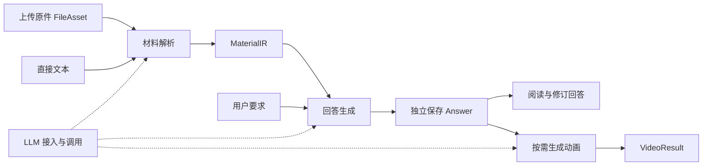

# ManimAgent 文档总览

更新日期：2026年10月28日

ManimAgent 从学习材料生成可独立阅读的回答，并按需将回答转成动画。近期围绕 LLM 接入、材料解析、文本回答和动画生成四项能力推进；长期记忆与个性化保留简要方向，暂不进入近期开发。

当前代码为 0.1.0 纯文本到动画 MVP，已有自动化与真实渲染验证记录。独立材料、回答、视频资源及 `/api/v2` 仍是后续设计；本次文档迁移不改变运行行为。真实模型生成质量的已记录验证范围见 [MVP 验证记录](MVP验证记录.md)。

## 文档入口

| 主文档 | 维护内容 | 当前状态 |
|---|---|---|
| [01 LLM 接入与调用](01-LLM接入与调用.md) | 连接、协议、模型与角色配置、能力检测、统一调用和错误 | 当前为可配置 Chat Completions；多协议接入待实现 |
| [02 材料输入与解析](02-材料输入与解析.md) | 上传、格式处理、解析路由、来源与统一材料结果 | 独立模块待实现；当前入口仅支持纯文本 |
| [03 文本回答生成](03-文本回答生成.md) | 内容组织、检查、来源引用、独立回答与修订 | 待实现；当前讲解规划尚未拆成独立回答 |
| [04 动画生成](04-动画生成.md) | 分镜、Manim、执行纠错、视觉检查、渲染、合成与后续配音 | 当前 MVP 已有基础流程；消费 Answer 的边界待迁移 |
| [05 长期记忆与个性化](05-长期记忆与个性化.md) | 长期目标和基本原则 | 暂缓，近期不展开 |

使用项目从 [运行与配置](运行与配置.md) 开始；实施顺序见 [开发计划](开发计划.md)；当前验证证据见 [MVP 验证记录](MVP验证记录.md)，回归输入见 [输入与验收样例](mvp/输入与验收样例.md)。

LLM 配置的设计思想、字段与调用契约、开源源码依据及实施验收统一维护在 [LLM 接入与调用](01-LLM接入与调用.md)。

前四份主文档按“职责与边界、处理流程、输入输出、实现方案、当前状态与待办”组织。总览维护跨模块规则，各模块维护自己的数据契约与验收；开发计划集中维护实施顺序。

## 模块关系与完整流程

LLM 接入为各业务模块提供公共调用能力。材料解析决定采用哪种读取路径，LLM 模块负责相应协议与远端文件操作；回答模块决定讲解内容，动画模块将确定版本的回答转成画面。用户可以停在解析或回答完成的节点，各模块通过已保存的结果 ID 协作。

| 结果 | 定义归属 | 下游用途 |
|---|---|---|
| FileAsset、MaterialIR | [材料输入与解析](02-材料输入与解析.md) | 原件与派生资产登记、带来源的统一材料 |
| Answer | [文本回答生成](03-文本回答生成.md) | 独立展示、人工修订、动画输入 |
| VideoResult | [动画生成](04-动画生成.md) | 视频、字幕及回答步骤到画面的映射 |
| LLMRequest、LLMResponse、配置与能力记录 | [LLM 接入与调用](01-LLM接入与调用.md) | 各模块的模型调用 |
| Job、Error | 本总览 | 跨模块执行状态与错误 |

上传原件只保存文件，不调用模型；向模型提供商上传临时文件由解析模块通过 LLM 模块完成。厂商文件 ID、SDK 对象和会话状态保留在适配层，下游使用本系统的材料与回答。

## 公共数据约定

- 公共结果均为可序列化 JSON，携带 `schema_version`，初始值为 `"1.0"`。破坏性字段或语义变化需要新契约版本，未知版本明确拒绝。
- `file_id`、`material_id`、`answer_id`、`video_id` 和 `job_id` 由服务端生成，为不透明字符串。每个结果 ID 对应不可变内容；修改、重新解析或重新生成产生新 ID。
- 文件及派生图片、音视频通过本系统的资产 ID 引用。公共契约不包含宿主机路径、厂商文件 ID、访问密钥或完整模型配置。
- 时间采用带时区的 ISO 8601 字符串。可选字段省略时使用声明的默认值；没有默认值的可选结果字段使用 `null`。数组无内容时为 `[]`。
- 每次执行保存输入引用、配置快照、实现版本、实际处理路径及使用量。用户配置通过服务端的 `profile_id` 引用，执行时解析为固定快照。
- 所有引用均由服务端检查存在性与可访问性。来源位置无法可靠确定时允许为空，不补造页码、坐标或时间戳。

## 后续任务与 HTTP 通用规则

本节仅定义尚未实现的 `/api/v2`。各模块文档分别维护业务端点；公共任务查询为 `GET /api/v2/jobs/{job_id}`。当前 `/api/jobs` 的输入、状态和队列规则见 [动画生成](04-动画生成.md)，迁移前继续服务现有页面与 CLI。

上传成功同步返回 201；解析、回答、视频和能力检测等长任务返回 202 与 Job。各模块独立检查依赖：上传不要求模型，回答不要求 Docker、字体或 TTS。页面分别显示材料、回答与视频状态，用户取得回答后可以结束流程。

### Job 与 Error

Job 字段：

| 字段 | 类型 | 规则 |
|---|---|---|
| schema_version | string | 必填，`"1.0"` |
| job_id | string | 必填，执行标识 |
| kind | enum | 内容任务为 `parse`、`answer`、`video`；提供商控制面检测扩展为 `probe` |
| status | enum | `queued`、`running`、`completed`、`needs_input`、`needs_review`、`failed`、`interrupted` |
| stage | string | 必填，模块内当前阶段；用于显示，不控制下游业务 |
| message | string | 必填，可直接展示的说明 |
| result | object \| null | 必填；completed 时为 `{type, id}`，内容结果 type 为 `material`、`answer` 或 `video`，检测结果扩展为 `probe_report`，其他状态为 null |
| error | Error \| null | 必填；需要处理的问题或失败原因，正常运行及完成时为 null |
| diagnostic_asset_ids | string[] | 必填，日志、预览、候选结果等可用资产 |
| created_at / updated_at | string | 必填，任务创建与更新时间 |

终态为 completed、needs_input、needs_review、failed 或 interrupted。需要补充或核对材料时，客户端读取诊断产物、修正输入后提交新的解析或回答任务；视频任务指出已有 Answer 的内容问题时，可以通过回答修订创建新版本再生成视频。恢复能力实现前，服务重启后的未完成任务标为 interrupted，不宣称自动恢复。

Error 为 `{code, message, retryable, details}`，details 是 JSON 对象，默认 `{}`，可记录相关 file_id、material_id、block_id 或 step_id。错误消息应说明可采取的动作，不能回显密钥。

请求未被接受时，HTTP 错误响应统一为 `{error: Error}`：格式无效为 422，引用不存在或不可访问为 404，请求体超过上传上限为 413，媒体类型不接受为 415，队列满为 429，阶段依赖不可用为 503。任务接受后发生的问题写入 Job，GET 查询本身仍返回 200。

首批错误码包括 `unsupported_file_input`、`parser_unavailable`、`source_incomplete`、`content_uncertain`、`invalid_reference`、`provider_auth_error`、`provider_quota_exceeded`、`provider_timeout`、`invalid_provider_response`、`budget_exceeded` 和 `render_failed`。适配器将厂商错误映射到这些业务错误，不向上游暴露厂商专属判断逻辑。

## 存储、复用与失败隔离

原件、解析结果、回答、视频结果和任务记录分别持久化。存储实现初期可以使用本地文件与清单，公共接口只依赖资源 ID 与仓储接口。

复用判断以输入结果 ID 或文件内容摘要、选择范围、契约版本、实现版本和配置快照为依据。相同文件名不能作为复用依据；需要独立生成新候选时可直接创建新任务。自动缓存及请求幂等不属于首版接口承诺，客户端应保存已获得的 job_id，避免轮询期间重复提交。

| 操作或故障 | 保留和复用的结果 |
|---|---|
| 更换解析策略或解析模型 | 原件复用，创建新 MaterialIR |
| 修改问题或更换回答模型 | 已完成 MaterialIR 复用，创建新 Answer |
| 人工编辑回答 | 保留旧 Answer，保存新的 Answer |
| 调整视频配置或渲染失败后重试 | Answer 复用，创建新视频任务 |
| 原生文件接口不支持并回退 | 保留原件与失败记录，由解析模块决定本地路径 |
| 上游结果存在未解决的关键歧义 | 停在对应阶段，不自动启动下游生成 |

资源删除和跨用户共享接口后续单独设计。在引入删除前，作为其他结果来源的材料与回答应持续可读取，保证来源追溯。

## 当前实现与技术位置

当前代码使用 Python 3.12、uv、Pydantic、FastAPI、LangGraph 和本地产物目录；Manim、LaTeX、中文字体、FFmpeg 与 ffprobe 固定在 Linux 渲染镜像。单 Worker 串行处理任务，简单 HTML/JavaScript 页面轮询进度。代码入口如下：

| 代码 | 当前职责 | 对应主文档 |
|---|---|---|
| `src/manimagent/config.py`、`providers.py` | 模型角色、参数与 Chat Completions 调用 | LLM 接入与调用 |
| `src/manimagent/schemas.py`、`agents.py` | MVP 输入、讲解规划、场景及检查结构 | 文本回答生成、动画生成 |
| `src/manimagent/workflow.py` | 主流程与逐场景循环 | 动画生成 |
| `src/manimagent/rendering.py`、`renderer_driver.py` | 宿主侧隔离协议、容器内渲染与合成 | 动画生成 |
| `src/manimagent/api.py`、`cli.py`、`jobs.py`、`web/` | 页面、CLI、任务 API 与单 Worker | 总览、动画生成 |
| `src/manimagent/artifacts.py`、`budget.py` | 产物清单、访问和运行预算 | 总览、动画生成 |

近期以同一后端中的模块边界拆分能力。数据库、向量检索、图数据库、独立消息队列、React 前端和 SSE 等旧设计候选尚未成为本次开发前提，需要实际需求和验证后另行决定。

## 旧文档内容去向

| 原文档或内容 | 当前维护位置 |
|---|---|
| 多 LLM 提供商接入设计、LLM 配置设计参考 | LLM 接入与调用，合并设计思想、协议、配置、能力、诊断、源码依据与实施验收 |
| 模块解耦与接口设计 | 总览保留公共约定与 Job；材料、回答、视频契约分别迁入所属模块 |
| MVP 设计、基础动画生成 | 动画生成，保留 0.1.0 输入、接口、预算、检查与产物规则 |
| 完整视听讲解 | 材料与回答部分迁入各自模块；语音、字幕与时间线迁入动画生成 |
| 技术栈与整体设计 | 当前技术位置归总览，解析、生成与视听设计归各模块；远期技术候选暂不落实 |
| 总体开发计划、第一版开发计划 | 开发计划，统一近期顺序与交付要求 |
| 长期记忆、个性化规划 | 合并为简要的长期记忆与个性化，暂停详细设计 |
| 交互集成与局部更新 | 阶段页面编排归总览和开发计划；片段依赖与重建归动画生成 |
| 评测优化与成果交付 | 模块验收与开发计划中的评测、交付要求 |

原阶段与综合设计文档已合并，不再作为并行维护入口；历史详细草案可从 Git 历史查阅。运行说明、验证记录与输入样例继续保留。
