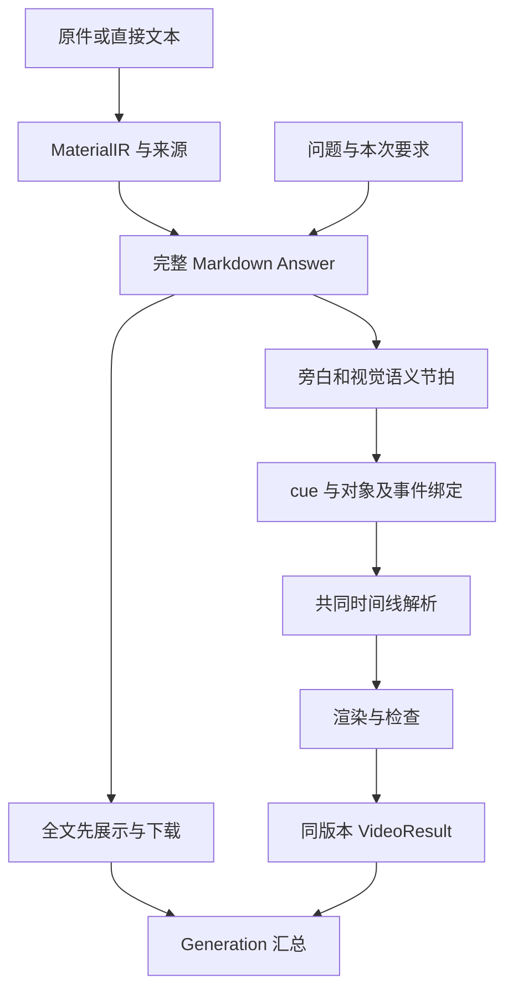

# ManimAgent 文档总览

更新日期：2026年10月29日。

## 版本与本次发布范围

本分支只更新文档，已提交应用代码仍为 **0.1.0 纯文本到动画 MVP**，运行方法见[运行与配置](运行与配置.md)。已有 API、CLI、依赖、预算与检查基线保留在[历史动画 MVP 流程](mvp/动画MVP流程.md)，测试事实见[MVP 验证记录](MVP验证记录.md)。

本地开发工作区已形成 0.2.0 文字链路阶段成果，并将旧动画迁移到独立 legacy_mvp；这些代码、配置、测试和报告尚未随本分支提交。文中以完整 Answer 为前提的设计不表示 GitHub 当前源码已经提供相应能力。

正式版目标是一次提交、先展示完整文字，再自动生成同版本动画。**真实 TTS 合成暂缓，旁白稿、语义锚点、对象与事件绑定以及共同时间线现在就设计。** 未生成音频时只验证语义对应和估计排程，不声称真实同步精度已经通过。

## 文档入口

| 文档 | 内容与证据边界 |
|---|---|
| [音画对齐调研](research/音画对齐开源项目与论文调研.md) | 官方论文、固定提交源码、场景／句／书签／强制对齐比较；未运行复现 |
| [动画 Pipeline](04-动画生成.md) | 正式版教学分析、旁白和画面计划、时间解析、有限渲染与失败边界 |
| [Prompt 与检查规范](动画Prompt与检查规范.md) | 角色输入输出、题型差异、对象和时间证据、失败处理 |
| [时长与生产验收](动画时长与生产验收.md) | 播放时长与墙钟预算、同步指标、固定样例与指标分母；数字均待实测 |
| [开发计划](开发计划.md) | 从本地文字成果接入正式动画的实施步骤 |
| [01 LLM 接入与调用](01-LLM接入与调用.md) | 连接、协议、模型角色、能力与错误设计 |
| [02 材料输入与解析](02-材料输入与解析.md) | 原件、格式、来源、解析覆盖与 MaterialIR 设计 |
| [03 文本回答生成](03-文本回答生成.md) | 独立正文、来源与版本；本地文字实现另行提交 |
| [05 长期记忆与个性化](05-长期记忆与个性化.md) | 暂缓，不作为近期交付依赖 |
| [运行与配置](运行与配置.md)、[历史动画基线](mvp/动画MVP流程.md) | 当前已提交 0.1.0 的运行行为和限制 |

材料与 LLM 的开源依据另见[文件上传与输入调研](research/开源Agent文件上传与LLM输入调研.md)。各模块维护内部契约，主流程与公共状态归本总览，性能数字集中维护在生产验收。

## 正式版模块关系（待实现）



LLM 模块负责统一调用；材料模块负责原件、解析与覆盖；回答模块负责完整解答；动画模块消费确定版本 Answer，并派生旁白、分镜和事件。GenerationService 负责阶段编排、结果发布与状态，不能替业务模块重新判断题设。

旁白是同一答案的表达派生物，与屏幕短句和公式显示分别保存映射。动画不重新解题、不静默改正文；答案有错时返回定位，由回答模块创建新版本。视频失败不撤销完整文字。

时间线区分语义事件与具体秒数：当前用明确标记的估计时间预览；以后真实音频边界就绪再解析同一事件。实际视频总长、对象指向、动作触发和可见持续时间分别检查。2～6 分钟播放范围与视频阶段 P95 八分钟目标均为初始工程假设，详细口径和硬限见[生产验收](动画时长与生产验收.md)，不作为当前性能承诺。

## 资源与版本

| 资源 | 内容与定义归属 |
|---|---|
| FileAsset、MaterialIR | 原件、派生资产、读取范围、块与来源；材料模块 |
| Answer | 不可变完整正文、派生步骤与来源；回答模块 |
| NarrationUnit、Cue、EventBinding、ResolvedTimeline | 同版正文的讲解表达、对象和事件、时间依据；动画内部设计 |
| VideoResult | 通过检查的完整视频、answer_id、实测时长与步骤映射；动画模块 |
| Generation | 一次提交的来源、结果引用、阶段状态和尝试历史；本总览 |
| Job、Error | 有限执行、错误、诊断与状态；本总览 |

公共结果采用 JSON，携带 schema_version；不兼容变更升级版本，未知版本拒绝。资源 ID 为服务端生成的不透明字符串。材料、答案和视频不可变；修改创建新 ID。Generation 与 Job 可更新执行状态。

资产只通过资源 ID 引用，不接受任意宿主路径、厂商文件 ID 或访问密钥。时间使用带时区 ISO 8601；deadline 用单调时钟。每次执行固定配置快照并保存正文／旁白／代码／时间／环境版本。缺失时间、定位或用量不能伪装成零或已核验。

## 正式版 Generation 与双输出（草案）

本节不是当前 0.1.0 API。扩展入口拟为 `POST /api/v2/generations`，`output_mode: text_video` 表示双输出，另保留文字模式 `text`。video_profile_id 可省略，采用服务端默认配置。

source 是互斥联合：

| type | 字段与用途 |
|---|---|
| inputs | inputs、非空 instruction，及可选 parser／answer profile；先解析和回答，再生成视频 |
| materials | material_ids、非空 instruction，及可选 answer profile；复用完整材料 |
| answer | answer_id；复用已保存正文，不重跑 writer；未检查的修订版需补检 |

```json
{
  "output_mode": "text_video",
  "source": {
    "type": "inputs",
    "inputs": [{"type": "text", "text": "a=(3,2)，b=(2,0)"}],
    "instruction": "求 a 在 b 方向的投影，解释系数与投影向量的区别。"
  },
  "video_profile_id": null
}
```

接受请求时原子创建 Generation 和 Job，返回 202。Generation 至少保存 generation_id、output_mode、source、material_ids、answer_id、video_id、stages、active_job_id、job_ids 和创建／更新时间；结果尚未就绪时 ID 为 null。stages 分 material、answer、video，每项包含 status、error 和诊断资产 ID。

发布顺序：保存并校验完整 Answer → 登记 answer_id 并立即展示 → 执行视频 → 保存完整合格 VideoResult → 核对 answer_id 一致 → 登记 video_id 并完成。截断正文与失败视频只能是诊断候选，不发布为合格结果。

| 情况 | 双输出整体状态与行为 |
|---|---|
| 材料或回答运行中 | queued／running；尚无完整正文时不发布候选为成功 |
| 完整文字就绪，视频运行中 | running；全文可读、可下载 |
| 两项均合格且版本一致 | completed |
| 已有完整文字，视频失败、待核对、超预算或中断 | partial；保留 answer_id，video_id 为 null |
| 材料／回答缺条件、待核对或失败 | needs_input／needs_review／failed；阻塞视频 |

文字模式完整 Answer 保存即 completed，不使用 partial。partial 只用于双输出 Generation，独立 parse、answer、video Job 沿用自身状态。重启不自动续跑：有完整文字而视频未完成的双输出任务核对后记 partial，否则 interrupted；全部结果已持久化时核对后可完成。

### 视频重试与页面

拟议 `POST /api/v2/generations/{id}/video-retries` 接收 expected_job_id 与可选 video_profile_id，只接受已有完整文字且当前 Job 为 partial 的 Generation。expected_job_id 不符或并发重试原子返回 409。新 Job 只重做视频，保留原 answer_id、历史终态、诊断与累计用量；不重答材料。

修改正文产生新 answer_id，以 source.type=answer 创建新 Generation；旧视频仍对应旧正文。已 completed 后更换视频配置也创建新 Generation。默认正式版页面一次提交、文字先可读、视频独立显示进度／失败／重试，明确版本关系。

## 公共任务、错误与预算（目标契约）

各模块独立检查依赖。上传不要求模型，回答不要求渲染器；双输出视频依赖不可用时仍保留文字生成机会。独立视频入口可在接受前拒绝依赖错误。单 Worker 不得等待另行排入同一队列的子任务形成死锁。

Job 包含 schema_version、job_id、kind、status、stage、message、resource_ref、result、error、diagnostic_asset_ids、created_at、updated_at。kind 为 generation／parse／answer／video／probe；status 为 queued、running、completed、partial、needs_input、needs_review、failed、interrupted。generation 接受时 resource_ref 即指向 Generation；completed 才填写最终 result，partial 通过 resource_ref 读取完整文字。

Error 为 code、message、retryable、details。接受前的 HTTP 错误：422 格式，404 引用不存在／不可访问，413 上传超限，415 类型不支持，409 并发冲突，429 队列满，503 必要依赖不可用；任务接受后的问题写入 Job，查询本身仍为 200。错误和日志不回显密钥。

可使用 budget_exceeded、render_failed、content_uncertain、source_incomplete、invalid_reference、provider_timeout、invalid_provider_response、result_version_mismatch 等归一化错误。发布前版本冲突不得登记视频。

播放秒数与生产墙钟秒数分别管理。排队、模型等待、检查、重试、合成、解码和落盘都计入父 deadline；子阶段不能重置总预算。预算不足优先减少装饰和停止美化，不删推理、缩短必要阅读、跳过检查或裁掉旁白。

## 存储与复用

原件、材料、答案、视频和执行记录分别保存。复用依据是内容摘要／资源版本、范围、prompt、模型、旁白、时间、渲染环境与质量配置，而非文件名。变更只使依赖结果失效，已有合格版本保持可读。

当前不承诺跨任务自动缓存、幂等、断点恢复、删除或跨用户共享 API；客户端保存 job_id，避免轮询时重复提交。长期记忆与个性化、复杂调度和更多前端依赖不作为本阶段前置。

## 当前已提交源码位置

| 位置 | 职责 |
|---|---|
| src/manimagent/config.py、providers.py | 模型与调用 |
| src/manimagent/schemas.py、agents.py、workflow.py | 0.1.0 规划、场景与逐场景循环 |
| src/manimagent/rendering.py、renderer_driver.py | 隔离渲染、抽帧与合成 |
| src/manimagent/api.py、cli.py、jobs.py、web/ | 0.1.0 页面、API、CLI 与 Worker |
| src/manimagent/artifacts.py、budget.py | 产物、访问与预算 |

本地 0.2.0 的答案／材料模块和 legacy_mvp 目录迁移另行提交。后续代码合入时再同步已实现状态与验证证据，不能用本次文档 PR 代替功能验收。
