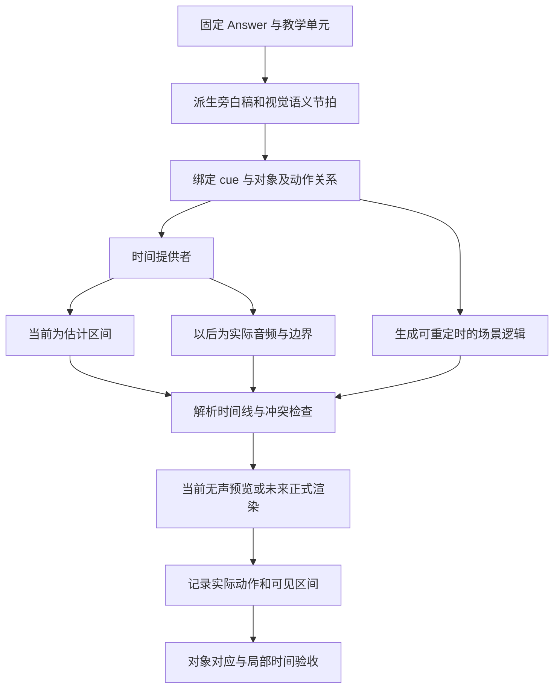

# 音画对齐：开源项目与论文调研

调研日期：2026年10月29日。对象是数学／知识讲解中的**旁白语义与画面事件同步**，不是数字人口型同步、音乐卡点或环境音生成。本轮在线阅读官方论文、项目文档及固定提交源码，未安装或运行这些工程，未生成音频，也没有同步误差或性能实测。

## 1 对本项目当前方向的修正

**TTS 服务可以后接，旁白脚本、语义锚点和音画时间契约现在就需要设计。** 之前只按无声阅读时间规划 Timeline，不足以保证之后接入旁白时长度与节奏一致。不能先把动画秒数写死，再在最后添加一段语音。

应分开处理三件事：

| 对齐层次 | 要解决的问题 | 只检查视频总长能否证明 |
|---|---|---|
| 内容／对象 | 旁白中的“这个系数”指向 c，还是投影向量 p；公式读法对应哪个视觉对象 | 不能 |
| 语义事件 | 讲到“作垂线”时执行哪个动作；说结论时公式是否已经可见 | 不能 |
| 实际时间 | 该词／句在音频何时发生，动作与可见区间是否满足约束 | 只能核对最终边界，不能证明局部同步 |

下面的分类和本项目建议是本轮综合判断；各项目已经实现的能力另列出处，不将论文宣称等同于可复现源码能力。

## 2 方法比较

| 方法 | 时间依据 | 主要粒度 | 优点 | 主要缺口／代价 | 代表材料 |
|---|---|---|---|---|---|
| 渲染后让音频适配视频 | 场景实测视频时长 | 场景 | 接入简单，成功对齐时避免边界累计漂移 | 可能加速／裁剪旁白；内部动作仍可能错位 | Paper2Manim |
| 分句合成后累计计时 | 每句音频实际采样时长 | 句／节拍 | 不需要整段 ASR，易保存和局部更新 | 请求数增加，句间语气连续性要验证；句内仍需锚点 | Explanimator 的 beat 数据 |
| 书签与词边界 | 原生词时间戳或事后转写／对齐 | 词／短语触发点 | 关键动作可以绑定具体表达 | 词边界和文本映射可能不准，需检测超时和缺证据 | Manim Voiceover |
| 命名事件与可重排时间线 | 独立事件元数据；可手工调整 | 动作事件 | 修改时间不必重新写动作逻辑 | 事件不自动知道旁白何时说到，仍需时间提供者 | Motion Canvas |
| 脚本／音频后做强制对齐 | 已有音频和相应文本 | 字／词／短语 | 可给不提供时间戳的音频补充边界 | 增加模型推理；语言、数字、公式与缺词需处理 | WhisperX |
| 统一教学脚本编译 | 教学步骤、旁白单元、对齐规则 | 教学单元／事件窗口 | 内容、旁白、画面共享依据 | 论文形式化不等于已经公开全部调度与误差处理 | LASEV、TeachMaster |

这不是从低到高的一条单轴排名：一个系统可能段落边界很准、对象却指错；另一系统对象选对、触发时刻仍偏移。需要分别验收。

## 3 开源项目的实际机制

### 3.1 Manim Voiceover：旁白块与书签

这是最直接可借鉴的 Manim 对齐接口。`voiceover(...)` 创建一个有实测音频长度的 tracker；动画可取 `tracker.duration`，上下文结束时补等尚未播放完的旁白。片内 `<bookmark .../>` 关联文本位置，`wait_until_bookmark` 等到对应时间再触发动作。[VoiceoverScene 源码](https://github.com/ManimCommunity/manim-voiceover/blob/3dc0d95d2f1d9d0937872b3dd68c7b38c4dfc96a/src/manim_voiceover/voiceover_scene.py#L151-L217)、[官方示例](https://github.com/ManimCommunity/manim-voiceover/blob/3dc0d95d2f1d9d0937872b3dd68c7b38c4dfc96a/examples/voiceover-demo.py#L81-L103)。

书签时间不是模型凭空生成的：tracker 依据 `text_offset → audio_offset` 插值。当前 Azure 适配器移除书签后合成，收集服务返回的词边界；不是直接依赖服务端原生 bookmark 回调。[tracker](https://github.com/ManimCommunity/manim-voiceover/blob/3dc0d95d2f1d9d0937872b3dd68c7b38c4dfc96a/src/manim_voiceover/tracker.py#L14-L114)、[Azure 适配器](https://github.com/ManimCommunity/manim-voiceover/blob/3dc0d95d2f1d9d0937872b3dd68c7b38c4dfc96a/src/manim_voiceover/services/azure.py#L189-L248)。

没有词边界时，可启用额外转写来补充；若边界字段存在但条目不足，tracker 会退回按全文长度线性估计。音频调速时还会缩放边界时间。[服务基类](https://github.com/ManimCommunity/manim-voiceover/blob/3dc0d95d2f1d9d0937872b3dd68c7b38c4dfc96a/src/manim_voiceover/services/base.py#L187-L216)、[退回逻辑](https://github.com/ManimCommunity/manim-voiceover/blob/3dc0d95d2f1d9d0937872b3dd68c7b38c4dfc96a/src/manim_voiceover/tracker.py#L56-L114)。

本项目可借鉴“代码绑定书签、时间由旁白解析”的接口，但应补充两条约束：估计时间必须有明显状态，不能标记为实测通过；动画已经越过书签时必须报告冲突。该 tracker 把剩余时间截为非负，等待接口本身不会把迟到动作拉回正确时刻。能调用 bookmark 不等于同步已经合格。

### 3.2 Motion Canvas：事件名和秒数分开

官方推荐用 `waitUntil('event')` 代替硬编码等待秒数，在编辑器调整事件；`useDuration('event')` 可把事件时间用于动画持续长度。事件数据包含场景内的注册时间和目标时间。[固定版本文档](https://github.com/motion-canvas/motion-canvas/blob/7b91435c301d530351dcf5ebb91dd139c002e405/packages/docs/docs/getting-started/time-events.mdx)、[TimeEvent](https://github.com/motion-canvas/motion-canvas/blob/7b91435c301d530351dcf5ebb91dd139c002e405/packages/core/src/scenes/timeEvents/TimeEvent.ts)。

它展示了一个适合当前阶段的设计：先定义“展示投影公式”“高亮分母”等稳定事件，具体时间放在外部元数据。尚无 TTS 时也可以编排、预览和调整；以后换成音频实测时间，不需要让 LLM 重写整段场景逻辑。但文档中的事件编辑不是自动语音识别，也不自行证明事件选对了旁白。

### 3.3 Paper2Manim：场景级后处理，不能直接当作精细对齐

本项目以前参考的仓库，在当前固定提交中确实有 narrator 和 voiceover assembly。旁白计划一场景一条，音频工作放在渲染后的 `assemble_av`；narration 不进入 Manim 代码路径。[Narration schema](https://github.com/jwj1342/Paper2Manim/blob/16191b602e98dc3cc6172014ba6290bef337d1e8/paper2manim/schemas/narration.py#L1-L27)、[narrator](https://github.com/jwj1342/Paper2Manim/blob/16191b602e98dc3cc6172014ba6290bef337d1e8/paper2manim/agents/narrator.py#L1-L10)。

`_align_audio` 的规则是：音频短则填静音；略长则调速；上限 1.15 倍仍不够时，strict 模式失败，best-effort 模式调速后裁音频。目标依据 ffprobe 得到的视频时长。[assembly 常量](https://github.com/jwj1342/Paper2Manim/blob/16191b602e98dc3cc6172014ba6290bef337d1e8/paper2manim/voiceover/assembly.py#L38-L39)、[对齐函数](https://github.com/jwj1342/Paper2Manim/blob/16191b602e98dc3cc6172014ba6290bef337d1e8/paper2manim/voiceover/assembly.py#L465-L512)。

适合复用的思路是场景清单、音视频实测、strict 失败和版本追踪；不宜照搬“画面先定长、旁白挤进去”。它没有在上述合成机制中绑定每句话和画面对象，场景边界吻合也可能内部错位。正式教学不能自动裁掉一段推理来适配短视频。

### 3.4 Explanimator：句级 beat 很有价值，但宣传路径和快速路径要区分

`NarrationBeat` 保存 text、audio_file、duration、start_time；按句切分后逐 beat 合成、读取音频帧数／采样率，累计得到时间线，并支持并发请求。代码生成接口能接收 beat 时间。[beat_sync_tts.py](https://github.com/lgupta-mle/explanimator/blob/85b08fc7b8cb4e669bd7e1b47532512a133717bf/src/research_viz/audio_generator/beat_sync_tts.py#L29-L95)、[实际时长读取](https://github.com/lgupta-mle/explanimator/blob/85b08fc7b8cb4e669bd7e1b47532512a133717bf/src/research_viz/audio_generator/beat_sync_tts.py#L126-L176)、[注入代码生成上下文](https://github.com/lgupta-mle/explanimator/blob/85b08fc7b8cb4e669bd7e1b47532512a133717bf/src/research_viz/manim_generator/pdf_to_manim_pipeline.py#L186-L206)。

需要特别注意：冷启动快速路径会并行启动 TTS 和 codegen。codegen 从已经载入的 timeline 取 beats，而等待 streaming audio 的位置在 sync 阶段；不能据项目页的描述认定“所有路径在生成代码前已拿到实际 beat 时间”。[快速路径](https://github.com/lgupta-mle/explanimator/blob/85b08fc7b8cb4e669bd7e1b47532512a133717bf/src/research_viz/manim_generator/pdf_to_manim_pipeline.py#L1782-L1822)、[codegen 与 sync 的依赖](https://github.com/lgupta-mle/explanimator/blob/85b08fc7b8cb4e669bd7e1b47532512a133717bf/src/research_viz/manim_generator/pdf_to_manim_pipeline.py#L1251-L1296)。这是静态代码路径分析，未运行验证。

其后处理仍可能整体调整视频速度、冻结末帧或截短。TTS 某 beat 失败时会退回估计时间；codegen prompt 又同时出现“每场景至少 120～150 秒”和“精确服从 beat 时长”等要求。[sync 后处理](https://github.com/lgupta-mle/explanimator/blob/85b08fc7b8cb4e669bd7e1b47532512a133717bf/src/research_viz/manim_generator/pdf_to_manim_pipeline.py#L777-L853)、[失败估时](https://github.com/lgupta-mle/explanimator/blob/85b08fc7b8cb4e669bd7e1b47532512a133717bf/src/research_viz/audio_generator/beat_sync_tts.py#L361-L401)、[prompt](https://github.com/lgupta-mle/explanimator/blob/85b08fc7b8cb4e669bd7e1b47532512a133717bf/src/research_viz/manim_generator/prompts/manim_code_generation_prompt.txt#L104-L146)。

因此可以借鉴句级资产、实测累计与并行准备；不能直接认为已有可靠的逐事件同步验收。我们的计时绑定必须有明确前置依赖，估计和实测不能混用；不要让“至少几分钟”和“按旁白精确播放”成为互相冲突的 prompt 指令。

### 3.5 WhisperX：取得已有音频的词时间，不负责选画面对象

WhisperX 论文将 VAD、分块／批处理转写和强制对齐组合起来，补充更细的词时间戳。它解决“文本在音频何时说到”，不解决“此时应该高亮哪个公式”。已有可靠逐字旁白稿时，可以评估直接对齐该稿，避免无必要重做整段识别。[WhisperX 论文，v2，2023年7月](https://arxiv.org/html/2303.00747v2)。

当前代码按语言选择对齐模型，并区分中文／日文无空格文本；对未识别字符存在特殊处理。README 对字典外数字／符号仍有局限提示，而所读代码已包含 wildcard 尝试，不能把旧说明理解为所有数值必然失败，也不能认为已保证精度。[alignment.py](https://github.com/m-bain/whisperX/blob/5d3678b8535698a2826a5db9eb3e4105aef85dd9/whisperx/alignment.py#L50-L74)、[字典处理](https://github.com/m-bain/whisperX/blob/5d3678b8535698a2826a5db9eb3e4105aef85dd9/whisperx/alignment.py#L308-L327)、[README 限制](https://github.com/m-bain/whisperX/blob/5d3678b8535698a2826a5db9eb3e4105aef85dd9/README.md#L251-L256)。

本项目首先需要“公式显示形式—规范读法—原始语义”的显式映射。对齐模型只接收将实际朗读的文本，不能把 LaTeX、未展开单位或没读出的来源标记直接当音频稿。对齐结果缺边界时记未知；不要悄悄按字数平均分配后称其为实测。

## 4 论文给出的架构与证据边界

### 4.1 TeachMaster：先建立跨模态关系，再改代码时间

阅读 [TeachMaster v2，2026年4月，§2.1～2.3](https://arxiv.org/html/2601.04204v2)，并核对 [ACL 2026 Industry 正式条目](https://aclanthology.org/2026.acl-industry.7/)。方法先形成页面蓝图和视觉代码；旁白结合当前页、上一页讲稿与视觉代码生成，TTS 给音频和语速，再由 synchronization agent 结合代码事件锚点与旁白语义单元插入等待等时间控制。文中没有给出可据以认定其使用强制对齐／逐词实测的完整实现细节，本轮也未获得对应执行源码。

其表 1 报告 Gemini 配置制作约 35.97 分钟视频需 88.43 分钟，生产／播放比约 2.46。这提醒我们对齐会影响生产时间；不能把成本优势理解为本机短任务延迟已达标，也不能按此比例直接推算我们的 P95。可借鉴的是显式 synchronization 职责，而非再加一个名称相同的 Agent 就能得到精度。

### 4.2 LASEV：把对齐规则作为独立编译输入

阅读 [LASEV v2，2026年5月，§3.2～4.4](https://arxiv.org/html/2602.11790v2)。EVS 表示为教学内容 P、旁白 N、对齐与编排 A；旁白按逻辑单元分段，A 将其映射到视觉事件窗口，由模板和程序执行。它支持“同步契约应现在建立”的方向，但文中 frame-accurate 的表述不能单独替代实际触发误差评测。

项目链接对应的 [RobitsG/LASEV 仓库快照](https://github.com/RobitsG/LASEV/tree/6258633a108c13a90bea86451bb33ed9abce8ec8) 本轮看到的是 README、项目页、素材与视频，没有可核验的完整生成／对齐引擎。论文的百万日吞吐也不是单任务等待时间，不能支撑本项目八分钟目标。参考其统一脚本架构，不称为已经复现的开源实现。

### 4.3 AutoLectures：把“对哪里”和“何时对”明确拆开

阅读 [Generating Narrated Lecture Videos from Slides with Synchronized Highlights，v1，2025年5月，§3～4](https://arxiv.org/html/2505.02966v1)。旁白带 highlight 标记，OCR 给视觉位置，语义匹配决定目标文字／公式，TTS 的词起止时间决定高亮区间；重复短语按出现次序定位。其核心价值是区分对象定位和时间查找，不能用平均语速完成二者。

论文的 92.5% F1 是高亮**位置匹配**指标，不是时间误差，也不是学习效果；作者还指出无标签图形区域难处理，未做学习者效果实验。本轮只核对论文，不将其当作已运行的开源系统。对程序生成的 Manim 对象，可直接保留 object_id，减少事后 OCR 猜测。

### 4.4 Code2Video：可参考生成与纠错，不作为旁白同步证据

[Code2Video v1，2025年10月](https://arxiv.org/html/2510.01174v1) 及所读 [公开 prompt](https://github.com/showlab/Code2Video/blob/1142d8e14cdc2806df85aedb0fbb5dca474caa0f/prompts/stage2.py) 主要给出规划、可执行可视化、纠错和画面评价机制。它对本项目的画面生成有价值，但本轮没有从这些材料核验出可直接使用的旁白词时间—动作绑定流程。不要将文中的 temporal coherence／lecture flow 自动解释为精确音画同步。

## 5 对本项目的建议：语义先绑定，秒数后解析

以下是结合上述证据提出的设计建议，尚未实现，也不是任一论文的原样复刻。

当前阶段应产出可朗读的旁白稿，而不仅是 screen_text。旁白是固定 Answer 的表达派生物，不是另一份独立解答；屏幕公式、短句和旁白读法各自保存映射。既定内容缺少解释时回到 Answer 修订，不靠 narrator 补造新的推理。

逻辑代码绑定事件名而不是固定秒数。例如“说明垂直关系”绑定 `cue_orthogonal`，读出 c 的计算式绑定 `cue_coefficient_formula`。将来 TTS 改变语速，只替换时间解析结果；不让 LLM 因秒数变化再重写数学逻辑。布局和对象准备可与未来音频并行，**最终时间参数绑定必须等待该段所需音频边界就绪**，再渲染；不能重复 Explanimator 快速路径中的依赖缺口。

### 5.1 当前就建立的最小记录

| 记录 | 必要内容 | 当前无 TTS 时 |
|---|---|---|
| NarrationUnit | narration_id、answer／unit 引用、完整 spoken_text、规范化读法与文本版本 | 现在生成与审查 |
| Cue | cue_id、旁白文本范围／出现次序、所指对象、动作语义 | 现在固定；不只存一句模糊的“此时” |
| EventBinding | event_id、cue_id、object_ids、关系、最短动作时长、允许提前／延后范围 | 现在校验引用和依赖 |
| TimingEvidence | 时间来源、estimated／measured、边界缺失项、正文／音频摘要 | 当前只能 estimated；actual_audio_id 为 null |
| ResolvedTimeline | 每段／事件解析后的起止、停顿、实际执行日志、冲突 | 可按估计预览，不能写成音频实测通过 |

文本范围必须指定属于规范化前还是朗读文本，保留两者映射。服务返回的偏移编码也需转换，不能默认所有接口都与 Python 字符下标一致。文字、公式读法、语速、声音或音频处理改变时，失效并重算受影响边界；只改布局可复用同版音频，仍需复查可见区间。

### 5.2 同步关系不止“在这一秒开始”

| 关系示例 | 含义 | 投影题示例 |
|---|---|---|
| visible_by(cue) | 指代发生前目标已稳定可见 | 说“这个投影向量”前 p 已显示 |
| start_at(cue, offset) | 动作在语义锚点附近开始 | 说“作垂线”时开始作图 |
| finish_by(cue) | 到指定语句时推导／变换已完成 | 开始解释新公式时旧变换已经结束 |
| highlight_during(phrase) | 在对应表达区间突出正确对象 | 讲“分母是 b 的模长平方”时高亮 b·b |
| hold_until(cue) | 相关说明未结束前保持内容 | 讲完系数和向量区别之前不清屏 |

这些关系是提议的契约，不是现有 API。提前显示有时是教学需要，揭示答案有时应延后，不能要求所有画面恰在关键词开始的同一帧出现。允许偏移应按事件类型和实测设定；本轮没有依据制定统一的 200ms 合格阈值。

### 5.3 没有音频时怎样决定长度

先固定可朗读旁白，展开公式／数值／单位读法，按语言和受众给每段语速区间，再将显式停顿、观察和思考时间放入 Timeline。旁白和画面共同排程，可并行的时间取并集，先后发生的时间相加，不能把旁白秒数、动作秒数和阅读秒数全部机械相加。

“2～6 分钟”仍可作为原先的暂定产品范围，但是否适配某题，应由完整旁白和事件计划检验。不能先定一个 240 秒画面再逼 narrator 缩词／加词填满，也不能只因估计总时长达标就认为音画已对齐。未接音频时只能承诺讲稿和画面语义对应、时长为估计；未来实测后可能需要重新解析时间和重渲染相关场景。

时间冲突时，依次检查：是否一个旁白单元承载过多动作，是否能并行准备对象，是否应拆句或增加有教学理由的停顿。仍不适合则修订派生讲解结构或明确范围冲突；不自动裁旁白、漏步骤、全局加速或在片尾补空白。

## 6 Prompt 和检查应补什么

| 阶段 | 需要新增／调整的要求 |
|---|---|
| 教学与旁白规划 | 每个必要单元同时给 spoken_text、屏幕表达、cue 和对象；规范公式读法，区分先展示／随讲高亮／讲完再揭示 |
| 规划检查 | 核对旁白与 Answer 等价、所有指代有目标、每个动作有语义理由、脚本时长与视觉最短执行时间相容 |
| 代码生成 | 接收稳定 event_id 与外部 timing；禁止自己更改旁白、伪造时间戳或重排有依赖的动作 |
| 运行检查 | 记录真实触发、完成、可见／消失时间；检测错过 cue、动作超窗、缺失事件和跨段累计漂移 |
| 语义与画面检查 | 对照当前正在讲的句子检查对象、公式、高亮与清屏；整场景抽几张截图不足以证明连续同步 |
| 音频接入后 | 校验音频文本覆盖、边界来源、缺词／误读、裁剪和真实偏移；必要时按片段人工听看 |

不必新增五六个 LLM 调用。语义计划可在一次结构化规划中产出，计时计算、ID 检查、冲突求解和偏移计算尽量程序化。模型适合判断“说的是谁／有没有漏解释”，不适合从未提供的音频猜精确毫秒。

## 7 时间成本与评测建议

现阶段先验证同一套事件能否在不同估计语速下重新排程，记录冲突比例和重渲染范围。可由人工朗读固定稿测量少量片段作为估时校准，但不能把文字估时升级为全量音频精度结论；本轮未进行录音。

未来真实音频接入，优先评估：原生可靠边界、逐语义片段的实际长度、必要时强制对齐。分句 TTS 的请求开销和连贯性、整段 TTS 的对齐推理成本各自测量，不预先认定哪个更快。对已有高质量边界无需重复跑 ASR；只对不确定片段补查，缓存同版本讲稿与音频。

| 指标 | 说明 |
|---|---|
| 旁白—对象正确率 | 高亮／指代是否指向正确对象，和时间误差分开统计 |
| 关键事件时间偏差 | start／finish／visible 等关系各自测量，报告有符号提前／延后和绝对误差的 P50／P95 |
| 片段漂移 | 每个段落边界及连续播放累计偏移，不能只看最后总长 |
| 必需同步覆盖率 | 有效实测证据的必要锚点／所有必要锚点；丢失或估计的锚点不能从分母剔除 |
| 冲突和完整性 | 动作过短、过早清屏、指代对象未出现、旁白裁剪、结论丢失 |
| 增量生产开销 | 旁白生成、TTS、对齐、时间线解析、额外渲染和重检分别计时、计调用 |

现有视频阶段八分钟 P95 仍只是本项目工程目标；未来必须把音频与对齐的关键路径计入，不能直接引用论文吞吐或单个模型的实时倍数。现在应避免把全部时间约束写进 LLM 代码，减少未来接音频后的全片重写和反复渲染。

最小验证题建议沿用投影题，包含：公式规范读法、重复提到“投影”、标量／向量分别指代、作垂线、公式高亮、句中停顿、讲完前不清屏。另测相同内容不同语速、缺边界、未发生事件和音频／讲稿版本变化。当前验证结构和估计排程；未来使用同一组锚点做实际听看和偏移测量。

## 8 调研后的取舍

当前优先吸收：Manim Voiceover 的旁白块／书签接口，Motion Canvas 的事件与时间分离，Explanimator 的句级资产和实测累计，以及 LASEV／AutoLectures 对内容、目标和时间的显式关联。WhisperX 保留为未来无可靠边界时的候选，不在当前阶段部署。

不直接采用：按已渲染短视频压缩旁白、宽松裁音频、全局 retime 作为主要对齐手段，以及只靠 prompt 声明“精确同步”。TeachMaster 的同步职责值得参考，具体精度和性能仍需自己实现、测量。

当前文档需要把“音频对齐以后再考虑”改为“**现在完成旁白与事件契约、估计排程；以后接入真实音频并验证时间精度**”。本轮保留研究与设计建议，不选择 TTS 供应商、不新增运行依赖、不把未知的实际音频对齐标为通过。

## 9 核对快照与限制

| 项目 | 本轮核对提交 | 证据范围 |
|---|---|---|
| Manim Voiceover | `3dc0d95d2f1d9d0937872b3dd68c7b38c4dfc96a` | tracker、场景上下文、服务基类、Azure 与示例 |
| Motion Canvas | `7b91435c301d530351dcf5ebb91dd139c002e405` | 官方 time-events 文档、TimeEvent、useDuration |
| Paper2Manim | `16191b602e98dc3cc6172014ba6290bef337d1e8` | narrator、旁白 schema、prompt、AV assembly |
| Explanimator | `85b08fc7b8cb4e669bd7e1b47532512a133717bf` | beat TTS、代码生成上下文、快速依赖路径、sync 与 prompt |
| WhisperX | `5d3678b8535698a2826a5db9eb3e4105aef85dd9` | README、alignment.py；论文另按 2023 v2 |
| LASEV | `6258633a108c13a90bea86451bb33ed9abce8ec8` | 仓库目录／项目展示；机制依据 2026 v2 论文 |
| Code2Video | `1142d8e14cdc2806df85aedb0fbb5dca474caa0f` | README、代码生成 prompt 与 2025 v1 论文 |

检索摘要中 LAVES／LASEV 名称存在不一致，本文按论文全文与项目页的 LASEV 记名。所有实现结论限定在所读版本和路径；没有把“未在所读材料找到”写成整个领域不存在。本文未比较商业 TTS 服务、未复现论文实验、未评估学习效果，也未证明本项目已能自动完成精确音画同步。

[返回文档入口](../README.md) · [动画 Pipeline](../04-动画生成.md) · [Prompt 与检查](../动画Prompt与检查规范.md) · [生产验收](../动画时长与生产验收.md)
