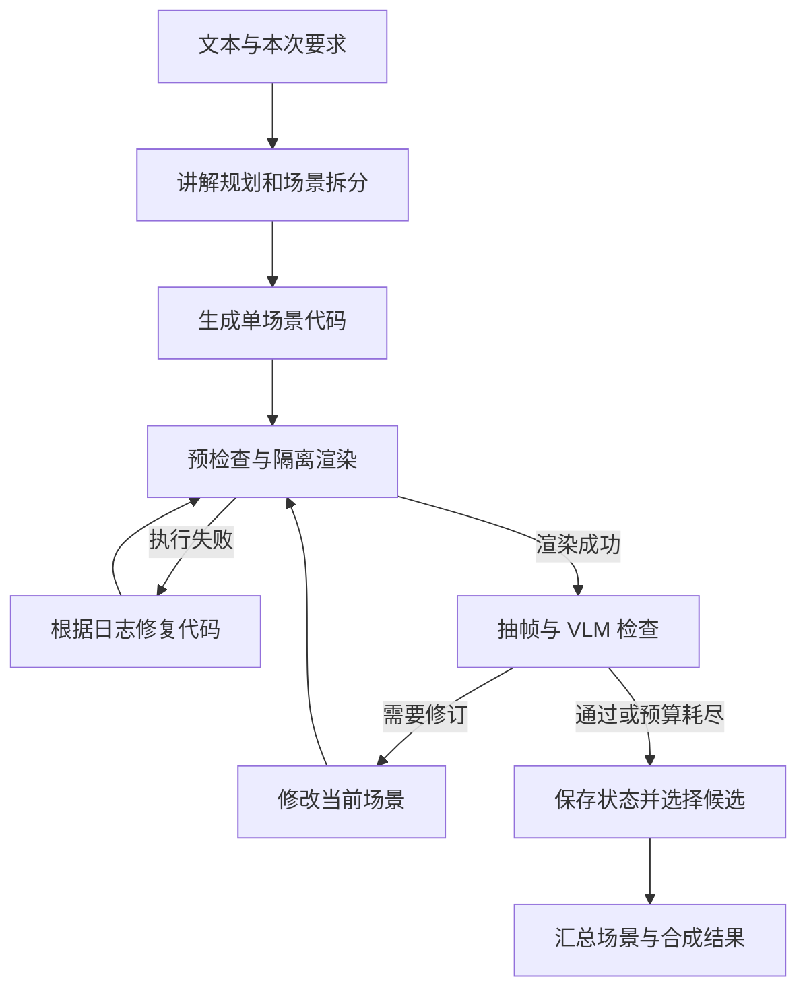

# 第一阶段 基础动画生成

状态：MVP 代码已实现；运行与模型验证范围见[MVP 验证记录](../MVP验证记录.md)。

本阶段完成文本输入到动画输出的基础流程，并通过执行纠错与 VLM 检查修订提高生成稳定性。它是后续视听讲解与个性化规划共同使用的生成模块。

具体实施以[第一版 MVP 设计](../MVP设计.md)为基线：用户仅提交一个 text 字符串，内部结构化规划由系统生成。

## 目标与边界

输入一个知识点、题目或简短材料，输出由少量场景构成的 MP4。先选适合二维演示的小型数学领域，控制内容长度和动画复杂度。

学习者记忆、跨任务生成经验检索、配音和文件解析在后续阶段接入。本阶段只保存当前任务的产物与记录。提供简单本地网页，CLI 用于调试与批量验收，完整 Web 交互放到第五阶段。

## 输入与输出

| 类型 | 内容 |
|---|---|
| 输入 | 唯一 text 字符串，包含学习内容和可选的本次讲解要求；时长和输出质量由应用配置控制 |
| 中间结果 | 讲解规划、场景描述、Manim 代码、候选版本、执行与视觉检查报告 |
| 输出 | 合成视频、场景视频、产物清单与任务完成状态 |

## 核心流程

## 模块与关键设计

| 模块 | 职责 |
|---|---|
| Planner | 产生讲解目标、场景顺序、关键公式与视觉步骤 |
| Coder | 按 SceneSpec 生成完整场景代码 |
| Renderer | 隔离执行、限制资源并返回结构化结果 |
| ExecutionReviewer | 根据错误类型和日志给出修复依据 |
| VisualReviewer | 对照场景目标检查画面，给出问题与修订建议 |
| Assembler | 选择适用候选，按顺序合成并登记产物 |

数据契约包括 GenerationRequest、LessonPlan、SceneSpec、RenderResult、ReviewReport 和 RunManifest。它们记录输入、场景目标、运行结果与候选关系，不包含学习者画像。

执行纠错与视觉修订分别受次数、耗时及调用预算约束。保留可用的历史候选；检查不可用时标记未完成检查；严重内容错误不能仅凭平均视觉评分判为通过。全部场景满足输出条件时才将整段视频标为完成。

VLM 先使用四帧采样建立基线，必要时增加关键变换前后的画面。静态截图可能遗漏动态问题，验收仍需人工观看视频。

## 技术与依赖

初始采用 Python、Pydantic、LangGraph、Manim、FFmpeg、模型 API 适配器及本地产物目录。渲染使用固定的 Linux 环境，中文字体和 LaTeX 一并验证。参考 Paper2Manim 固定提交的场景循环，不接入其 EMB。

## 验收与交付

使用固定样例验证自动生成、错误修复、视觉修订和多场景合成。检查中文与公式、内容完整性、候选一致性，以及超时、模型异常、部分场景失败时的任务状态。

交付可运行的基础生成入口、配置模板、样例视频、运行记录与使用说明。具体任务拆分见[第一阶段任务清单](../第一版开发计划.md)。

进入第二阶段后保持场景标识和步骤关系，扩展材料来源、讲稿与时间线。

[返回总体计划](../总体开发计划.md) · [下一阶段](02-完整视听讲解.md)
