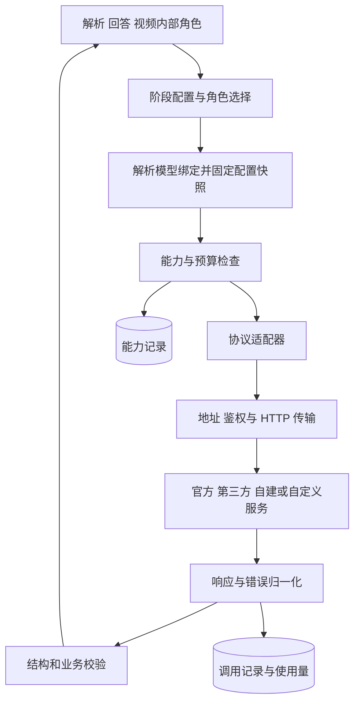

# 多 LLM 提供商接入、配置与能力适配设计

更新日期：2026年10月23日

状态：设计草案，尚未实现。本文定义官方服务、第三方服务、自建服务及自定义端点的统一接入边界，与[模块解耦与接口设计](模块解耦与接口设计.md)共同约束后续实现。当前 0.1.0 的实际配置方式仍见[运行与配置](运行与配置.md)。

## 1 问题与当前实现

用户应能选择提供商、模型及各阶段使用的配置，也能添加没有预设的服务。适配结果必须覆盖文本、图片、文件、结构化输出、错误及使用量，不能只让一条简单文本请求成功。

当前 `config.py` 的 ModelConfig 支持 base_url、model、api_key_env、json_mode、token_parameter 与 max_output_tokens，roles 可指定不同模型配置。`providers.py` 的 ChatProvider 仍固定拼接 `/chat/completions`，使用 Bearer 鉴权、Chat Completions 消息和 choices 响应结构。这是单一协议的可配置连接，尚不是多协议提供商适配层。

需要独立处理以下差异：

| 维度 | 示例 | 设计要求 |
|---|---|---|
| 服务运营方 | 模型官方、云平台、聚合或中转、自建服务 | 记录真实请求目标，分类只用于展示和配置管理 |
| API 协议 | Chat Completions、Responses、Messages、Gemini Native | 选择明确的协议适配器 |
| 地址规则 | 带版本前缀的根地址、自定义路径、完整请求 URL | 按操作构建地址，避免重复或丢失路径 |
| 鉴权与请求头 | Bearer、API Key 请求头、自定义请求头、无鉴权 | 与协议分别配置，由服务端注入 |
| 模型标识 | 官方名称、网关别名、带前缀的部署名 | 原样传递实际标识，不按名称猜模型能力 |
| 功能支持 | 文本、视觉、文档输入、JSON、流式、工具调用 | 按连接、模型和具体操作记录能力 |
| 失败与计量 | 限流、额度不足、截断、空输出、用量缺失 | 归一化原因并执行有界策略 |

官方与非官方是服务来源信息。实际协议、当前端点与模型能力共同决定调用方式；第三方服务也可能暴露多个不同协议，同名模型在不同服务上的能力不能直接互相继承。

## 2 从 CC Switch 借鉴的内容

本次查阅 [farion1231/cc-switch](https://github.com/farion1231/cc-switch)，固定参考提交为 [d8983bb10b82a1ccc15ae5f44ab070902623e990](https://github.com/farion1231/cc-switch/commit/d8983bb10b82a1ccc15ae5f44ab070902623e990)。以下是对该提交的观察与本项目的设计选择，不能当作对任意网关兼容性的保证。

| 已查阅的实现或说明 | 得到的启发 | ManimAgent 的采用方式 |
|---|---|---|
| [提供商与元信息](https://github.com/farion1231/cc-switch/blob/d8983bb10b82a1ccc15ae5f44ab070902623e990/src-tauri/src/provider.rs)、[预设配置](https://github.com/farion1231/cc-switch/blob/d8983bb10b82a1ccc15ae5f44ab070902623e990/src/config/codexProviderPresets.ts) | 预设、自定义实例、API 格式与完整 URL 等信息可以分别表达 | 预设是可编辑的起点，实例使用同一配置结构，能力另行验证 |
| [ProviderAdapter](https://github.com/farion1231/cc-switch/blob/d8983bb10b82a1ccc15ae5f44ab070902623e990/src-tauri/src/proxy/providers/adapter.rs) | URL、鉴权和请求响应转换有统一接口 | 业务请求先归一化，再由协议适配器编码和解码 |
| [鉴权策略](https://github.com/farion1231/cc-switch/blob/d8983bb10b82a1ccc15ae5f44ab070902623e990/src-tauri/src/proxy/providers/auth.rs) | API 格式与鉴权方式需要分别处理 | 同一种协议允许配置不同鉴权策略及必要版本头 |
| [模型映射](https://github.com/farion1231/cc-switch/blob/d8983bb10b82a1ccc15ae5f44ab070902623e990/src-tauri/src/proxy/model_mapper.rs) | 展示模型与实际请求模型需要区分 | 使用显式绑定，保留请求模型与上游报告模型 |
| [路由器](https://github.com/farion1231/cc-switch/blob/d8983bb10b82a1ccc15ae5f44ab070902623e990/src-tauri/src/proxy/provider_router.rs)、[故障转移说明](https://github.com/farion1231/cc-switch/blob/d8983bb10b82a1ccc15ae5f44ab070902623e990/docs/user-manual/zh/4-proxy/4.3-failover.md) | 候选顺序、健康状态与熔断可以单独维护 | 首版固定主连接和有界重试，跨提供商切换由配置明确开启 |
| [连通检测说明](https://github.com/farion1231/cc-switch/blob/d8983bb10b82a1ccc15ae5f44ab070902623e990/docs/user-manual/zh/4-proxy/4.5-model-test.md) | 该检测只验证地址可达，不验证密钥和模型 | 分开呈现网络可达、文本调用、结构化输出、图片和文件测试结果 |

CC Switch 面向多个客户端的配置切换与本地路由，ManimAgent 直接发起业务 API 请求。本项目优先采用其配置分层、适配接口和诊断思路；客户端配置改写、账号登录接管、完整代理服务与所有协议互转不作为本项目的前置条件。参考代码与手册，预设目录中的商业宣传不作为服务质量或模型能力证据。

## 3 接入架构与职责



| 对象 | 负责的问题 | 不承担的职责 |
|---|---|---|
| ProviderConnection | 请求发送到哪里，用什么协议和凭据 | 不决定教材内容或教学策略 |
| ModelBinding | 通过该连接调用哪个模型，使用哪些参数 | 不把展示别名当成已验证模型身份 |
| RoleProfile | 本次阶段和角色选择哪些模型绑定 | 不修改全局默认连接或其他任务 |
| CapabilityRecord | 当前组合支持什么，有什么验证依据 | 不把一次文本成功推广成全功能成功 |
| ProtocolAdapter | 请求、响应、文件引用及错误如何转换 | 不吞掉图片、公式、来源或业务约束 |
| 调用执行器 | 传输、超时、预算、重试及调用记录 | 不重新生成教学内容或绕开上层校验 |

一条业务调用只经过一层实际协议适配：内部统一请求直接转换为目标协议。更换 SDK 可以作为适配器内部实现选择，不能改变上层 MaterialIR、Answer 或 VideoResult 的含义。

## 4 连接、模型与角色配置

### 4.1 ProviderConnection

一个连接表示一个具体服务端点、协议与凭据绑定。同一运营方同时提供 Chat Completions 和 Responses 时，可以建立两个连接并在界面分组展示。

| 字段 | 类型与默认值 | 约束 |
|---|---|---|
| provider_id | string，必填 | 本系统连接 ID，不作为厂商枚举 |
| revision | integer，必填 | 从 1 开始，配置修改后递增 |
| name | string，必填 | 用户可读名称 |
| origin_type | enum，必填 | official、cloud、gateway、self_hosted、custom，仅用于来源描述 |
| preset_ref | object 或 null，默认 null | 采用的预设 ID 与版本；自定义连接可为空 |
| protocol | enum，必填 | openai_chat、openai_responses、anthropic_messages、gemini_generate_content；后续按适配器扩展 |
| endpoint_mode | enum，默认 api_root | api_root 或 operation_urls |
| api_root | string 或 null，默认 null | api_root 模式必填，包含所需版本和路径前缀 |
| operation_urls | object，默认 {} | 完整 URL 模式逐项配置 generate、models、files_upload、files_get、files_delete |
| auth | object，必填 | mode 为 bearer、api_key_header 或 none；有凭据时使用 credential_ref，api_key_header 另需 header_name |
| headers | object，默认 {} | 固定非密钥请求头，例如 API 版本；不能覆盖 auth 生成的鉴权头 |
| compatibility_profile | object 或 null，默认 null | 已实现兼容规则的 ID、版本及受限参数 |
| proxy_ref | string 或 null，默认 null | 显式选择出站网络代理配置 |
| enabled | boolean，默认 true | 关闭后不接受新任务使用；已开始调用按快照处理 |

api_root 模式由对应协议适配器构造操作路径。示例：`https://gateway.example/v1` 与 Chat 生成路径组合得到 `https://gateway.example/v1/chat/completions`。不能再次附加 `/v1`，也不能用覆盖根路径的 URL 拼接方式丢掉 `/team-a/v1` 等前缀。

operation_urls 模式使用配置中的完整地址，不再自动拼接生成路径。未配置的文件或模型列表操作视为未知或未提供，不能从生成 URL 猜测。路径模板及模型名编码由已注册适配器处理；云服务需要特殊签名、区域或部署参数时，增加专用适配器和经过校验的配置契约。

凭据首版通过环境变量引用，例如 `{source: "env", name: "MANIMAGENT_GATEWAY_API_KEY"}`。公共查询只返回已配置状态和脱敏引用，执行时再解析秘密。无鉴权仅用于用户明确配置的连接；客户端订阅登录、第三方 API Key 与本项目 API 凭据分别建模，首版不读取或搬用其他客户端的登录文件。

### 4.2 ModelBinding

| 字段 | 类型与默认值 | 约束 |
|---|---|---|
| binding_id | string，必填 | 业务侧引用的模型绑定 ID |
| revision | integer，必填 | 从 1 开始，修改模型、参数或能力声明后递增 |
| provider_id | string，必填 | 指向 ProviderConnection |
| display_name | string，必填 | 页面展示名称 |
| upstream_model | string，必填 | 实际请求模型字符串，保留大小写、斜杠和前缀 |
| parameters | object，默认 {} | 统一参数，例如 max_output_tokens；适配器校验并转换 |
| declared_capabilities | object，默认 {} | 用户或预设声明的能力及限制，保留来源，不伪装成实测 |

同一个 upstream_model 通过不同 provider_id 调用时，是不同绑定。网关模型列表可作为选项来源，但列表接口不是接入前提，允许手动填写模型名；返回名称也不能证明上游实际使用了哪一个模型。

统一参数不直接等同于厂商参数。max_output_tokens 等字段由适配器转换；temperature、推理预算、JSON 约束或工具调用若未实现转换或未确认支持，应明确拒绝或使用配置中已经声明的兼容策略，不能静默删除。

### 4.3 RoleProfile 与配置快照

阶段公开请求继续使用 parser_profile_id、answer_profile_id 或 video_profile_id，由服务端阶段配置解析到角色绑定。

| 阶段或角色 | 可选绑定 | 边界 |
|---|---|---|
| 材料解析 material_reader | 独立模型绑定，也可为空 | 本地文本解析不要求配置 LLM，原生文件或模型 OCR 路径才检查相应依赖 |
| 回答 answer_writer、answer_checker | 可共用一个绑定 | 只依赖本次材料、要求及允许使用的上下文 |
| 视频 planner、plan_checker、coder、execution_repair、visual_reviser、vision_checker | 按角色覆盖或采用阶段默认值 | 画面检查角色必须满足实际图片读取要求 |

RoleProfile 为 `{profile_id, revision, roles}`，revision 从 1 开始；roles 中的每个角色为 `{primary_binding_id, fallback_binding_ids, allow_failover}`，候选数组默认空，allow_failover 默认 false。阶段配置另维护该阶段业务预算和解析模式，不把厂商参数塞进 Answer 等内容结果。

任务接受时固定角色绑定、连接 revision、协议适配器版本、兼容规则版本、模型参数及能力记录引用。修改全局默认配置只影响新任务。凭据值在发送前解析且不进入日志；快照记录凭据引用，轮换凭据不改变该任务的目标服务或协议。凭据被撤销时允许任务明确失败，不能自动换成另一账户。

### 4.4 配置示例

下例为未来配置草案，域名、模型名和能力声明均为占位示例，当前 config.py 尚不接受这些字段。预设连接和自定义连接使用相同结构。

```yaml
provider_connections:
  gateway_a:
    provider_id: gateway_a
    revision: 1
    name: 我的网关 A
    origin_type: gateway
    protocol: openai_chat
    endpoint_mode: api_root
    api_root: https://gateway.example/team-a/v1
    auth:
      mode: bearer
      credential_ref:
        source: env
        name: MANIMAGENT_GATEWAY_API_KEY
    enabled: true

model_bindings:
  answer_primary:
    binding_id: answer_primary
    revision: 1
    provider_id: gateway_a
    display_name: 回答模型
    upstream_model: vendor/model-example
    parameters:
      max_output_tokens: 6000
    declared_capabilities:
      text: supported
      images: unknown
      file_inputs: unknown

role_profiles:
  answer_default:
    profile_id: answer_default
    revision: 1
    roles:
      answer_writer:
        primary_binding_id: answer_primary
        fallback_binding_ids: []
        allow_failover: false
```

## 5 协议适配器与统一调用契约

### 5.1 协议家族

| 适配器 | 需要独立处理的内容 | 依据 |
|---|---|---|
| openai_chat | messages、choices、结构化输出参数及图像或文件消息 | [OpenAI 官方接口差异说明](https://developers.openai.com/api/docs/guides/migrate-to-responses) |
| openai_responses | input、分类型 output、结构化输出配置、文件和状态 | [OpenAI 官方接口差异说明](https://developers.openai.com/api/docs/guides/migrate-to-responses) |
| anthropic_messages | Messages 请求响应内容块、版本头及可配置鉴权 | [Claude API overview](https://platform.claude.com/docs/en/api/overview) |
| gemini_generate_content | contents、parts、候选结果和模型相关路径 | [Gemini generateContent](https://ai.google.dev/api/generate-content) |

上述为待实现的协议目录，不代表当前已经支持，也不代表协议名称保证所有扩展功能可用。官方协议版本和网关兼容范围需要在对应适配器实施时复核。文件输入的支持还依赖端点与格式，例如 [OpenAI 文件输入说明](https://developers.openai.com/api/docs/guides/file-inputs)明确区分接口和文件类型。

新增提供商若满足已支持协议，只新增连接和模型绑定。新增协议或特殊签名才扩展适配器。自定义配置只选择已注册的规则和受限参数，不在 YAML 中执行任意 Python、JavaScript 或请求改写脚本。

### 5.2 内部调用对象

```text
LLMRequest:
  role
  instruction
  messages             # 本系统消息与 text/image/file 内容块
  output_schema        # 可为空，业务要求的 JSON Schema
  required_capabilities
  parameters

CallContext:
  job_id
  profile_snapshot_id
  resolved_binding_id
  deadline
  budget

LLMResponse:
  text
  structured_output    # 可为空，经过结构校验后的对象
  finish_reason        # stop/length/refusal/tool_call/error/unknown
  usage                # input/output/cache/reasoning 等已知值，未知为 null
  trace_id
```

适配层对外提供以下逻辑接口：

```text
resolve_binding(profile, role) -> ResolvedBinding
check_capabilities(binding, requirements) -> CapabilityDecision
generate(request, context) -> LLMResponse
prepare_file(file_id, binding, context) -> ProviderFileRef
release_file(provider_file_ref, context) -> ReleaseResult
probe(binding, scopes, context) -> ProbeReport
```

文本、图片与文件块保持显式类型。适配器遇到无法表达的内容块返回 capability_unsupported，不允许只保留文字后把请求标为成功。streaming 与工具调用的公共事件契约后续单独扩展，首版可以只实现非流式生成并明确拒绝对应功能要求。

JSON Schema 原生约束、JSON 对象模式与提示词后校验分别记录。业务需要结构化结果时，允许配置“提示词约束加校验”的执行路径；无论采用哪种路径，最终都通过本系统契约校验。截断、空输出、拒绝或工具调用未完成均不能直接作为完整 Answer 或检查报告。

调用失败统一抛出携带 LLMError 的异常，字段为 `{code, message, retryable, retry_after_seconds, trace_id, details}`，等待时间未知为 null，details 默认 `{}`。details 可含脱敏的上游状态码和请求标识，不能承载原始鉴权信息。首批分类包括 provider_auth_error、provider_quota_exceeded、provider_rate_limited、provider_unavailable、provider_timeout、model_unavailable、capability_unsupported、invalid_provider_response、output_truncated 与 budget_exceeded。材料解析模块将文件读取能力问题映射为既有 unsupported_file_input；其余分类按业务需要写入 v2 Error，不让业务层解析厂商原始错误体。

## 6 能力记录与实际验证

CapabilityRecord 以连接配置 revision、协议与适配器版本、模型绑定及其 revision、凭据作用域标识为范围。不同区域、套餐、网关、凭据或兼容规则的结果不直接共用；作用域标识只存服务端引用，不存密钥值。

| 能力 | 必须区分的内容 |
|---|---|
| text | 最小文本调用是否成功 |
| images | 是否保留并实际理解图片，支持的媒体类型与输入方式 |
| file_inputs | 接受的格式、传输方式、限制及所提取的内容类型 |
| files_api | 是否提供上传、查询、删除；与生成接口读取文件分别记录 |
| structured_output | native_schema、json_object、prompt_validated 分别支持到什么范围 |
| streaming / tools | 协议与本项目适配器是否均已实现 |
| limits | 文件字节数、页数、上下文和输出限制，未知为 null |
| usage | 哪些 token 或费用字段可以读取，其余保持未知 |

每项记录包含 `state: supported/unsupported/unknown`、`evidence_source: preset/manual/probe/runtime`、checked_at、expires_at 及证据引用。预设或手动声明保留其来源标签；实测记录保留测试范围与结果。测试过期或连接、凭据作用域、协议版本变化时，需要重新评估。一次上传成功只能支持上传能力结论，不能证明生成模型读懂了文件。

有效能力由适配器实现范围、服务声明或配置、有效测试证据以及本次限制共同决定。显式未支持或本项目尚未实现的操作不能被预设或手动开关覆盖成支持；unknown 需要按业务要求决定是否先做测试或退回其他处理方式。

材料解析的 auto 路由只有在所需格式、大小及内容类型满足条件时才选择原生文件输入。DOCX 或 PPTX 中的图示、扫描 PDF 中的文字和复杂数学公式都属于本次读取要求，不能仅按扩展名判断。未满足要求时交给解析模块选择可用的本地、转换或 OCR 路径；视频模块不参与该判断。

检测分为四类，结果分别展示：

1. 网络可达：检查连接和 HTTP 响应，不能据此确认鉴权或模型正确。
2. 文本调用：使用用户选定模型发送最小真实请求，验证鉴权、协议及响应解码。
3. 输出能力：按业务 schema 验证结构化输出及截断处理。
4. 图片或文件：使用明确的合成样例验证所选格式及内容保留，避免只看 2xx 状态。

检测范围由用户选择，真实调用计入检测预算；不自动向全部预设提供商发送用户学习材料。检测失败按网络、鉴权、模型不可用、功能不支持、内容未被保留等原因记录，而非统一显示“厂商不可用”。

## 7 原件、本系统文件与厂商文件引用

本系统 FileAsset 始终是可复用的原件与派生资产。原生调用需要文件上传时，由解析模块请求 prepare_file，记录上传、处理完成或失效状态，再用于目标调用。

ProviderFileRef 为内部对象，至少包含 provider_id、连接 revision、凭据作用域、原 file_id、远端引用、状态和可用的过期时间。远端引用只在其所属连接与作用域使用；切换提供商或凭据后，必须从原件重新准备文件，不能转发另一服务的远端 ID。

能力检查需要覆盖上传、等待处理、实际读取和结果提取，设置共同 deadline。上传成功但处理未完成、远端文件过期或读取失败时，不能直接进入回答生成。原件保留，清理远端临时文件单独记录失败，清理问题不改变已保存 MaterialIR 的内容。

原生文件读取成功后，仍必须转为本系统 MaterialIR 并校验，再进入独立回答模块。下游不持有厂商文件 ID、SDK 对象或需要继续存在的厂商会话。

## 8 重试、解析回退与跨提供商切换

三种策略分别配置，避免一次异常引起整个任务重新生成或材料被转到未选定的服务。

| 策略 | 所属层 | 默认行为 |
|---|---|---|
| 同一连接重试 | 调用执行器 | 对明确暂时性错误在剩余预算内重试 |
| 原生文件转本地解析 | 材料解析模块 | auto 模式下仅对已识别的文件能力不支持进行回退 |
| 切换提供商或模型 | 角色路由 | 默认关闭；仅使用 profile 中明确列出的候选 |

| 错误类别 | 处理规则 |
|---|---|
| 鉴权失败、额度不足、模型配置错误 | 明确报告，默认不重试也不切换 |
| 限流、暂时服务异常 | 遵循可用的重试等待信息并退避，受截止时间与次数限制 |
| 超时或连接中断 | 允许有界重试；记录请求可能已到达上游，不能假定没有计费 |
| HTTP 400/404 | 由适配器结合错误体分类，不把状态码直接等同于能力不支持 |
| 文件能力不支持 | auto 可触发解析回退，native 返回明确问题 |
| 输出截断、无效 JSON、结构错误 | 区分输出预算与契约问题，按明确的修复预算处理 |
| 拒绝、关键内容缺失或识别不确定 | 返回业务可处理的问题，不作为网络健康故障轮换服务 |

候选提供商必须满足该角色全部能力要求。切换后以新 trace 重新执行完整的一次逻辑调用，丢弃上次的未完成输出，不能把两家模型的半份回答拼接为一个结果。文件引用、隐藏会话和推理状态不能跨服务直接复用；首版优先使用从本系统材料重建的完整无状态请求。

所有尝试共用阶段与任务的时间、调用次数和使用量预算。SDK 自带重试和执行器重试不能叠加成无界循环。已有成功 Answer 或视频产物不因后续失败而覆盖；模型切换不修改其他任务的默认配置。

按任务固定实验配置时关闭跨提供商切换。启用切换的任务保存实际使用的绑定、候选顺序和每次失败原因，评测按实际路径统计。

## 9 使用量、日志与可追溯性

每次调用记录 trace_id、job_id、阶段与角色、配置快照、连接与模型绑定、请求模型、上游报告模型、开始结束时间、HTTP 或业务错误码、重试与回退原因。上游报告模型标明为服务自报信息，不能写成已经验证的真实模型身份。

输入、输出、缓存及推理 token 分别记录已知值；厂商未返回时保持 null。另存估算值与估算方法，避免将缺失值记成 0。无法取得实际用量时，调用次数与时间上限继续强制执行，并保留未核实成本；预算耗尽时停止。

不同提供商的计费规则不能只套用模型官方价格。估算成本需要记录价格来源、币种、版本及是否包含网关倍率，作为估算展示；首版不实现任意额度查询脚本和全厂商余额抓取。

连接与能力诊断默认展示必要的脱敏元信息。API Key、鉴权头和远端临时访问令牌不进入公共 Job、错误消息、配置导出或渲染容器。模型响应原文如用于调试，按本项目产物访问规则保存。

## 10 用户选择与管理接口边界

用户可以从预设创建连接，也可以选择“自定义”，显式填写协议、地址、凭据引用和模型名称。预设只负责初始化，修改后生成实例新 revision，预设目录更新不覆盖已有实例。切换提供商时仅更新连接或角色引用，保留其他阶段的配置。

页面按连接展示来源类型、协议、模型绑定以及各项检测结果。选择时根据角色要求说明可用、能力未知或缺少能力，不用一个笼统的绿色状态代表全部功能。文件解析、回答生成及视频内部角色可以分别选择。

首版可以先用服务端 YAML 管理连接与绑定，业务 API 仍只提交阶段 profile_id。后续配置界面使用以下控制面契约，与内容生成 API 分开：

| 方法与路径 | 输入或用途 | 成功响应 |
|---|---|---|
| GET /api/v2/providers | 列出本用户可用连接 | 脱敏 ProviderConnection 列表 |
| POST /api/v2/providers | 新建预设实例或自定义连接 | 201，脱敏配置与 revision |
| PUT /api/v2/providers/{provider_id} | 完整替换可编辑配置，携带 expected_revision | 200，新 revision；并发冲突为 409 |
| GET /api/v2/model-bindings | 按 provider_id 可选过滤 | 本系统模型绑定列表 |
| POST /api/v2/model-bindings | 创建模型绑定 | 201，ModelBinding |
| PUT /api/v2/model-bindings/{binding_id} | 完整替换绑定，携带 expected_revision | 200，新 revision；并发冲突为 409 |
| GET /api/v2/llm-profiles | 查询角色配置 | RoleProfile 列表 |
| POST /api/v2/llm-profiles | 创建角色配置 | 201，RoleProfile |
| PUT /api/v2/llm-profiles/{profile_id} | 完整替换角色配置，携带 expected_revision | 200，新 revision；并发冲突为 409 |
| POST /api/v2/providers/{provider_id}/probes | binding_id、scopes、检测预算 | 202，probe 类型 Job |

以上管理端点均为后续接口设计，不是当前可用 API。credential_ref 必须引用服务端已有凭据，公共配置响应不返回秘密值；凭据录入界面及后续密钥存储后端另行设计。云签名或 OAuth 在专用适配器具备明确凭据来源后再接入，不从协议名称推断登录方式。

探测任务沿用 v2 Job 的状态及错误封装，扩展 kind 为 probe，完成时 result 为 `{type: "probe_report", id}`，增加 `GET /api/v2/probe-reports/{id}` 获取 ProbeReport。报告包含 binding_id、配置 revision、各 scope 的状态、证据与脱敏错误；不为每次连通检测创建业务 MaterialIR 或 Answer。

## 11 实施顺序与验收

本次仅补充设计文档，不修改现有运行逻辑。后续建议顺序：

1. 把当前 ChatProvider 包装为 openai_chat 适配器，引入 ProviderConnection、ModelBinding 和配置快照；旧 models/roles 配置经适配继续可用。
2. 拆出统一响应、错误和使用量；增加文本调用及结构化输出诊断，先验证自定义 Chat 兼容端点。
3. 按需求实现 Responses、Messages 和 Gemini 适配器，用各自请求响应样例验证，不提前声称全部兼容。
4. 加入分格式文件能力、远端文件生命周期及解析回退，与独立材料解析模块联通。
5. 增加配置管理界面；实际有需要时再引入跨提供商切换、熔断和更复杂的代理或认证。

| 验收情形 | 需要确认的行为 |
|---|---|
| 官方与第三方暴露同一协议 | 复用协议适配器，连接和凭据分别隔离 |
| 同一提供商有多个协议 | 显式选择协议，响应按对应规则解码 |
| 自定义根路径或完整 URL | 保留路径前缀，没有重复版本或多余端点拼接 |
| Bearer、自定义 API Key 头与无鉴权 | 只发送对应配置，密钥不被响应或日志回显 |
| 相同模型名称通过不同网关调用 | 模型绑定、能力与调用记录互相区分 |
| 模型列表接口缺失 | 手动模型绑定仍可测试和使用 |
| 文本可用但图片被忽略 | 不能把视觉检查角色标为可用 |
| 文件上传成功但模型不能读 | files_api 与 file_inputs 结果分开，正确回退或报告 |
| 未实现的参数或输入块 | 明确返回不支持，不能静默丢弃 |
| 原生 JSON、JSON 对象模式及提示词后校验 | 实际执行路径可追踪，最终统一校验 |
| 限流、鉴权、额度、超时、拒绝与截断 | 分别分类，不触发不相干的解析或提供商回退 |
| 用量缺失或失败请求可能已计费 | 保留未知或估算，仍执行调用与时间预算 |
| 任务运行中修改默认连接 | 已接受任务保持快照，新任务采用新配置 |
| 显式跨提供商切换 | 候选满足能力要求，文件重新准备，累计预算且不混合半份输出 |
| 旧 MVP 与独立阶段 | 旧配置和接口可用，上传或本地解析不依赖全套模型与渲染服务 |

[返回文档目录](README.md) · [模块解耦与接口设计](模块解耦与接口设计.md) · [技术栈与整体设计](技术栈与整体设计.md)
