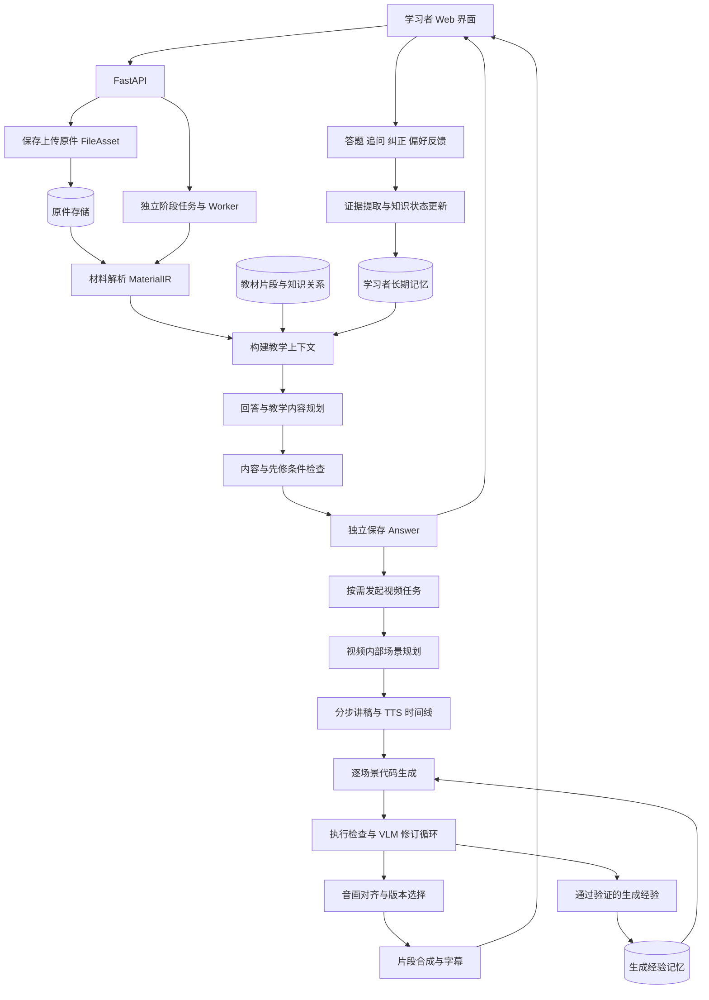
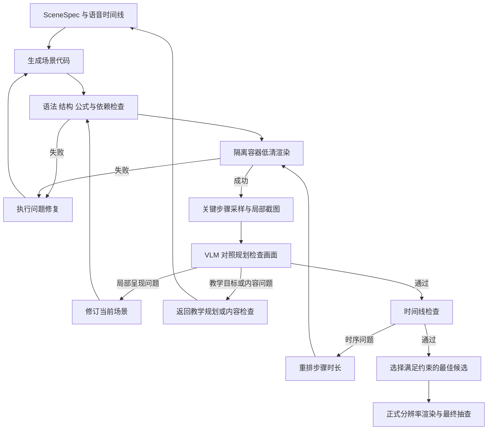

# 面向长期学习记忆的个性化可视化教育智能体 技术栈与整体设计

设计日期：2026年10月17日

接口边界更新：2026年10月23日。后续上传、解析、回答与视频的公共契约及 v2 API 以[模块解耦与接口设计](模块解耦与接口设计.md)为准；当前 MVP 代码与接口保持原语义。

项目按[总体开发计划](总体开发计划.md)的六个能力阶段完成申报书目标，各阶段设计见[项目文档目录](README.md)。第一阶段仅完成从文本输入到动画输出，包括执行纠错与 VLM 检查，内部任务见[第一阶段任务清单](第一版开发计划.md)。本文件提供完整系统的技术候选与跨阶段设计；技术在对应阶段验证后再引入，记忆与配音等不构成第一阶段的依赖。

第一阶段具体规则以[第一版 MVP 设计](MVP设计.md)为基线：输入仅为一个 text 字符串，时长、质量与运行预算由应用配置控制，页面轮询任务状态。下文更完整的交互和服务技术按对应后续阶段引入。

本方案依据《图灵创新探索项目申报书》设计，目标是构建一个能够持续记录学习证据、据此调整讲解，并生成动画与语音的可运行系统。推荐采用 Python 与 LangGraph 组织生成流程，以 PostgreSQL 保存学习记忆，以 Manim 生成动画，并复用 Paper2Manim 的逐场景渲染纠错和 VLM 复查思路。

项目的研究重点是长期学习记忆如何改变教学决策，以及这种改变能否帮助学习。动画生成经验记忆是支撑生成稳定性的另一个模块。两类记忆应独立建模、分别评测。

本文给出的是拟实施的设计。阶段范围、评分门槛与时间安排是建议，尚未经过本项目的实验验证。

## 1 长期需求与分期边界

申报书要求形成材料输入、内容理解、长期记忆、个性化规划、动画与语音生成、Web 交互、反馈更新的完整流程，并提供源代码、说明、演示和测试材料，为论文投稿或专利申请提供支撑。

内容领域建议选择大学数学中的一个小范围，例如线性代数的向量、线性变换、特征值与特征向量。V1 仅支持文本输入和动画生成；文本型 PDF、DOCX、语音和学习记忆按后续版本逐步接入。扫描件、复杂手写公式和跨学科内容放到更后续扩展。

| 申报书要求 | 系统设计 | 可以检查的交付结果 |
|---|---|---|
| 长期学习记忆 | 学习事件、知识状态、来源与版本分开保存 | 换会话后仍能检索；错误记忆可以更正 |
| 个性化讲解 | 规划中记录教学决策及其证据 | 同一材料针对不同知识状态产生合理差异 |
| 动画质量 | 执行检查、内容检查、VLM 复查 | 保留错误、修订与最终版本记录 |
| 动画与语音协同 | 讲解步骤与统一时间线 | 每句话可以定位到相应画面 |
| 局部调整 | 场景独立产物与依赖追踪 | 修改一个片段时复用未受影响的内容 |
| Web 交互 | 上传、进度、播放、追问、小测、记忆纠正 | 可运行的完整演示流程 |
| 研究验证 | 固定材料、学习历史与对照实验 | 可复现实验和评测报告 |

## 2 完整系统候选技术栈

完整系统可采用模块化单体后端，另设异步任务 Worker 与隔离渲染容器。V1 则先用命令行、单 Worker、本地产物与简单 Web 页面完成生成流程；本表中的数据库、检索与分布式队列等在对应后续模块需要时再引入。

| 层次 | 完整系统候选 | 选择理由与使用边界 |
|---|---|---|
| 后端语言与依赖 | Python 3.12、uv | 与参考项目的 Python 兼容范围衔接；用锁文件固定依赖 |
| Web API | FastAPI、Pydantic 2 | API、输入校验、结构化生成结果与数据契约 |
| 数据访问 | SQLAlchemy、Alembic | 业务数据访问与数据库版本迁移 |
| 智能体流程 | LangGraph 1.x | 明确表达分支、循环和检查点；规划与检查均为有边界的节点 |
| 后台任务 | Celery、Redis | API 提交任务，Worker 执行；数据库保存业务状态与最终结果 |
| 持久化 | PostgreSQL、pgvector | 在同一数据库维护用户、学习证据、知识关系和向量检索 |
| 知识关系 | 关系表、必要时使用 NetworkX | 首版管理有限领域的一至两跳先修关系，暂不增加图数据库服务 |
| 向量表示 | BGE-M3、sentence-transformers | 作为中文与中英混合材料的初始候选；首版先用稠密向量，实际效果另行评测 |
| 材料解析 | PyMuPDF、python-docx | PDF 页码与文本块、DOCX 段落与表格；复杂公式保留原图与来源位置 |
| 模型接入 | 按角色配置的 LLM 与 VLM API 适配层 | 规划、编码、复查、记忆提取分别配置；用小型实测集确定具体模型与版本 |
| 动画 | Manim Community、Cairo、LaTeX、dvisvgm | 首轮复现先沿用参考项目固定的 Manim 0.20.1，确认基线后再评估升级 |
| 音视频 | Azure Speech SDK 作为首个 TTS 适配器、FFmpeg、ffprobe | 获取语音及边界时间，测量音频时长，拼接视频与字幕 |
| 前端 | React、TypeScript、Vite、Tailwind CSS、原生 video | 支持材料、播放器、对话、小测、记忆来源与纠正界面 |
| 进度推送 | SSE | 首版主要需要服务器向浏览器推送任务状态 |
| 产物存储 | 本地目录与数据库元信息 | 保存视频、音频、代码、抽帧和报告；后续可替换为 S3 兼容存储 |
| 部署 | Linux、Docker Compose；Windows 开发采用 WSL2 | 固定字体、LaTeX 和渲染环境；避免直接依赖参考项目的 POSIX 资源限制代码在 Windows 运行 |
| 质量与实验 | pytest、Ruff、结构化运行日志 | 检查状态更新、任务恢复、产物一致性与实验复现 |

LangGraph 适合此类有状态、长流程编排，但它的运行检查点不等于学习者长期记忆。业务记忆仍应保存到明确的数据表中。[LangGraph 文档](https://docs.langchain.com/oss/python/langgraph/overview)

pgvector 可以让向量与关系数据一起存储，并支持精确与近似检索。首版数据量较小时优先使用带用户过滤的精确检索，经过测量再引入近似索引。[pgvector 项目说明](https://github.com/pgvector/pgvector)

BGE-M3 支持多语言检索，适合作为候选；这不代表它在本项目中文教材上的效果已经得到验证。每个索引记录模型标识、版本与向量维度，替换模型时重新建索引。[BGE-M3 模型说明](https://huggingface.co/BAAI/bge-m3)

模型层先使用托管 API，避免把大模型训练纳入首版。具体厂商暂不写进业务逻辑：先用同一批中文公式讲解、Manim 编码和画面问题样例比较质量、调用成本与延迟，再固定实验配置。应用中的多个角色不要求使用多个不同模型。

## 3 整体架构



这里包含两个闭环。

上传、解析、回答和视频分别通过 FileAsset、MaterialIR、Answer、VideoResult 交换已保存的结果。原生文件上传和本地解析回退封装在解析模块内，厂商与模型配置不进入下游业务契约。用户可以只获取回答，也可以复用同一回答生成多个视频。

学习闭环是“学习证据 → 知识状态 → 教学规划 → 学习交互 → 新证据”。它回答接下来应该讲什么、讲多深、补充哪些背景。

生成闭环是“讲解规划 → 代码 → 渲染 → 检查 → 修订”。它回答讲解是否完整呈现、画面是否清楚、音画是否协调。

学习者记忆按用户隔离。生成经验库可以积累通用布局与 API 修复经验，但共享记录不得包含学习者身份、私人学习记录或未获授权的材料原文。

## 4 长期学习记忆

### 4.1 将公共知识与个人知识状态分开

领域知识层保存 Concept 及 prerequisite、part_of、related_to 等关系，记录教材依据和审核状态。首版在选定领域人工整理一份小型知识结构，模型只负责辅助对齐和提出候选关系。

个人学习层保存某个学习者与知识点之间的状态，包括掌握估计、误解候选、证据数量、最近观测时间与不确定性。教材中的事实、模型对学生的推断、学生自述与实际答题表现使用不同记录类型。

首版核心表建议为：

| 表 | 主要字段或职责 |
|---|---|
| concepts | concept_id、名称、别名、所属领域、来源 |
| concept_edges | 起点、关系类型、终点、来源、确认状态 |
| learning_events | user_id、事件类型、内容、时间、关联知识点、来源 |
| evidence_links | 事件与知识点的关联、证据类型、关联置信度、评分规则版本 |
| learner_concept_states | user_id、concept_id、掌握估计、不确定性、证据集合、状态版本 |
| memory_revisions | 更正、撤销、替代关系、原因、时间与操作者 |
| learner_preferences | 明确表达的语速、讲解深度等偏好及其来源 |
| generation_experiences | 可复用生成方案、失败原因、修复方式、验证结果 |

原始事件尽量追加保存，当前知识状态由有效事件推导。发生误判时，使原证据失效或补充纠正事件，重新计算状态，保留变更历史。

### 4.2 更新原则

一次提问只说明学生正在关注某个概念，通常不足以判定未掌握；一次视频观看也不足以判定掌握。正确答题、错误类型、提示使用情况和多次独立观测，才是更直接的学习证据。偏好反馈只更新偏好。

LLM 负责将交互转成候选结构，例如“可能混淆特征向量与任意向量”；确定性代码负责校验证据类型、来源、去重、状态迁移和数据库写入。对矛盾或不足的证据保持 uncertain 或 pending 状态，并可在下一轮安排诊断题。

掌握估计与估计置信度需要分别记录。记忆模块初期可以采用明确的证据权重和规则进行状态更新，保留后续替换为 BKT 等知识追踪模型的接口；在未校准之前，不把规则生成的数值称为真实掌握概率。

### 4.3 检索与快照

检索先确定当前知识点与必要先修节点，再读取该用户的相关知识状态、历史错误和讲解反馈，最后通过向量检索补充相关交互。相关性、证据可靠程度和时间均参与筛选。

每个任务保存 memory_snapshot_id。规划与质量检查使用同一份状态快照，避免生成过程中新的交互改变评判标准。快照保存引用和版本，不必复制整份个人历史。

用户身份由服务端认证上下文确定，检索与写入均强制限定 user_id；不能由模型生成的过滤条件决定访问哪个用户的数据。

## 5 个性化教学规划与统一中间表示

回答模块根据材料、本次目标与可用学习上下文生成可独立阅读的 Answer。视频模块消费确定版本的 Answer，内部再生成可校验的 LessonPlan、SceneSpec 和可执行动画。代码生成器不直接读取完整聊天历史后自由决定教学内容；回答的题设和结论在视频表达中保持不变。

建议统一定义以下数据契约：

| 对象 | 核心字段 | 主要用途 |
|---|---|---|
| FileAsset | 本系统资产标识、文件名、媒体类型、大小、内容摘要 | 独立保存原件和派生产物，不暴露厂商文件标识 |
| MaterialIR | 源文件、页码或段落、文本、公式、图像、知识点候选、解析置信度 | 保留内容来源 |
| LearnerContext | 记忆快照、目标知识点状态、先修缺口、误解候选、偏好 | 为规划提供有限上下文 |
| Answer | 材料引用、标题、正文步骤、派生 Markdown、来源引用 | 独立展示回答，作为视频生成的确定输入 |
| LessonPlan | 目标、讲解顺序、深度、需补背景、检查题、个性化决策与依据 | 表达教学意图 |
| SceneSpec | scene_id、目标、讲解步骤、视觉对象、公式、讲稿、约束、输入输出状态 | 约束动画生成与检查 |
| Timeline | step_id、句子、音频范围、动画事件、字幕范围 | 对齐声音与画面 |
| ReviewReport | 检查类型、问题位置、证据、严重程度、修订范围、版本 | 让修订有具体目标 |
| VideoResult | 回答引用、完整视频资产、字幕资产、步骤到场景及时间的映射 | 标识针对某一回答生成的完整视频 |

上述表格说明跨阶段概念；公共接口的字段、类型、默认值与约束以[模块解耦与接口设计](模块解耦与接口设计.md)为准。当前 schemas.py 中的 LessonPlan 与 SceneSpec 属于 MVP 契约，后续通过适配迁入视频模块，不能直接当作新的 Answer。

每项个性化决策保存 decision、concept_id、evidence_ids 和 planned_effect。例如：

```json
{
  "scene_id": "eigenvector_intro",
  "objective": "理解特征向量的变换结果仍在其张成的直线上",
  "memory_snapshot_id": "ms_001",
  "personalization": [
    {
      "decision": "先补充矩阵对平面向量的作用",
      "concept_id": "linear_transformation",
      "evidence_ids": ["quiz_17", "correction_4"],
      "planned_effect": "增加单位基向量与网格变换步骤"
    }
  ],
  "steps": [
    {
      "step_id": "s1",
      "narration": "先观察矩阵如何改变平面中的向量。",
      "visual_action": "展示单位基向量及变换后的网格",
      "required_concepts": ["matrix_vector_product"]
    }
  ],
  "constraints": {
    "preserve_definition_conditions": true,
    "do_not_infer_mastery_from_question_alone": true
  }
}
```

例如同样解释特征向量，对先修知识不足的学习者补充矩阵作用与网格变换；对已熟悉线性变换的学习者直接比较一般向量与特征向量，再进入方程。差异应能对应到有效学习证据。

在生成前检查关键定义、适用条件、公式来源和先修依赖。可用 SymPy 或数值检查辅助验证具体代数关系，但不能将它视为任意数学论证的通用验证器。

## 6 Paper2Manim 的复用范围

参考基线为提交 `16191b602e98dc3cc6172014ba6290bef337d1e8`，提交时间为2026年10月15日。使用固定提交链接，避免之后主分支更新导致实现说明漂移。

参考项目将场景拆成独立子图，包含代码生成、渲染、执行错误修复、抽帧、VLM 检查与视觉修订。默认最多两次执行纠错和两次视觉修订；抽取四张均匀分布的画面；VLM 使用逻辑流程、布局遮挡和准确性三项评分；最终选择评分最好的可渲染版本。其经验记忆保存成功示例和已验证的修复教训。[架构说明](https://github.com/jwj1342/Paper2Manim/blob/16191b602e98dc3cc6172014ba6290bef337d1e8/docs/architecture.md)、[场景子图](https://github.com/jwj1342/Paper2Manim/blob/16191b602e98dc3cc6172014ba6290bef337d1e8/paper2manim/graphs/scene_graph.py)、[VLM 检查实现](https://github.com/jwj1342/Paper2Manim/blob/16191b602e98dc3cc6172014ba6290bef337d1e8/paper2manim/agents/vlm_scene_reviewer.py)

| 参考模块 | 在本项目中的处理 |
|---|---|
| graphs/scene_graph.py | 保留逐场景循环、预算和候选版本管理思路，适配新的 SceneSpec |
| agents/vlm_scene_reviewer.py | 扩展为带步骤、时间与对象定位的结构化检查 |
| agents/visual_revision_agent.py | 根据问题修改当前场景，并约束教学目标和数学含义 |
| utils/frame_sampler.py | 先复现四帧基线，再加入关键步骤采样与局部放大图 |
| sandbox/render.py | 复用错误分类与日志思路；执行迁入隔离的 Linux 渲染容器 |
| EMB 相关模块 | 作为可选生成经验库，独立于学习者知识状态 |
| storyboarder 与 generation 主图 | 需要接入学习记忆、教学规划和统一时间线，改动较大 |

建议先复现上述固定提交的少量场景，记录可运行环境与样例，再通过适配层接入自己的系统。这样保留一个可比较的参考基线，也能避免长期学习记忆与参考项目的生成经验逻辑相互缠绕。

## 7 本项目的检查与修订循环



### 7.1 检查分工

执行检查负责 Python 语法、场景结构、API 使用、LaTeX、缺失资源、超时和产物有效性。内容检查负责讲稿与来源是否一致、定义条件是否保留、可验证计算是否正确。VLM 主要负责画面是否表达了目标步骤，以及文字、布局、遮挡和视觉对应是否清楚。

静态画面不能证明整个动画过程正确，也无法直接检查真实语音。音画同步主要依据 Timeline、音频边界和动画事件日志进行检查；动态问题可以对关键变换前、中、后追加采样，必要时检查短片段。

VLM 可以判断是否呈现了要求的补充步骤，但不能据此证明学生学会了。教学效果需要答题表现等独立证据。

### 7.2 VLM 输入与反馈

输入包括当前 SceneSpec、对应教材片段与公式、个性化约束、带时间标签的画面，以及必要的局部高分辨率截图。只提供与该场景有关的学习状态摘要。

四帧均匀采样作为参考基线；本项目计划加入事件采样，例如公式完成后、关键对象出现后、推导变换前后。对长场景先拆分，避免将过多小图缩成不可辨识的拼图。参考项目的采样实现见[frame_sampler.py](https://github.com/jwj1342/Paper2Manim/blob/16191b602e98dc3cc6172014ba6290bef337d1e8/paper2manim/utils/frame_sampler.py)。

每条问题输出 scene_id、step_id、frame_time、object_id、issue_type、severity、evidence、suggested_fix 和 repair_scope。没有可靠定位时允许相关字段为空，不能编造时间或坐标。

### 7.3 终止与版本选择

初始配置可以沿用最多两次执行修复、两次视觉修订；另外限制每场景总耗时与模型调用预算。返回教学规划的次数也应受限。服务超时与输出解析失败单独重试，不应自动改动原本有效的画面。

通过条件先检查硬约束：必须可播放、关键教学步骤完整、没有尚未解决的严重内容或公式问题、时间线一致。随后才比较视觉评分。评分阈值在固定开发集上校准，不直接照搬参考项目的平均分门槛。

只在同一 SceneSpec 和 Timeline 版本的合格候选之间比较分数。教学目标或讲稿变化后，旧候选不能凭旧评分直接入选。每个候选将代码、音频、视频、截图、报告及其版本绑定。

保留历史上合格的最佳版本，后续失败不覆盖它；但如果没有满足硬约束的版本，将任务标为待检查或生成失败，并展示已完成片段和文字讲解。检查服务不可用时标记未完成检查，不能记录为质量通过。

## 8 语音同步与局部修改

语音与动画共享 step_id，生成顺序建议为：

1. 固定讲解步骤、符号与每步讲稿。
2. 将数学公式转成适合朗读的文本，保留朗读文本与展示公式的映射。
3. 按句或短步骤合成语音，记录实际时长与可用的词句边界。
4. 根据语音边界安排对象出现、高亮、变换和停顿，生成场景代码。
5. 检查时间线并合成片段、字幕与最终视频。

Azure Speech 提供 WordBoundary 等事件，用于取得文本与音频的对应位置；实际可用事件依服务配置与所选声音验证。[语音合成文档](https://learn.microsoft.com/en-us/azure/ai-services/speech-service/how-to-speech-synthesis)

没有可靠边界时，语音模块初期按句合成并用 ffprobe 测量时长即可，不必立即增加 ASR 对齐服务。若讲解动作无法在音频时长内清晰完成，应添加停顿或调整讲稿，不能无限压缩动画。

局部修改以场景为主要单位，场景边界尽量自包含。保存 SceneSpec → 讲稿 → 音频 → 时间线 → 代码 → 视频 → 合成清单的依赖关系。更改讲稿就重建相应音频与时间线；只改布局时可以复用音频，但仍需检查时长。

缓存键至少包含材料内容、规划与步骤版本、相关记忆快照或决策依赖、模型与提示词版本、TTS 配置、渲染环境和质量配置。个人产物按用户隔离。用户要求“把第二段讲慢一点”时，重新生成受影响的片段并更新全局字幕偏移；若共享符号或场景边界状态变化，则扩大重建范围。

## 9 后端任务与 Web 交互

### 9.1 任务状态

建议状态包括 queued、parsing、planning、synthesizing、rendering、reviewing、assembling、completed、needs_review、failed 和 canceled。状态变化由后端保存并通过 SSE 推送。

Celery 负责排队和执行，LangGraph 负责教学与生成节点之间的流转。Worker 重启后从持久化检查点恢复；节点使用幂等键，避免任务重复执行时重复写学习事件或重复登记产物。Redis 不作为长期记忆或唯一任务记录。[Celery 文档](https://docs.celeryq.dev/en/stable/getting-started/introduction.html)

### 9.2 前端主要页面

第五阶段的完整 Web 设置材料输入、讲解播放和学习记忆三个主要视图。播放页面组合视频、章节步骤、同步字幕、追问入口与可选小测；记忆页面展示知识点状态、来源与更正入口。讲解旁可以显示简短依据，例如“根据上次诊断题，补充矩阵乘向量的几何解释”。

进度使用真实阶段与完成场景数。错误时显示可理解的原因与重试操作，详细模型日志保存在开发与实验界面。

## 10 部署与资源控制

第一阶段使用本地产物和串行任务，第三阶段引入数据库，第五阶段按交互与调度需求完善 frontend、api 和 worker。Redis 与专用队列仅在实际需求明确时引入，Worker 按需启动独立渲染容器。模型调用与渲染分别设置并发上限，再根据实际内存和延迟调整。

渲染容器使用固定镜像，安装 Manim、LaTeX、FFmpeg 和中文字体。容器内不注入模型密钥，不挂载用户主目录，默认禁网、非 root、限制 CPU、内存、进程数与运行时长，仅允许写当前任务目录。静态代码检查作为额外检查，不能代替执行隔离。

参考项目的 renderer 使用 resource.setrlimit 和 preexec_fn，属于 POSIX 实现，因此本项目在 Windows 主机上优先使用 WSL2 与 Linux 容器。[渲染实现](https://github.com/jwj1342/Paper2Manim/blob/16191b602e98dc3cc6172014ba6290bef337d1e8/paper2manim/sandbox/render.py)

申报书预算没有单列模型 API、TTS 与云算力费用。实施前需要明确现有设备、可用服务额度与实验预算，并在运行记录中按任务统计 token、模型调用次数、TTS 使用量、渲染时长和产物体积。先获得一批真实样例的成本，再估计评测规模。

## 11 评测设计

### 11.1 首先验证记忆是否正确工作

构造包含首次学习、重复答题、追问、相互矛盾的反馈、显式纠正、跨会话恢复的学习历史。检查证据来源、状态更新、撤销、更正和用户隔离。模拟记录可以检验机制，不能单独支持真实学习效果结论。

### 11.2 分别评测记忆与 VLM

记忆实验建议设置四个对照：无历史记忆、历史摘要、非结构化向量记忆、本项目的结构化学习记忆。各组使用相同材料、模型、提示词主体和生成预算，控制可用上下文预算；比较先修补充、误解针对性、决策证据有效性与错误个性化率。

VLM 实验固定记忆与教学规划，比较仅执行纠错、执行纠错加四帧检查、执行纠错加关键步骤采样。比较独立人工评审的画面错误率、内容遗漏率、音画对应、修复轮数、耗时与成本。若声称某个具体检查机制有收益，应增加对应消融，避免把多项改动的效果合在一起解释。

单次运行的学习记忆使用固定快照。生成经验库在各实验组使用相同冻结快照或统一关闭，避免跨组积累造成不公平。开发集用于调参，测试集与学习者划分独立，不能将测试反馈写回后继续报告同一测试结果。

### 11.3 学习效果

有真实学习者条件时，再做前测、即时后测与延迟测验；报告样本、分组方式和差异的不确定性。若只有模拟记录与专家评审，结论限定在系统运行、个性化合理性与内容质量。系统内部 VLM 评分用于修订，不能同时充当唯一最终评测指标。

## 12 开发顺序与里程碑

整体按以下六个能力阶段推进，具体边界与验收见[总体开发计划](./总体开发计划.md)。申报书执行期为一年半，具体工期在基础流程取得真实开发进度后细化。

| 阶段 | 主要能力 | 完成条件 |
|---|---|---|
| 一 基础动画生成 | 文本到动画与检查修订 | 自动生成完整视频，保存代码、候选和检查记录 |
| 二 完整视听讲解 | 多种材料与动画语音协同 | 材料能转成音画基本同步的讲解视频 |
| 三 长期学习记忆 | 证据、知识状态、关系与纠正 | 跨会话保存、更新、检索和纠正可运行 |
| 四 记忆驱动的个性化规划 | 依据学习状态调整教学决策 | 相同材料对不同知识状态产生有依据的讲解差异 |
| 五 交互集成与局部更新 | Web、反馈回写与片段修改 | 形成完整学习交互闭环，并复用未受影响的片段 |
| 六 评测优化与成果交付 | 系统测试、对照与研究成果 | 完成交付材料及论文投稿或发明专利申请 |

第一阶段验收聚焦输入到动画。后续集成演示覆盖同一道题在不同学习历史下的讲解差异、学习反馈更新后下一会话的调整，以及局部片段修改时对既有合格产物的复用。

## 13 建议代码结构

```text
manimagent/
  apps/
    web/                    React 前端
    api/                    FastAPI 路由与认证
    worker/                 后台任务入口
  src/
    contracts/              MaterialIR LessonPlan SceneSpec Timeline ReviewReport
    ingestion/              PDF DOCX 与来源定位
    knowledge/              知识点与先修关系
    learner_memory/         学习事件 证据 状态更新与检索
    generation_memory/      通用生成经验
    planning/               个性化教学规划与内容检查
    generation/             Manim 生成与修订
    review/                 执行检查 VLM 检查与时间线检查
    narration/              朗读文本 TTS 与语音边界
    rendering/              容器调度与渲染协议
    workflows/              LangGraph 主图与场景子图
    artifacts/              版本 缓存 与合成清单
    providers/              模型 TTS 与嵌入服务适配
  configs/                  模型角色 预算 与实验配置
  experiments/              材料清单 学习历史 对照与评测
  tests/
  docker/
  docs/
```

## 14 参考资料

- 用户提供的《图灵创新探索项目申报书》，本地 DOCX，作为项目目标与交付范围依据。
- [Paper2Manim 固定提交](https://github.com/jwj1342/Paper2Manim/tree/16191b602e98dc3cc6172014ba6290bef337d1e8)，作为生成与检查流程的参考。
- [Paper2Manim 依赖声明](https://github.com/jwj1342/Paper2Manim/blob/16191b602e98dc3cc6172014ba6290bef337d1e8/pyproject.toml)，作为首轮复现的环境依据。
- [FastAPI](https://fastapi.tiangolo.com/)、[LangGraph](https://docs.langchain.com/oss/python/langgraph/overview)、[Celery](https://docs.celeryq.dev/en/stable/getting-started/introduction.html)。
- [pgvector](https://github.com/pgvector/pgvector)、[BGE-M3](https://huggingface.co/BAAI/bge-m3)。
- [Manim 安装文档](https://docs.manim.community/en/stable/installation.html)、[Azure Speech 语音合成](https://learn.microsoft.com/en-us/azure/ai-services/speech-service/how-to-speech-synthesis)。
- [PyMuPDF](https://pymupdf.readthedocs.io/en/latest/)、[python-docx](https://python-docx.readthedocs.io/en/latest/)。
