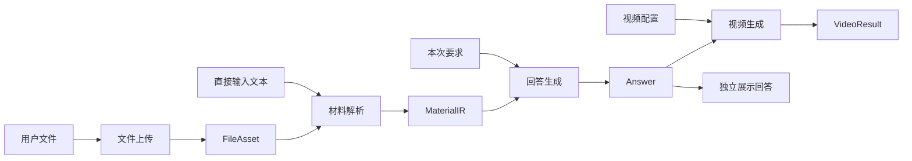

# 上传、解析、回答与视频的模块解耦及接口设计

更新日期：2026年10月23日

状态：接口设计，尚未实现。本文确定后续开发的数据边界和接口；当前 0.1.0 的纯文本入口仍以[第一版 MVP 设计](MVP设计.md)为准。

## 1 设计目标与边界

系统分为文件上传、材料解析、回答生成、视频生成四个模块。前三个模块的结果可以单独查看和复用，用户可以只获得回答，也可以将已有回答转换为视频。初期在同一个后端中按模块实现，通过接口组织协作；是否拆成独立服务由实际运行需求决定。



| 模块 | 接收 | 产出 | 职责边界 |
|---|---|---|---|
| 文件上传 | 文件字节、文件名 | FileAsset | 保存原件和元信息，不调用模型 |
| 材料解析 | 文件引用或文本、解析配置 | MaterialIR | 提取并整理材料，保留内容与来源，不回答用户问题 |
| 回答生成 | MaterialIR 列表、用户要求、回答配置 | Answer | 生成可独立阅读的完整回答，不生成 Manim 代码 |
| 视频生成 | 确定版本的 Answer、视频配置 | VideoResult | 分镜、讲稿、动画、检查及合成，不重新决定回答结论 |

向 LLM 厂商上传文件是材料解析模块内部的操作，与用户向本系统上传原件分开。更换厂商、模型或解析方式，不改变下游接收的 MaterialIR。

长流程编排器可以顺序调用四个模块，也允许停在任意一个已经完成的阶段。模块通过已保存的结果标识传递依赖，不依靠上一次模型对话或内存中的临时对象。

## 2 公共数据约定

- 公共结果均为可序列化 JSON，携带 `schema_version`，初始值为 `"1.0"`。破坏性字段或语义变化需要新契约版本，未知版本明确拒绝。
- `file_id`、`material_id`、`answer_id`、`video_id` 和 `job_id` 由服务端生成，为不透明字符串。每个结果 ID 对应不可变内容；修改、重新解析或重新生成产生新 ID。
- 文件及派生图片、音视频通过本系统的资产 ID 引用。公共契约不包含宿主机路径、厂商文件 ID、访问密钥或完整模型配置。
- 时间采用带时区的 ISO 8601 字符串。可选字段省略时使用声明的默认值；没有默认值的可选结果字段使用 `null`。数组无内容时为 `[]`。
- 每次执行保存输入引用、配置快照、实现版本、实际处理路径及使用量。用户配置通过服务端的 `profile_id` 引用，执行时解析为固定快照。
- 所有引用均由服务端检查存在性与可访问性。来源位置无法可靠确定时允许为空，不补造页码、坐标或时间戳。

### 2.1 FileAsset

FileAsset 同时用于上传原件和登记派生文件。文件上传成功仅表示原件已保存，不表示能够解析。

| 字段 | 类型 | 规则 |
|---|---|---|
| schema_version | string | 必填，`"1.0"` |
| file_id | string | 必填，资产标识 |
| filename | string | 必填，用于展示，不作为存储路径 |
| media_type | string | 必填，服务端确认的媒体类型 |
| size_bytes | integer | 必填，非负字节数 |
| sha256 | string | 必填，文件内容摘要，用于完整性与复用判断 |
| created_at | string | 必填，登记时间 |

下载使用 `GET /api/v2/files/{file_id}/content`，无需在结果中保存可能过期的外部链接。

### 2.2 MaterialIR

本文统一使用 `MaterialIR` 表示解析结果，与阶段设计中的同名对象一致。一个解析请求产出一个 MaterialIR；多个文件在其中分别保留来源。

| 字段 | 类型 | 规则 |
|---|---|---|
| schema_version | string | 必填，`"1.0"` |
| material_id | string | 必填，不可变解析结果标识 |
| source_file_ids | string[] | 必填；直接文本输入时为空 |
| blocks | MaterialBlock[] | 必填，按材料内阅读顺序组织，至少一个内容块 |
| warnings | Notice[] | 必填；记录缺失、不确定或未覆盖内容 |
| created_at | string | 必填，结果创建时间 |

MaterialBlock 的公共字段：

| 字段 | 类型 | 规则 |
|---|---|---|
| block_id | string | 必填，在 MaterialIR 内唯一 |
| kind | enum | `heading`、`text`、`formula`、`table`、`image` |
| content | string | 必填；标题或正文为文本，公式为 LaTeX，表格为 Markdown，图片为描述；无可靠识别内容时允许为空 |
| asset_ids | string[] | 必填；关联原图或裁剪图等本系统资产 |
| source | SourceLocation | 必填，定义见下文 |
| review_state | enum | `unverified`、`verified`、`needs_review`；默认 `unverified` |

SourceLocation 包含 `input_index`（对应 ParseRequest.inputs 中从 0 开始的位置）、`file_id`（直接文本输入为 `null`）、`locator` 和 `verification`。`locator` 为可空对象，可包含从 1 开始的 `page`、`slide`、`paragraph`、`line_start`、`line_end`，或非负的 `start_seconds`、`end_seconds`；只填写适用于该来源的字段。`verification` 为 `verified`、`unverified` 或 `unavailable`，区分可靠定位、模型给出的待核对定位和无法定位。

Notice 统一为 `{code, message, block_ids}`；无法关联到特定块时 `block_ids` 为 `[]`。`review_state` 记录内容核对情况，来源的 `verification` 仅记录位置可靠性，两者独立。模型成功返回 JSON 本身不能使内容变成 `verified`。

解析记录保留选择范围及覆盖情况。处理预算不足时不得静默截断；关键区域缺失或关键公式存在歧义时，任务进入 `needs_input` 或 `needs_review`，尚未完成的解析结果不作为成功结果供回答模块消费。

### 2.3 Answer

Answer 是可独立使用的回答，与动画类名、画面布局、渲染分辨率等实现细节无关。

| 字段 | 类型 | 规则 |
|---|---|---|
| schema_version | string | 必填，`"1.0"` |
| answer_id | string | 必填，不可变回答标识 |
| material_ids | string[] | 必填，至少一个来源材料标识 |
| derived_from_answer_id | string \| null | 必填；编辑或修订时引用旧回答，首次生成为 `null` |
| title | string | 必填，回答标题 |
| instruction | string | 必填，本次用户要求 |
| steps | AnswerStep[] | 必填，至少一个，按讲解顺序排列 |
| markdown | string | 必填，由 title 和 steps 的内容按确定规则生成 |
| warnings | AnswerNotice[] | 必填，保留回答中仍需注意的限制 |
| created_at | string | 必填，结果创建时间 |

AnswerStep 为 `{step_id, title, content, source_refs, example_notes}`：`step_id` 在回答内唯一；`content` 为可含 LaTeX 的 Markdown；`source_refs` 为 `{material_id, block_id}` 数组；`example_notes` 为字符串数组，说明系统自行选择的演示例子。没有来源的演示内容允许空引用，并需明确说明其性质。

AnswerNotice 为 `{code, message, step_ids, source_refs}`，使用带 material_id 的来源引用避免多材料中的 block_id 混淆；无定位的数组为 `[]`。

`steps` 是回答正文的唯一事实来源。`markdown` 按“一级标题为 title；每个步骤依次生成二级标题、正文及非空的演示例子说明”派生，避免完整回答与结构化步骤各自维护后发生冲突。来源索引根据 source_refs 单独展示。

用户编辑回答时提交结构化步骤，服务端校验引用并重新生成 markdown，以新 answer_id 保存。视频始终引用某个确定的 answer_id，已有视频不随回答编辑而改变。

### 2.4 VideoResult

| 字段 | 类型 | 规则 |
|---|---|---|
| schema_version | string | 必填，`"1.0"` |
| video_id | string | 必填，不可变视频结果标识 |
| answer_id | string | 必填，本次消费的回答版本 |
| video_asset_id | string | 必填，已检查并登记的完整视频资产 |
| subtitle_asset_id | string \| null | 必填，无字幕时为 `null` |
| duration_seconds | number | 必填，实际时长，大于 0 |
| step_mapping | object[] | 必填，每项为 `{step_id, scene_ids, start_seconds, end_seconds}` |
| report_asset_ids | string[] | 必填，检查报告等资产引用 |
| created_at | string | 必填，结果创建时间 |

VideoResult 只在完整视频生成成功时创建，任务状态统一由 Job 表达。失败场景、预览和日志可列在 Job 的诊断资产中，不伪装成完整视频。

step_mapping 必须覆盖 Answer.steps 中的所有 step_id，不能引用不存在的步骤；每项 scene_ids 非空，且 `0 <= start_seconds < end_seconds <= duration_seconds`。一个步骤对应不连续片段时，可以记录多项映射。

视频模块内部仍可使用 LessonPlan、SceneSpec、Timeline 和 ReviewReport。内部场景步骤增加对 Answer.step_id 的映射，允许一个回答步骤拆成多个场景；讲稿与画面可以调整表达，但必须保留题设、公式含义和结论。发现回答错误或无法完整覆盖时，返回待核对问题；如需修订回答，由上层显式调用回答模块并生成新版本。

## 3 模块调用接口

以下为逻辑接口签名，表示模块职责；具体同步或异步函数形式在实现时确定。

```text
upload_file(stream, filename, media_type) -> FileAsset
parse_material(request: ParseRequest) -> MaterialIR
generate_answer(request: AnswerRequest) -> Answer
save_answer_revision(request: AnswerRevisionRequest) -> Answer
generate_video(request: VideoRequest) -> VideoResult
```

文件流只进入上传模块。其他接口通过结果 ID 读取本系统保存的输入，不接受任意本地路径。

### 3.1 ParseRequest

| 字段 | 类型 | 规则 |
|---|---|---|
| inputs | ParseInput[] | 必填，至少一个，数组顺序表示材料顺序 |
| parser_profile_id | string \| null | 可选，默认 `null`，使用应用默认解析配置 |
| input_mode | enum | 可选，默认 `auto`；支持 `auto`、`native`、`local` |

ParseInput 是带 type 的互斥联合：

- 文件：`{type: "file", file_id, selection}`；selection 可省略，默认全文。支持 `{kind: "pages", start, end}` 或 `{kind: "slides", start, end}`，范围从 1 开始且包含两端，必须与实际文件类型匹配。
- 文本：`{type: "text", text}`；text 必须非空，保存原始文本供来源核对，按同一 MaterialIR 输出。

首版未提供范围选择的格式按全文处理，超出预算时提示缩小材料。不得声称支持尚未实现的任意区域或时间段选择。

input_mode 只控制文件输入；直接文本输入始终走文本规范化，不因 native 或 local 模式被拒绝。

### 3.2 AnswerRequest 与回答修订

| 字段 | 类型 | 规则 |
|---|---|---|
| material_ids | string[] | 必填，至少一个，只能引用完成的解析结果 |
| instruction | string | 必填，非空，本次讲解要求 |
| answer_profile_id | string \| null | 可选，默认 `null`，使用应用默认回答配置 |

材料的选取、必要上下文补充和教学内容规划属于回答模块。长材料先选取与要求有关的内容，同时保留定义、题设和依赖条件；材料不足时返回明确提示。

AnswerRevisionRequest 为 `{base_answer_id, title, instruction, steps, warnings}`。用户提交完整替换内容而非局部补丁，服务端继承原 material_ids 并设置 derived_from_answer_id。引用仍需属于这些材料。修改材料集合或要求模型重新推理时，重新提交 AnswerRequest。

后续学习者上下文和记忆快照通过新版本或可选字段扩展 AnswerRequest，解析模块与视频模块不直接读取学习者完整历史。

### 3.3 VideoRequest

| 字段 | 类型 | 规则 |
|---|---|---|
| answer_id | string | 必填，只能引用已保存的完整回答 |
| video_profile_id | string \| null | 可选，默认 `null`，使用应用默认视频配置 |

视频配置包含渲染质量、预算及可选的配音与字幕设置，也可以引用该阶段使用的模型配置。具体参数由配置契约维护，文件解析厂商配置不传入视频请求。

## 4 原生文件输入与本地解析路由

连接、模型绑定、角色配置、能力证据及调用适配接口详见[多 LLM 提供商接入设计](多LLM提供商接入设计.md)。文件解析回退由本节约束；调用重试与跨提供商切换分别在提供商接入层处理。

解析模块内部维护厂商适配器与本地解析器注册表。能力判断依据服务地址或适配器、API 类型、模型、文件格式、大小与页数限制，以及是否需要识别图片或图表。能力规则由适配器配置维护，记录规则版本，不写死在上传接口或视频模块中。

| 模式 | 行为 |
|---|---|
| auto | 已确认满足本次读取要求时使用原生文件输入，否则选择可用的本地解析路径 |
| native | 强制原生文件输入；未知或不支持时明确返回能力问题 |
| local | 强制使用应用自行组织的解析器，OCR 等识别组件按解析配置选择 |

自定义服务地址能力未知时，auto 默认选择本地解析；用户可通过服务端解析配置声明并验证其能力。local 控制解析路径，具体 OCR 或其他识别服务的使用由 parser_profile_id 对应配置明确声明。

```text
接收文件引用或文本
  → 读取解析配置与能力规则
  → 选择原生文件输入或本地解析器
  → 转换为统一内容块与来源结构
  → 检查覆盖情况、引用和关键内容歧义
  → 保存 MaterialIR 或返回需要处理的问题
```

原生路径可以要求模型输出结构化提取结果，但厂商返回的内容必须经过本系统校验和资产登记后才能成为 MaterialIR。不能只传出厂商 file_id 或依赖其会话继续存在。

auto 模式下，仅在适配器明确识别为当前文件输入能力不支持时回退。鉴权、配额和计费问题直接报告；超时与限流按固定预算重试；结构错误或内容不完整进入相应的校验失败或待核对状态。不得将所有 HTTP 400 或所有异常一律视为文件能力不支持。失败尝试、回退调用及模型使用量累计计入本阶段预算。

本地解析也必须满足本次读取要求。扫描件、图片或复杂公式需要 OCR 或其他识别能力时，通过可替换解析组件处理；缺少能力则给出提示。外部 OCR 或视觉模型调用需要由解析配置显式启用，原生与本地均失败时不提交缺失内容的成功结果。

解析与回答可以各自选择模型厂商。公开请求只携带 profile_id，厂商配置和密钥由服务端解析；所有厂商文件上传、格式转换与回退记录留在解析任务内部。

## 5 HTTP 接口

新增接口统一放在 `/api/v2`。现有 `/api/jobs`、任务查询与产物下载保持 0.1.0 语义，迁移前继续服务现有页面与 CLI。

| 方法与路径 | 请求 | 成功响应 |
|---|---|---|
| POST /api/v2/files | multipart/form-data，单个 file | 201，FileAsset |
| GET /api/v2/files/{file_id} | 无 | 200，FileAsset |
| GET /api/v2/files/{file_id}/content | 无 | 200，文件内容 |
| POST /api/v2/materials/parse | ParseRequest JSON | 202，Job |
| GET /api/v2/materials/{material_id} | 无 | 200，MaterialIR |
| POST /api/v2/answers | AnswerRequest JSON | 202，Job |
| GET /api/v2/answers/{answer_id} | 无 | 200，Answer |
| POST /api/v2/answers/revisions | AnswerRevisionRequest JSON | 201，新 Answer |
| POST /api/v2/videos | VideoRequest JSON | 202，Job |
| GET /api/v2/videos/{video_id} | 无 | 200，VideoResult |
| GET /api/v2/jobs/{job_id} | 无 | 200，Job |

上传多个文件通过多次上传取得 file_id，再在一个解析请求内组合。上传接口只依赖文件存储，不要求配置模型或启动渲染环境。回答服务不因 Docker、字体或 TTS 不可用而拒绝运行，各阶段分别检查自身依赖。

Job 字段：

| 字段 | 类型 | 规则 |
|---|---|---|
| schema_version | string | 必填，`"1.0"` |
| job_id | string | 必填，执行标识 |
| kind | enum | 内容任务为 `parse`、`answer`、`video`；提供商控制面检测扩展为 `probe` |
| status | enum | `queued`、`running`、`completed`、`needs_input`、`needs_review`、`failed`、`interrupted` |
| stage | string | 必填，模块内当前阶段；用于显示，不控制下游业务 |
| message | string | 必填，可直接展示的说明 |
| result | object \| null | 必填；completed 时为 `{type, id}`，内容结果 type 为 `material`、`answer` 或 `video`，检测结果扩展为 `probe_report`，其他状态为 null |
| error | Error \| null | 必填；需要处理的问题或失败原因，正常运行及完成时为 null |
| diagnostic_asset_ids | string[] | 必填，日志、预览、候选结果等可用资产 |
| created_at / updated_at | string | 必填，任务创建与更新时间 |

终态为 completed、needs_input、needs_review、failed 或 interrupted。需要补充或核对材料时，客户端读取诊断产物、修正输入后提交新的解析或回答任务；视频任务指出已有 Answer 的内容问题时，可以通过回答修订创建新版本再生成视频。恢复能力实现前，服务重启后的未完成任务标为 interrupted，不宣称自动恢复。

Error 为 `{code, message, retryable, details}`，details 是 JSON 对象，默认 `{}`，可记录相关 file_id、material_id、block_id 或 step_id。错误消息应说明可采取的动作，不能回显密钥。

请求未被接受时，HTTP 错误响应统一为 `{error: Error}`：格式无效为 422，引用不存在或不可访问为 404，请求体超过上传上限为 413，媒体类型不接受为 415，队列满为 429，阶段依赖不可用为 503。任务接受后发生的问题写入 Job，GET 查询本身仍返回 200。

首批错误码包括 `unsupported_file_input`、`parser_unavailable`、`source_incomplete`、`content_uncertain`、`invalid_reference`、`provider_auth_error`、`provider_quota_exceeded`、`provider_timeout`、`invalid_provider_response`、`budget_exceeded` 和 `render_failed`。适配器将厂商错误映射到这些业务错误，不向上游暴露厂商专属判断逻辑。

### 5.1 调用示例

示例中的 ID 为便于阅读的占位值。

```json
{
  "inputs": [
    {
      "type": "file",
      "file_id": "file_demo",
      "selection": {"kind": "pages", "start": 12, "end": 14}
    }
  ],
  "parser_profile_id": "parser_default",
  "input_mode": "auto"
}
```

解析完成后的 Job 返回 `result: {"type": "material", "id": "material_demo"}`。客户端可以展示解析结果，也可以独立发起回答请求：

```json
{
  "material_ids": ["material_demo"],
  "instruction": "解释特征向量的几何意义，保留材料中的矩阵和向量。",
  "answer_profile_id": "answer_default"
}
```

回答完成后得到 answer_demo。用户可以先阅读、修改或更换回答模型；只有需要视频时才提交：

```json
{
  "answer_id": "answer_demo",
  "video_profile_id": "video_default"
}
```

同一个 answer_id 可使用不同视频配置生成多个视频，均保留各自对原回答的引用。

## 6 存储、复用与失败隔离

原件、解析结果、回答、视频结果和任务记录分别持久化。存储实现初期可以使用本地文件与清单，公共接口只依赖资源 ID 与仓储接口。

复用判断以输入结果 ID 或文件内容摘要、选择范围、契约版本、实现版本和配置快照为依据。相同文件名不能作为复用依据；需要独立生成新候选时可直接创建新任务。自动缓存及请求幂等不属于首版接口承诺，客户端应保存已获得的 job_id，避免轮询期间重复提交。

| 操作或故障 | 保留和复用的结果 |
|---|---|
| 更换解析策略或解析模型 | 原件复用，创建新 MaterialIR |
| 修改问题或更换回答模型 | 已完成 MaterialIR 复用，创建新 Answer |
| 人工编辑回答 | 保留旧 Answer，保存新的 Answer |
| 调整视频配置或渲染失败后重试 | Answer 复用，创建新视频任务 |
| 原生文件接口不支持并回退 | 保留原件与失败记录，由解析模块决定本地路径 |
| 上游结果存在未解决的关键歧义 | 停在对应阶段，不自动启动下游生成 |

资源删除和跨用户共享接口后续单独设计。在引入删除前，作为其他结果来源的材料与回答应持续可读取，保证来源追溯。

## 7 与当前代码及阶段规划的衔接

当前 `GenerationRequest(text)`、`Agents.plan(text)` 与 `GenerationEngine` 是第一阶段的整体流程，尚未实现以上模块接口。本次仅确定设计，不将新字段加入现有请求，也不更改现有运行状态含义。

建议按以下顺序迁移：

1. 增加公共契约与结果仓储，先用纯文本贯通 MaterialIR → Answer，确保回答可以单独获取。
2. 将已有讲解规划、场景生成、隔离渲染、执行修复和视觉检查封装在视频模块内，使其消费 Answer，并建立 AnswerStep 与内部场景步骤的映射。
3. 加入独立上传接口和解析器注册表，接入原生文件能力判断、本地回退与诊断记录。
4. 加入 v2 阶段 API 与页面编排，分别展示解析、回答和视频状态。旧入口在适配完成前继续使用原流程。
5. 配音与字幕在视频模块内部按[第二阶段设计](stages/02-完整视听讲解.md)扩展。长期记忆与个性化上下文按第三、四阶段接入回答及教学表达规划边界。

关键验收情形：

- 未配置模型和渲染环境时，仍能上传并读取原件元信息；未配置渲染环境时，仍能解析和生成回答。
- 原生读取与本地解析可生成相同契约结构，下游无需知道所选厂商或解析方式。
- 能力不支持触发正确回退；鉴权、配额、超时和无效输出分别处理，并累计预算。
- 只生成回答即可结束；更换回答模型不重新上传或解析，视频重试不重新生成回答。
- 回答编辑后有新 ID，markdown 与 steps 一致，旧视频仍指向旧回答。
- 关键题设或公式无法确定时返回明确问题，未完成的结果不能进入后续模块。
- 多材料来源、直接文本来源、未知位置和不确定定位均能表达，引用校验拒绝不存在的材料或内容块。
- 视频步骤与原回答对应，内容问题能够返回明确的 answer_id 和 step_id，已有成功结果不会被失败重试覆盖。
- 当前 MVP API、页面和 CLI 在迁移期间保持可用。

[返回文档目录](README.md) · [第二阶段设计](stages/02-完整视听讲解.md) · [技术栈与整体设计](技术栈与整体设计.md)
