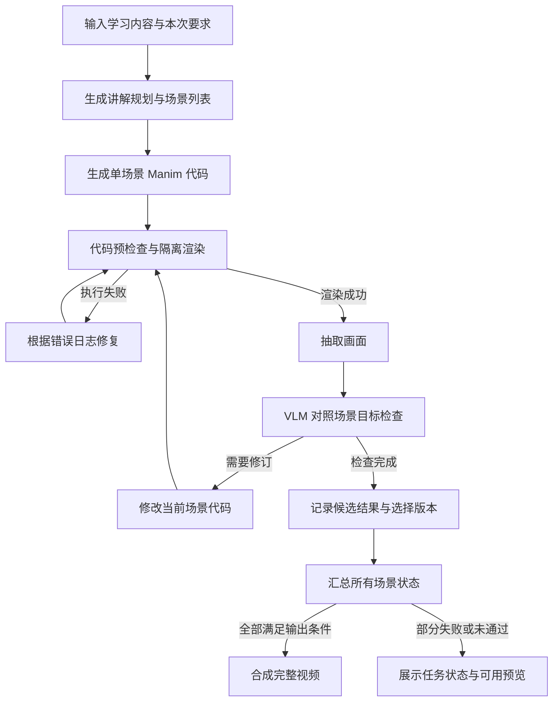

# 第一阶段任务清单

更新日期：2026年10月17日

本文从属于[项目总体开发计划](总体开发计划.md)的第一阶段，是[基础动画生成设计](stages/01-基础动画生成.md)的内部任务草案。下文六项均属于这一总体阶段，估计工期与验收门槛待实际基线验证后调整。

第一版具体输入、状态、接口与输出规则以[第一版 MVP 设计](MVP设计.md)为准，用户只提交一个纯文本字符串。

第一阶段目标是完成“输入学习内容 → 规划讲解 → 生成 Manim 代码 → 渲染 → 执行纠错与 VLM 检查 → 输出动画”的完整流程。V1 不实现学习者记忆或生成经验记忆，语音在总体计划的第二阶段接入。目前尚未开始代码实现。

## 1 第一版的范围

第一版以纯文本输入为起点，支持输入一个知识点、一道题或一段简短学习材料，并生成包含图形、公式和画面文字说明的 MP4。内容先限定在线性代数等适合二维 Manim 演示的小范围，输出由少量场景组成。

| V1 包含 | 后续阶段 |
|---|---|
| 文本输入与本次任务的讲解要求 | PDF、DOCX、扫描件等文件解析 |
| 结构化讲解规划与场景拆分 | 根据学习历史进行个性化规划 |
| Manim 代码生成与隔离渲染 | 生成经验检索与跨任务积累 |
| 执行错误诊断和有限次数修复 | 长期学习记忆、知识状态与知识图谱 |
| 抽帧、VLM 检查和有限次数视觉修订 | TTS 配音、音画同步 |
| 场景合成、视频预览和下载 | 多用户账户、复杂任务调度 |
| 当前任务的代码、日志、截图与候选版本 | 跨会话交互、小测和学习效果研究 |

运行记录用于检查、复现与定位错误；V1 不将其检索并注入后续任务。参考项目的 EMB 功能在 V1 关闭。

## 2 第一版技术选择

先完成命令行流程，再增加简单 Web 页面。核心生成逻辑独立于入口，CLI 与 Web 调用同一个生成服务。

| 模块 | 选择 |
|---|---|
| 语言与依赖 | Python 3.12、uv，提交依赖锁文件 |
| 数据契约 | Pydantic，定义请求、讲解规划、场景和检查结果 |
| 工作流 | LangGraph，表达逐场景的生成与修订循环 |
| 模型调用 | 文本模型与视觉模型适配器，角色和参数由配置文件指定 |
| 动画渲染 | Manim Community、Cairo、LaTeX、dvisvgm、中文字体 |
| 抽帧与合成 | FFmpeg、ffprobe |
| 结果保存 | 本地 runs 目录与 JSON 清单 |
| Web | FastAPI 与简单 HTML/JavaScript 页面 |
| 开发环境 | Windows 编辑，WSL2 与 Linux 容器执行渲染 |

首轮复现以 Paper2Manim 提交 `16191b602e98dc3cc6172014ba6290bef337d1e8` 及其 Manim 版本为参考。仅参考生成、渲染、错误修复和视觉检查模块，不把整个经验记忆系统接入 V1。

V1 不引入 PostgreSQL、pgvector、Neo4j、Redis 或 Celery。Web 阶段采用单 Worker 顺序处理任务，保存任务状态；中断任务可以手动重试，断点恢复和分布式调度以后再做。

## 3 生成流程

执行修复和视觉修订分别设次数限制，同时限制每个场景的总耗时和调用预算。起始可以各设置两次，开发中再根据样例调整。

每个候选绑定代码、视频、截图和检查报告。保留之前可用的候选，后续修订失败不能覆盖它；存在严重内容错误的候选不能作为通过结果。VLM 服务异常或输出无法解析时标记检查未完成，有限重试后保留待检查状态。

## 4 第一阶段内部任务

按一名开发者持续投入估计，V1 约需 4 至 6 个开发周。以下为顺序和工作量估计，实际进度以各阶段验收结果为准。

| 内部任务 | 估计工作量 | 主要任务 | 完成标志 |
|---|---|---|---|
| 1 环境与渲染验证 | 2至3天 | 固定依赖、字体与 LaTeX；手写场景渲染；复现参考项目的小样例 | 中文、公式、图形与基本变换均能渲染，MP4 可播放 |
| 2 输入到单场景 | 3至5天 | 定义输入与 SceneSpec；接入文本模型；生成代码并调用渲染器 | 输入一个知识点，自动得到单场景视频与代码 |
| 3 执行纠错 | 3至4天 | 识别 Python、Manim、LaTeX、超时等错误；将日志用于修复；保存候选与预算 | 可复现错误能够进入修复流程，无法修复时明确终止 |
| 4 VLM 检查循环 | 4至6天 | 抽帧、结构化检查、视觉修订、停止条件与候选选择 | 能发现并尝试修复遮挡、越界、内容遗漏等问题，完整记录前后结果 |
| 5 多场景合成 | 2至4天 | 讲解拆分、逐场景生成、统一尺寸帧率与风格、视频拼接 | 一个输入可生成约30至90秒、由少量场景组成的完整动画 |
| 6 简单 Web 与验收 | 3至5天 | 输入页面、任务状态、预览下载、失败提示；固定样例回归；整理说明 | 从页面提交到下载视频完整跑通，并形成验收记录 |

内部任务 2 结束时已有可演示的最小版本，内部任务 4 结束时形成“渲染—检查—修订”循环，六项任务完成后发布 V1，即完成总体计划的第一阶段。

### 内部任务 1 的具体准备

确认 WSL2、容器运行环境及可用模型接口；建立项目目录、配置模板和依赖锁文件；先渲染一个中文标题、一个公式和一个向量变换，再核对参考流程。此阶段就落实渲染代码与模型密钥的隔离，不将生成代码直接放进 API 服务进程执行。

### 内部任务 2 与任务 3 的数据契约

只定义当前流程需要的对象：

- GenerationRequest：仅含 text 的外部请求；本次讲解要求写在该文本中，时长与质量默认值来自应用配置。
- LessonPlan：讲解目标、关键步骤和场景列表。
- SceneSpec：场景目标、视觉对象、公式、动画步骤和画面文字。
- RenderResult：执行状态、错误类别、日志、视频路径与运行耗时。
- ReviewReport：检查状态、问题、依据、严重程度与修订建议。
- RunManifest：各场景状态、候选版本、最终选择与产物位置。

暂不创建学习者画像、记忆检索接口或空的知识图谱模块。未来加入记忆时，在生成 LessonPlan 之前增加上下文准备步骤即可。

### 内部任务 4 的检查重点

先使用固定四帧采样建立可比较的基线，重点检查文字可读性、遮挡越界、公式显示及目标步骤是否出现。发现固定采样遗漏关键过程后，再增加关键步骤前后的采样。

VLM 检查并不替代数学内容核对。首版样例范围保持可人工检查，对严重内容错误标记失败或待检查；使用人工抽查确认检查报告是否可靠。

### 内部任务 6 的最小页面

页面只需要输入区、生成按钮、当前阶段、场景完成数量、视频播放器、下载入口和失败提示。先不做完整聊天界面、用户中心或学习记忆视图。

## 5 V1 验收

建立约10个固定回归样例，覆盖向量加法、投影、矩阵变换、特征向量等内容；另保留少量未用于提示词调整的输入检查泛化表现。这里的样例用于工程验收，不作为论文实验结果。

验收逐项记录：

1. 是否在设定预算内完成，失败是否有明确类别。
2. 视频是否可播放，场景是否齐全，关键步骤是否遗漏。
3. 中文与公式是否正常，是否存在明显遮挡或越界。
4. 执行纠错与视觉修订是否实际触发并留下记录。
5. 是否保留合格的历史候选，最终代码与视频是否对应。
6. VLM 不可用、修订失败或部分场景失败时，页面状态是否准确。
7. 是否保存耗时、调用次数及可获取的使用量，便于后续估算成本。

“10个样例中至少8个能在预算内生成完整且人工检查无严重问题的视频”可以作为初始工程目标，最终门槛在基线跑完后确定。目前没有实测成功率。

## 6 后续版本

V1 完成后，按总体开发计划推进视听讲解、长期学习记忆、个性化规划、交互集成以及评测与成果提交。

当前开发的第一项工作是环境与参考流程复现；在完成中文、公式和基本变换的渲染验收后，再开始接入自动规划和代码生成。
