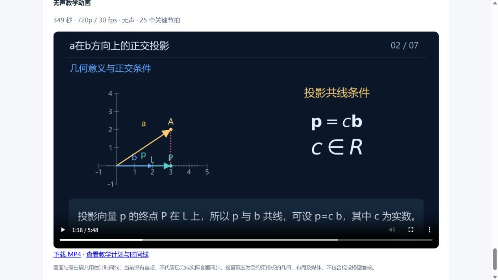
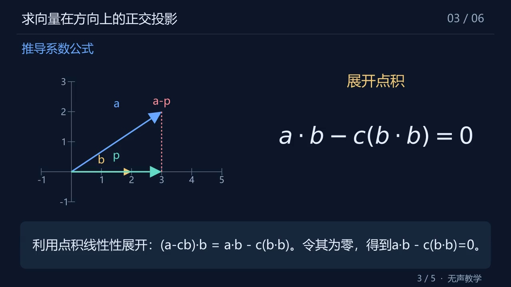

# 0.3.0 无声动画：真实测试与交付

日期：2026-10-30。模型：DeepSeek 官方 `deepseek-flash`。渲染：本机 Manim 0.20.1、PyAV 15.1.0、Microsoft YaHei；1280×720、30 fps、H.264／yuv420p，无音频。未使用 Docker、TTS、视觉模型或模型生成的 Python。

本轮实现了固定正文、整体切分、按场景分块生成、统一语义检查、阅读与旁白估计排程、本地模板渲染、媒体核验、播放与下载。已产出两份真实视频；本次开发包含失败、修复与续跑，不能把最终续跑耗时当作首次端到端交付时间。

## 实际结果

| 样例 | 场景／节拍 | 实测片长 | 完整解码 | 本次成功尝试耗时 |
|---|---|---:|---:|---:|
| 第一份向量投影 | 7／25 | 348.6 秒 | 10458 帧 | 198.55 秒，复用之前的分块，重新检查并渲染 |
| 桌面交付示例 | 6／24 | **294.8 秒（4分54.8秒）** | **8844 帧** | 186.78 秒，复用前次同版分块，补齐末场景、重新检查并渲染 |

题目均为 `a=(3,2), b=(2,0)`，要求从非零前提、垂足与正交关系推导公式，逐项计算，区分系数／有向标量投影／投影向量，并验证残差正交。正式正文由真实 writer 与 checker 生成；视频引用同一个不可变 answer_id 和正文摘要。

交付示例的六段实测约为 33.97、46.27、69.37、41.90、50.97、52.33 秒；合成 294.8 秒，没有片尾补长、全片降速或省略后半题。全部分块的渲染活动时间合计 108.61 秒，单进程树观测峰值内存约 453.46 MiB。这些只是本机样本，不是生产 P95 或 SLA。

网页验证了正文公式展示、双输出选择、已生成视频载入、原生播放、MP4 下载与时间线链接；实际播放时 readyState=4，播放时间递增，无浏览器控制台错误。API 单独验证 Range 请求返回 206，视频与源 Answer 摘要一致，全部教学单元有实际视频区间。

## 测试范围与失败证据

自动化：**112 passed，24.45 秒**。Ruff 检查、格式检查与两份前端脚本的 Node 语法检查通过。wheel 与 sdist 均通过无凭据、无源码路径依赖的独立环境安装，CLI、HTTP API、网页与静态资源可用；基础安装不需要动画依赖。

新增回归覆盖双输出同版本绑定、动画失败保留全文、仅重试视频不重答、人工修订补检、分块复用且重新检查、拒绝跨正文版本复用、Unicode 原文范围、公式／代码块完整性、非法坐标、退化向量、任意代码字段、危险公式、密钥与代理环境隔离、实测30秒不许冒充180秒，以及 MathText 命令前缀与通用提示词控制字符。

开发期间保存了 **9 次请求尝试，其中2次完成，7次因不同阶段问题停止**。它们跨多个代码／提示词迭代，且包含续跑，不是当前固定版本的独立随机评测集。累计实际模型调用 **32 次**，上游报告 **322132 输入／83486 输出 token**；失败请求与修复成本全部计入。

主要暴露并处理的问题：

| 实际失败 | 处理 |
|---|---|
| 初版计划解析为365.1秒，超过360秒硬范围 | 保留文字；显式给各分块阅读预算，并在共享修复额度内局部重新生成，未缩放时间或放宽门槛 |
| checker 的10000输出token全部用于推理，正文为空／截断 | 真实失败保留；DeepSeek 连接显式选择其已验证支持的 thinking=disabled，其他服务默认不发扩展参数 |
| 缺少独立标题单元 | 标题与其后正文组成可追溯单元；另加一次全局覆盖修正，仍由程序核验全部ID |
| 长公式未能在半屏保持可读 | 将公式和排版预检提前，局部修复；调整受控区域的合理宽度，仍保留字体／边距门槛 |
| 范数命令不被 MathText 识别、模型输出裸 frac | 规范化等价命令及明确的分式语法；未知命令仍失败，不执行外部LaTeX |
| 提示词示例反斜杠被转义成控制字符 | 修正运行提示词，并增加命令前缀及控制字符回归 |
| 公式白色背景、共线向量标签重叠、坐标单位比例不同 | 移除可信公式SVG背景，自动避让标签，坐标使用相同横纵单位比例；真实关键帧复核 |

## 交付与证据

- 桌面项目目录：`ManimAgent-0.3.0`，含源码、测试、锁文件、文档、启动入口和真实示例。双击 `start.cmd`。
- 桌面另放 `ManimAgent-示例-向量投影.mp4`；项目内 `examples/vector-projection/` 同时提供正文、计划和结果。
- 桌面源码压缩包不含 `.venv`、运行数据库或密钥；该机器的项目目录另有可直接运行的环境及用户绑定的加密配置。
- [summary.json](summary.json)：汇总、实际媒体和代码摘要。
- [history.json](history.json)：全部9次请求及失败状态、角色调用、用量、配置模式和结束原因。
- [plan.json](plan.json)、[video.json](video.json)、[answer.md](answer.md)：同版本内容与映射。
- [render-report.json](render-report.json)：实际节拍区间、边界、关键帧时间、峰值内存、媒体及语义报告。

## 结论的适用范围

已验证有界的“整体切分 → 分块生成 → 检查 → 受控本地渲染 → 合成”真实闭环和失败保留／复用。尚未完成原生产验收设计中的10题×3次固定版本评测，不能据此承诺首次成功率、广泛题型质量或生产耗时。矩阵与其他几何模板已经实现，但本报告真实 API 样本集中于向量投影。

本轮无音频，所有旁白与 cue 时间均标为 estimated。视觉模型状态为 not_run，未把缺失视觉复核写成通过；人工只检查了网页播放和代表关键帧，没有声称观察所有动态帧。不同场景的颜色约定仍可能需要进一步统一，不能仅靠文字检查保证所有视觉语义。

实现入口、配置、模板范围及安全边界见[动画实现与本地运行](../../docs/动画实现与本地运行.md)。
