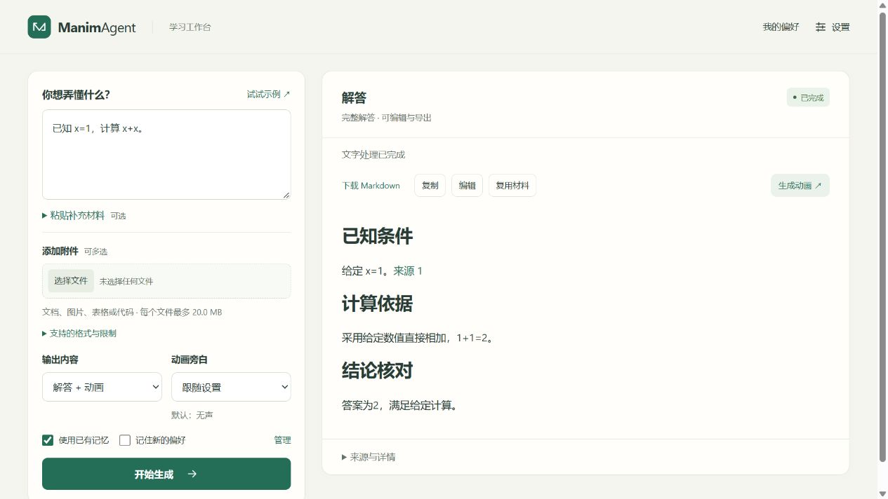
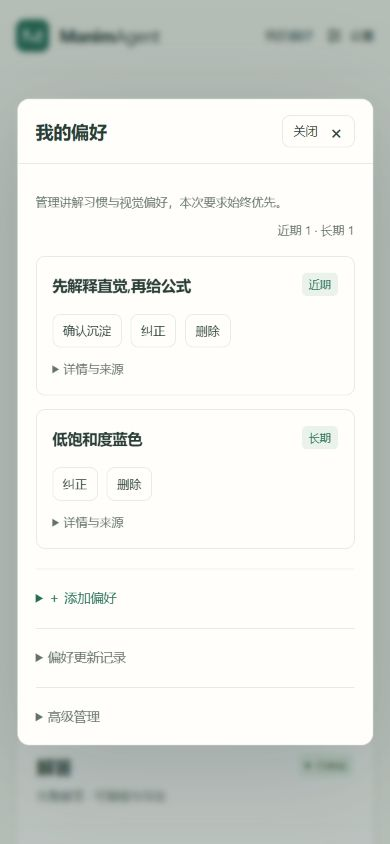

# 工作台信息层级与前端精简

日期：2026-11-06。针对主页面暴露过多配置、机制说明和调试信息的问题，修改前端及现有使用文档。保留此前未提交的工作，本轮未提交或推送。

## 界面变化

| 场景 | 当前呈现 |
|---|---|
| 日常生成 | 主页面保留问题、材料、输出选择、记忆开关和结果；移除大型介绍及三张常驻配置状态卡 |
| API 配置 | 顶部“设置”打开独立弹层，切换“核心模型 / 语音配音”；协议、角色分配和连接状态按需展开，两组配置分别保存 |
| 记忆管理 | 顶部“我的偏好”打开独立弹层；卡片先展示偏好内容及近期/长期状态，字段、ID、时间和证据进入详情 |
| 记忆维护 | 添加偏好、更新记录和高级管理分别展开；记忆文件、路径、清理等放入高级管理 |
| 结果核对 | “来源与详情”收纳历史记忆、材料来源和高级运行记录；普通来源显示位置和正文，保留原始记录入口 |
| 视频 | 主信息只展示时长和有声/无声，帧率、节拍数与计划进入动画详情 |

关闭弹层只关闭展示，保留当前输入；Esc 关闭后焦点返回原入口。切换核心/语音面板不重新加载配置，记忆后台刷新仍遵守原有编辑保护。文字来源引用会展开外层详情和内层材料来源，保留原 block 锚点。

配置错误、上传失败、正文警告、任务中断和需要用户核对的状态仍然可见。没有改变后端记忆生命周期、API 协议、上传格式、生成或配音逻辑。

## 验证

| 检查 | 结果 |
|---|---|
| 全部前端行为测试 | **92 passed**，包含弹层切换、草稿保持、焦点恢复、来源展开、元数据默认折叠；[web.txt](web.txt) |
| Python 相关回归 | **42 passed**：静态资产、发行检查及架构约束；[python.xml](python.xml) |
| Ruff、格式、差异检查 | 通过，177 个 Python 文件格式通过 |
| 发行物 | wheel / sdist 各 **96 个运行文件**匹配源码，全新安装、CLI、HTTP、页面资源检查通过；[distribution.txt](distribution.txt) |
| 浏览器实测 | 桌面和 390px 窄屏；配置/记忆编辑后关闭重开保持草稿，Esc 与焦点返回、文字生成、键盘来源跳转、高级文件入口均通过 |

本轮使用隔离运行目录、受控 provider 和测试渲染器，未调用真实 LLM 或 MiMo。Python 为与前端改动相关的 42 项，未将上一轮全量或原生结果当成本轮重测。源码和发行物摘要见 [source-manifest.json](source-manifest.json)。发行物在本机 `dist/frontend-simplification-20261106/`。

## 页面记录

主工作区中的内容来自离线测试样例，展示生成后的实际布局：

窄屏记忆管理仍将高级内容保持折叠：

操作路径同步到 [运行与配置](../../docs/current/运行与配置.md)、[核心模型配置](../../docs/current/LLM界面配置.md)、[语音配置](../../docs/current/MiMo语音与验收.md)、[用户记忆](../../docs/current/用户记忆与个性化.md) 与 README。
