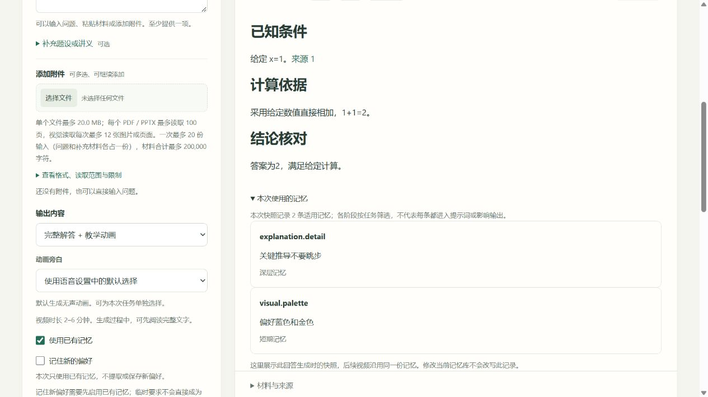

# 记忆生命周期、注入与缓存修复验收

日期：2026-11-06。工作树：`E:/manimagent`，分支 `codex/user-onboarding-20261106`。本轮接续已有上传与 API 配置改动，没有继续扩展文件格式支持。源码指纹见 [source-manifest.json](source-manifest.json)，汇总见 [verification.json](verification.json)。

## 已完成

| 问题 | 修复后的行为 |
|---|---|
| 近期记忆被限制为原会话 | 未过期的非临时近期偏好可跨会话使用；临时要求仍只用于原会话 |
| 普通纠正误变成长期确认 | 普通纠正保留层级、临时性与原到期时间；显式确认才晋升，不把旧取值的多会话证据移植给新取值 |
| 更新时间与支持次数扰动选择 | 同字段先解决冲突，再稳定选择容量内条目；同值证据增加不会无谓挤走其他字段；大量纠正后新观察仍能取得正确优先级 |
| 完整审计快照进入模型输入 | Answer 和任务继续保存完整快照；模型只收到字段、值、范围及近期临时标记，排除 ID、时间戳、会话账本和证据计数 |
| 动态要求破坏共享前缀 | 用户载荷按深层记忆、共享材料或固定正文、大纲、近期记忆、本次要求与场景反馈排列；同角色共享内容优先放前 |
| 记忆无差别进入所有角色 | 回答及内容检查过滤已知 `visual.*`；视频规划保留；材料读取和记忆提取不注入历史偏好，未知自定义字段保守保留 |
| 读取与写入绑定 | 页面分别控制“使用已有记忆”和“记住新的偏好”；只读任务不提取，新任务关闭记忆则不读写；手动管理仍是独立操作 |
| 结果展示当前库，难以追溯 | 结果区展示此 Answer 的历史快照；说明各阶段会筛选，不能把快照等同于模型最终收到或实际遵守的内容 |
| 缓存未知被当作零 | 归一化有效缓存回报；区分未知、合法零与部分回报，比例分母只包括有有效回报的调用；不从输入预算扣除缓存 token |
| 调用缺少缓存与耗时诊断 | 每个实际 HTTP 尝试记录 `call_summary`，包含角色、尝试、状态、总耗时和归一化用量；不将其称作首 token 延迟 |
| 验收未使用网页 TTS 设置 | `evals.narrated` 加载保存的语音配置及独立凭据，再建立隔离环境；正常或异常退出均清理临时环境凭据 |
| 多模态记录使记忆验收报错 | 跳过非字符串材料读取记录，继续严格检查各个性化角色的模型投影 |

完整来源 ID 和引用校验继续保留。人工修改 Answer 后的视频使用继承的快照；旧检查策略回执失效，视频提示词版本升级为 `memory-projected-templates-12`，阻止误用旧分块结果。

## 回归与安装包

| 检查 | 结果 | 证据 |
|---|---|---|
| Python 全量 | **397 passed，4 skipped**，58.50 秒 | [current.xml](current.xml) |
| 前端 Node 测试 | **60 passed** | [verification.json](verification.json) |
| Ruff check / format | 通过；154 个 Python 文件格式一致 | [verification.json](verification.json) |
| `uv lock --check` | 通过 | [package-lock.log](package-lock.log) |
| wheel / sdist | 两者构建并隔离安装成功，CLI、HTTP API、UI 和静态资源启动检查通过 | [命令与退出码](package-commands.json)、[安装检查](package-install-smoke.log) |
| 包内容 | 80 个运行文件逐字节匹配，包含三个新模块；不含私有配置、运行材料和密钥 | [package-archives.json](package-archives.json) |

四个跳过项为需显式开启的原生渲染测试，本轮没有重新运行真实动画与 TTS 联合评测。当前回归包括受控模型下的文字、规划、多场景和快照一致性；此前真实音视频证据按[上一轮报告](../onboarding-20261106/报告.md)及[记忆全链路报告](../memory-20261106/报告.md)各自源码版本解释。

主要新增边界测试覆盖：近期跨会话、临时隔离、纠正不晋升、旧证据不转移、过期与已替代条目不可纠正、容量稳定、重复证据不改变投影、不同场景保留公共前缀、当前库变更不改写历史 Answer、未知／零／矛盾缓存数据、重试调用用量及多模态验收。

## 真实 MiMo 缓存对照

模型 `mimo-v2.6-flash`，官方接口；使用 50 条程序生成的方程教学材料，固定材料与引用 ID，不采集真人数据。旧载荷和当前载荷交错各调用 3 次，提问分别为不同练习；6 次均完整返回，解及验算均正确，无重试。详细过程与全部尝试见[缓存子报告](cache-run/报告.md)。

| 方案 | 每次输入 token | 缓存统计覆盖 | 观察到的有效缓存回报 |
|---|---:|---:|---|
| 旧结构 | 6804 | 0 / 3 次 | 全部未知 |
| 当前结构 | 6649 | 1 / 3 次 | 第 3 轮 6592 / 6649，约 99.14% |

本样本每次输入少 155 token，约 2.28%；总用量 40359 输入、403 输出 token，6 次合计 31.344 秒。明确报告命中的那次请求耗时 10.125 秒，**不能宣称提速**。其余 5 次未报告缓存，不能称作零命中，也不能把 99.14% 写成全部任务命中率。

服务商缓存不能在本评测中主动清空，首轮／复用轮只是调用顺序；投影和载荷顺序同时变化，不能分别归因。仅检验小样本输入结构和真实缓存回报，不代表费用、整体延迟、记忆质量或学习效果改善。全部响应、用量、输入摘要和运行脚本原稿均保留；辅助解值正则的离线修正已记录，没有追加请求或覆盖缓存数据。

## 页面验收

隔离本机服务使用受控模型与测试记忆，未修改用户真实记忆库或凭据。桌面及 390 × 844 窄屏检查通过；窄屏实际内容宽度与滚动宽度均为 375，没有横向溢出，控制台无 error / warn。

1. 默认关闭记忆；开启读取后，学习仍可独立关闭。只读生成完成，库中条目数不变。
2. 页面显示生成时的两条快照及缓存覆盖；演示响应固定为每次 768 / 1000 token，页面显示 2 / 2 次、1536 / 2000、76.8%。**这个数字只是界面测试数据，与真实 MiMo 对照分开。**
3. 将近期视觉偏好从蓝色改成青色后仍是短期，历史 Answer 仍显示原蓝色偏好；刷新后同样成立。
4. “查看与管理”直接展开记忆面板。开启、关闭学习时说明同步更新，窄屏按钮与说明可读。

完整桌面证据见 [memory-desktop.jpg](memory-desktop.jpg)，窄屏证据见 [memory-mobile.jpg](memory-mobile.jpg)。

## 明确边界

- 本轮仍在文字生成前执行有界提取并冻结快照；没有实现生成结束后的后台学习。
- 快照先选同字段赢家。临时要求覆盖深层默认时，前置深层段也可能变化；不是所有近期变化都能保持材料之前的前缀。
- 新上传会产生新的来源 ID，因此不保证同内容重新上传后的跨任务缓存复用。当前优先保证同一材料、同一 Answer、同角色的稳定输入。
- 画像、视觉偏好等仍是字段；没有新增经验库、语义合并或画像摘要，也没有任意模板风格执行能力。
- 修改、删除和清理影响后续记忆选择；已经生成的历史快照保持原样。研究质量和真人学习效果仍需独立实验。

维护入口：[当前使用文档](../../docs/current/用户记忆与个性化.md)、[分层记忆设计](../../docs/design/05-长期记忆与个性化.md)、[评测入口](../../evals/README.md)。
