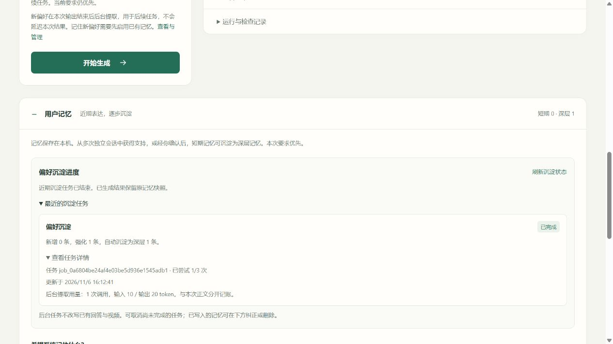

# 完整后台记忆沉淀验收

2026-11-06，`E:/manimagent`，分支 `codex/user-onboarding-20261106`。本轮完成用户记忆的持久后台沉淀，不扩展文件支持，不新增生成经验、语义合并或画像摘要。功能与接口见[用户记忆](../../docs/current/用户记忆与个性化.md)，机制与边界见[设计文档](../../docs/design/05-长期记忆与个性化.md)。

## 实现后的流程

```text
提交问题
  ├─ 固定模型配置与已有记忆快照 → 正文 → 可选视频
  └─ learn=true：持久化 waiting 事件
       ├─ 主任务结束且已有完整 Answer → queued
       │    → 后台提取用户原话 → 证据校验 → 短期积累 / 深层晋升
       └─ 没有发布 Answer → cancelled
```

当前 instruction 直接约束本次生成，不等待提取。后台新增偏好用于后续任务，不改写本次 Answer 或视频快照。只读取记忆不创建学习事件；复用 Answer、修订后的视频也不重复学习。

| 环节 | 已实现行为 |
|---|---|
| 生成 | 只从用户 instruction 提取候选，连续原句核验；不从材料、答案、渲染成功推断用户属性 |
| 积累与晋升 | 默认 3 个独立会话支持后自动进入深层；非临时记忆也可手动确认。同会话重试不增加独立支持数 |
| 临时要求 | 限原会话使用，不自动晋升；普通纠正保留层级和到期时间 |
| 清理 | 启动、后台维护及写入时清理到期／被替代条目；深层不因低使用频率被静默驱逐 |
| 队列 | SQLite 持久化；最多 100 个活动任务、200 个终态历史；后台一个 worker，优先让待处理前台任务执行 |
| 失败 | 不影响已发布正文；不自动重试服务商调用，用户可手动重试，总尝试上限 3 次 |
| 恢复 | 已提交来源幂等恢复完成；运行中但未提交的任务标失败并提示未知用量，须手动重试；waiting 与父任务发布状态对账 |
| 用户控制 | 确认／纠正／删除变更手动修订版本，旧后台结果不能覆盖；取消与写入在同一 SQLite 事务检查 |
| 用量 | 每次默认最多 1 次模型调用、20 秒、16000 token 独立预算；保存失败、重试和取消后晚到用量，不回填旧正文用量 |
| 前端 | 显示等待、排队、沉淀中、完成、失败、跳过、取消；提供晋升进度、重试与取消，状态刷新保留编辑草稿 |

任务成功、取消、跳过或尝试耗尽后清除队列载荷中的原文；仍可重试的失败保留原文，直到重试或历史数量清理。原任务记录、历史 Answer 和诊断不在此删除范围。后台状态最多自动刷新 120 轮，连续 3 次读取失败暂停，用户可手动刷新。

## 自动测试与复审

| 检查 | 结果 |
|---|---|
| Python 全量 | **435 passed，4 skipped**，87.23 秒；[current.xml](current.xml) |
| 前端 Node | **69 passed** |
| Ruff check / format | 通过，160 个 Python 文件 |
| 安装包 | 最终 wheel 与 sdist 各自独立安装、CLI、HTTP、页面及静态资源检查通过；82 个运行文件逐字节匹配当前源码 |

最终分发证据见[打包报告](package-final-20261106-161643-511094-report.md)。初次打包后又修了三个文件，旧包有单独 superseded 标记，未覆盖旧报告。

新增集成与并发测试验证：

- 阻塞提取时正文已完成，后续正文仍能生成；后台用量独立。
- 提交后排队期间修改当前记忆，不改变已固定的本次快照。
- 三个独立会话的重复支持触发晋升；原回答快照不随晋升改写。
- 模型返回与取消、确认、纠正、删除竞争时，不产生迟到写入。
- 失败可重试、重复来源不重复计证据、总尝试上限和用量累计有效。
- 视频部分失败但正文已发布时仍可沉淀；没有正文时取消学习。
- 重启时按父任务对账，不重新调用已经提交的提取。
- 后台 HTTP 尚未结束时，`stop()` 的有界等待返回不会提前释放进程锁；真实另一 Python 进程仍无法取得锁。
- SQLite 事件先写、父 JSON 尚未发布时，对账受接收锁保护，不误判孤立任务。
- 接收任务失败且清理再次失败时，仍释放队列容量；空后台队列不争用手动记忆接口的并发槽位。

四个跳过项为需显式启用的原生渲染测试；本轮没有重新运行真实视频/TTS。受控模型的动画集成测试仍在全量回归中，不能代替真实模型质量或学习效果实验。

## 页面验收

隔离服务使用固定模型响应和两份预置独立会话证据。操作前显示短期 `2/3`；开启读取与学习后完成正文，后台再写入第三份支持，显示“强化 1 条、自动沉淀为深层 1 条”和独立用量。当前库成为深层 `3` 会话支持，旧 Answer 仍显示其原来的短期快照。

桌面与 390 × 844 窄屏检查通过，窄屏内容宽度与滚动宽度均为 375，无横向溢出；控制台无错误或警告。图中输入 10、输出 20 token 来自固定测试响应，不是真实服务商用量。



另见[完整页面](memory-full.jpg)、[窄屏](memory-mobile.jpg)。

## 真实联测结果与限制

计划用 MiMo `mimo-v2.6-flash` 做三轮真实文字 → 后台记忆验证，遇失败立即停止。实际两次尝试均在正文阶段停止，**没有触发后台提取，不能报告真实自动晋升成功**：

1. [首次记录](live-run/报告.md)：实际 HTTP 200、完整响应，但验收脚本转发响应时重复解码压缩内容，造成客户端错误；这是验收器问题，不能当作真实接口超时。原脚本和响应完整保留。
2. 离线修复并验证压缩响应后，仅补跑一次。[补跑记录](live-run-02/报告.md)：模型实际 HTTP 200，但输出来源引用多了字面量 `material_id:` 前缀。严格引用校验返回 `invalid_reference`，主任务 `needs_review`；没有发布 Answer，学习事件取消，尝试数为 0。

总计 **2 次真实 HTTP 调用**，服务商报告输入 **1372**、输出 **1177 token**；没有第三次联测。未放松引用校验、伪造 Answer、语义合并候选或抹去失败。模型引用格式是本轮真实联合验收的阻断项，后台沉淀逻辑的正确性目前由自动测试与页面固定响应验收支持。

汇总见 [live-runs-summary.json](live-runs-summary.json)。凭据只读入内存，临时环境变量已恢复；报告和发布包不含密钥。全部材料为合成算术题，不采集真人数据。

## 证据边界

代码链路已覆盖生成、积累、晋升、纠正、清理、注入与持久化恢复；这不等于模型对任何自然语言都能正确归类，也不证明真人学习效果。当前仍按规范化字段与取值严格积累，不做语义同义合并；用户可核对证据并明确确认。稳定投影与缓存顺序沿用[上一轮实现](../memory-cache-20261106/报告.md)，没有在本轮重复测量缓存收益。

[source-manifest.json](source-manifest.json) 记录最终源码指纹；[verification.json](verification.json) 汇总回归、页面、链接与密钥模式检查。
