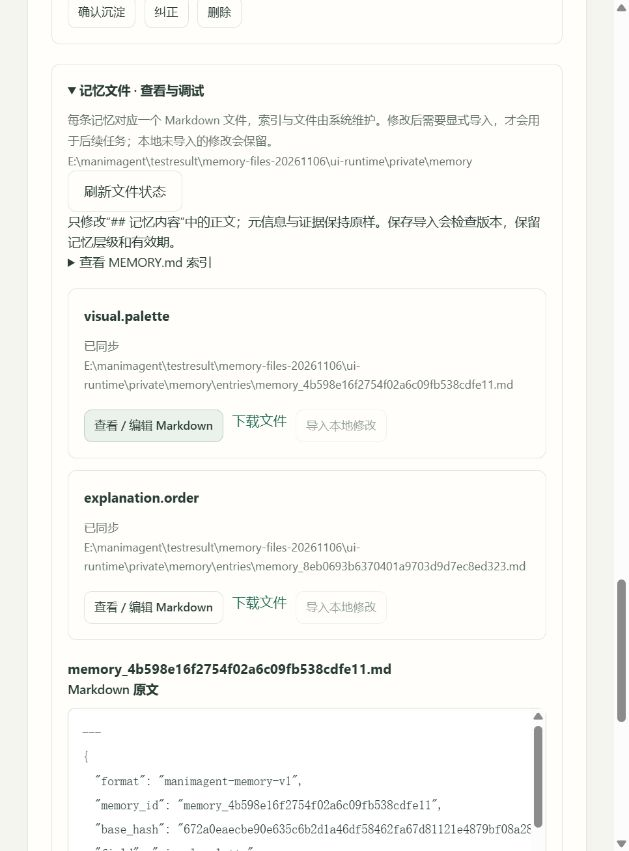

# 可读记忆文件与注入调试验收

日期：2026-11-06。基于 `E:\manimagent` 当前工作树完成，保留此前未提交的功能与整理结果。本轮未提交、推送或调用真实付费模型。使用说明见[用户记忆与个性化](../../docs/current/用户记忆与个性化.md)。

## 已交付

采用可读文件的展示与调试方式，SQLite 继续负责事务和正式状态；没有将 Markdown 改成第二套生效来源。

| 入口 | 行为 |
|---|---|
| `private_dir/memory/MEMORY.md` | 自动维护索引，列出独立记忆文件及其状态 |
| `memory/entries/<memory_id>.md` | 展示取值、层级、时间、支持次数和原句证据；仅“记忆内容”可编辑 |
| 网页“用户记忆 → 记忆文件 · 查看与调试” | 查看、下载、编辑后保存导入、刷新状态、导入本地修改 |
| `memory/snapshots/<job_id>.md` | 任务接收和终态时输出冻结快照及实际请求中的记忆片段 |
| `GET /api/v2/jobs/{job_id}/memory-context` | 根据当前持久记录返回 JSON 审计；`?download=true` 下载 Markdown |

导入在同一数据库事务内核对原始版本、元数据和证据，沿用普通纠正：新建取值条目，保留层级、临时性和原有效期，重新记录修改证据，不复制旧取值的多会话支持数。不通过编辑文件晋升、延长寿命或恢复已删除条目；原样导入不产生新条目。

自动同步用内容摘要识别本地草稿，显示 `current / edited / stale / deleted`。检测到未导入编辑时保留，页面刷新也保留编辑框草稿。导出失败不会撤销已经提交的记忆；状态接口显示错误，后续刷新重试。没有新增生成器经验、语义总结合并或附件格式。

## 审查和回归重点

- 外部文件版本过期、条目删除、只读元数据或证据被改动时明确拒绝；路径、链接、编码、文件大小和输入长度受检查。
- 文件发布前再次读取，保留生成文档期间保存的新草稿；导入成功后清理失败可重试，不把已提交修改误报成未保存。
- 文件写入和 JSON 复用原子替换与刷新机制；未变化文件不反复写入。同步清单写入失败采取保留文件的策略。
- 逐调用审计来自记录中的真实请求片段，区分“选入快照”与“进入该次请求”；保留尝试次数和 HTTP 状态，不复制整份提示、材料或凭据。
- 文字角色过滤视觉偏好；场景生成可以使用对应视觉记忆。独立视频继承 Answer 原快照，当前记忆被删除也不会改写历史。
- 旧任务或旧 Answer 缺少快照字段时标记 `unknown`，不会当作明确禁用。任务中断后的导出恢复成功会清除持久记录中的旧错误。
- 文件索引、证据、时间、版本摘要不进入模型投影，继续使用原有稳定序列化和提示词顺序；文件化本身不代表缓存命中率增加。

## 验证结果

| 验证 | 结果 | 证据 |
|---|---|---|
| 全量 Python 基础回归 | **503 passed、4 skipped**，112.71 秒；4 项为需显式启用的原生测试 | [current.xml](current.xml)、[python.txt](python.txt) |
| 本地原生渲染 | **4 passed**，142.69 秒；真实 Manim/FFmpeg 与媒体检查 | [native.xml](native.xml)、[native.txt](native.txt) |
| 前端行为 | **83 passed**，无跳过；含导入、草稿保留、提交后刷新失败和任务审计链接归属 | [web.txt](web.txt) |
| Ruff 与格式 | 全部通过，177 个 Python 文件已符合格式 | `ruff check/format --check src tests scripts evals` |
| 依赖锁 | 离线检查通过，82 个包 | [uv.lock](../../uv.lock) |
| wheel 与 sdist | 各 **95 个运行文件**逐字节匹配当前源码；全新环境安装、CLI、HTTP、页面及静态资源通过 | [distribution.txt](distribution.txt)、[build.txt](build.txt) |
| 差异与文档链接 | `git diff --check` 通过；当前文档和本报告的本地目标存在 | [source-manifest.json](source-manifest.json) |

首轮全量回归为 **502 passed、1 failed、4 skipped**：旧视频配置单测以 `object()` 代替存储，未实现本轮新增的 Answer 快照读取。补齐该测试替身后，相关配置与记忆文件集成测试 **5 项通过**。完整首轮记录保留在 [first-run.xml](first-run.xml) 与 [first-run.txt](first-run.txt)，没有隐藏失败或以部分测试结果冒充全量通过。

两种发行物保存在本机 `dist/memory-files-20261106/`。源码、验证文件和发行物摘要见 [source-manifest.json](source-manifest.json)。

## 页面实测

使用独立 `ui-runtime`，受控本地 provider 与测试渲染器；未读取生产凭据。通过真实浏览器完成以下流程：

1. 展开记忆文件，查看独立条目及元数据。
2. 将视觉取值从“低饱和度蓝色”改为“低饱和度绿色”，刷新文件状态后草稿仍在。
3. 保存导入，核对新条目 ID、绿色取值及原深层层级。
4. 开启“使用已有记忆”，关闭新偏好学习，提交简单文字问题并成功完成。
5. 从当前任务诊断打开注入审计，确认两个文字调用包含解释偏好、过滤视觉偏好，HTTP 状态为 200。

以下截图展示记忆文件区、同步状态和 Markdown 编辑入口。完整文字加视频快照继承另外由离线集成测试验证。



## 复现与边界

```powershell
uv lock --check --offline
uv run --no-sync ruff check src tests scripts evals
uv run --no-sync ruff format --check src tests scripts evals
uv run --no-sync python -m pytest -q
node --test tests/web/*.test.mjs
$env:RUN_NATIVE_TESTS = '1'
uv run --no-sync python -m pytest tests/native -q
uv build --out-dir dist/memory-files-20261106
uv run --no-sync python scripts/check_distribution.py dist/memory-files-20261106
```

外部编辑器不共享服务锁，最终检查和原子替换之间不具备操作系统级比较交换保证；避免多处同时修改同一文件，完成保存后再刷新、导入。数据库版本检查始终约束正式导入。

删除当前记忆不自动擦除历史 Answer、请求记录、任务快照或已修改的文件。此轮没有增加自动读取任意 Markdown 的 Agent，也没有承诺完整复制 Claude Code 或 Codex 的内部记忆实现。

审计证明构造了对应请求上下文，不证明服务端实际采用偏好或改善输出。本轮验证覆盖文件、事务、任务、页面和发行链路；没有重跑真实 LLM/MiMo，不作为提取准确率、个性化质量、音画对齐质量或缓存收益的新证据。
