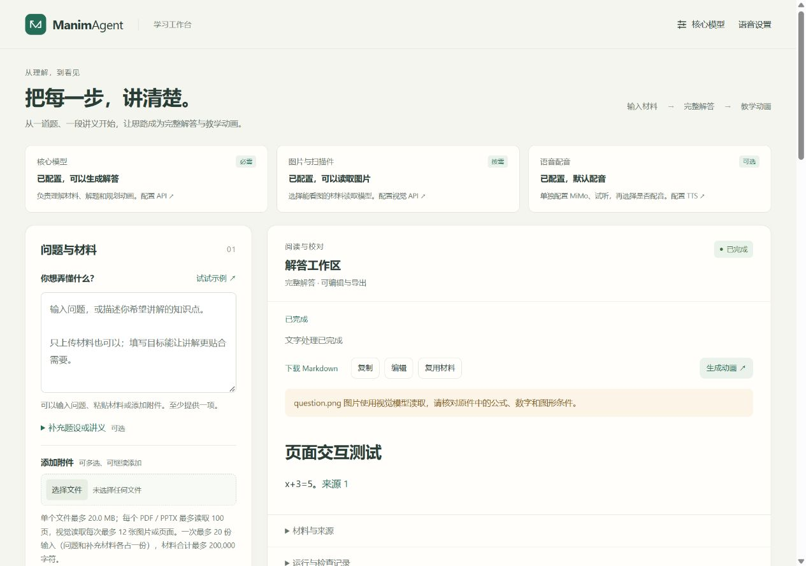

# 材料输入与 API 配置验收

日期：2026-11-06。工作目录 `E:/manimagent`，分支 `codex/user-onboarding-20261106`，基于 `8f5dd8b`。本次修改围绕用户上传材料、配置核心模型／视觉读取／配音三个入口；源码指纹见 [source-fingerprint.json](source-fingerprint.json)。

## 已实现的用户流程

- 首页区分核心模型、图片与扫描件、语音配音，分别展示配置状态与入口。文字请求不要求视觉或 TTS；动画可按次选择跟随默认、配音或静音。
- 核心 API 支持 DeepSeek、MiMo 和自定义 Chat Completions 兼容接口预设。一个模型可用于全部生成角色，也可分别配置材料读取、回答、检查和动画模型。完整接口地址会归一化，文本与结构化测试使用草稿，保存后仅影响新任务。
- MiMo TTS 有独立的密钥、音色、朗读要求和默认开关。短句试听返回播放器，不保存草稿；保存成功刷新首页状态。跨服务地址变更不能悄悄复用原密钥，任务入队后保持原配置和密钥引用。
- 文件可以追加、去重、逐个移除。PDF 可选页码，PPTX 可选幻灯片。文件显示待上传、已上传、已读取或具体错误；空文件、超限、格式与范围错误在可判断时提前拦截。只上传文件也可开始生成。
- 上传能力由后端统一描述。读取失败指出具体文件，不将上传成功等同读取完整；不确定内容停止生成并要求补充／核对。视觉转录保留未人工核验状态、原件位置及回答警告。

## 文件覆盖与边界

| 类型 | 当前处理方式 |
|---|---|
| TXT、Markdown、LaTeX、日志、常见代码和配置 | 本地读取 UTF-8 正文；不执行代码 |
| CSV、TSV、JSON、JSONL、Notebook | 保留结构与来源；Notebook 读取文本单元和文本输出，不执行 |
| PDF | 普通文字本地提取；扫描、图形或异常文字页渲染后交给视觉模型 |
| DOCX | 段落、表格、显式上下标和常见 OMML 公式；可支持的内嵌图片交给视觉模型 |
| XLSX | 工作表／单元格位置、公式和已缓存结果；不重算，缺缓存或未覆盖对象要求核对 |
| PPTX | 文字、表格、讲者备注与可提取图片；复杂图形关系需要导出 PDF／截图 |
| PNG、JPEG、WebP、静态 GIF、BMP、TIFF | 有界转换后发送所选视觉模型；多帧文件要求拆分 |

旧版 DOC／XLS／PPT、任意压缩包及音视频输入尚未直接接入，界面提供转换、解压或转录建议。支持扩展名不表示能完整解释其所有嵌入对象，也不表示实现了 Codex 的任意工具执行能力。

默认限额为每文件 20 MiB、每 PDF／PPTX 100 页、每任务 12 张视觉图片／页面、20 份输入、材料合计 200,000 字符；实际仍受模型上下文、调用与任务预算限制。

## 自动化与原生验证

| 验证 | 结果 | 证据 |
|---|---|---|
| Python 全量基础回归 | 327 passed，4 skipped，75.39 秒；跳过项为单独运行的原生测试 | [current.xml](current.xml) |
| 原生 Manim／FFmpeg | 4 passed，173.12 秒 | [native.xml](native.xml) |
| 前端状态与异步回归 | 54 passed | `node --test tests/web/*.test.mjs` |
| Ruff、格式、所有页面 JS 语法、diff 空白检查 | 通过 | `src tests scripts evals` 及页面 JS |
| 锁文件、wheel／sdist、隔离安装 | 通过；最终重建与首轮安装验证分别记录 | [package-validation.md](package-validation.md) |
| 版本库候选文本的密钥模式扫描 | 未发现实际 `sk-` 格式密钥 | 不扫描或输出私有运行目录内容 |

回归覆盖 PNG／PDF 的成功、缺少视觉配置、读取不确定路径；无视觉配置时零模型调用且不发布答案。还覆盖 DOCX 公式与图片、表格／幻灯片结构、视觉预算保留、图像载荷日志脱敏、凭据来源变更，以及已入队视觉任务使用原模型与密钥。配音覆盖默认开启时显式静音、默认关闭时显式配音。

初次总回归有 10 项旧 PDF 测试失败：它们仍要求图形 PDF 直接返回 `needs_review`；新流程会准备视觉输入，在未配置视觉模型时返回 `needs_input / vision_not_configured`。测试已改为精确检查新状态、页码 JPEG、零调用与不发布结果；最终结果如上，不把初次失败计为通过。

## 真实页面操作

使用 `127.0.0.1:8770`、独立运行目录和受控提供商，不修改实际用户配置。通过真实浏览器检查：

1. 核心模型“用于所有任务”→结构化测试→保存；测试与保存提示区分。
2. TTS 填写测试凭据→试听播放器→开启默认配音→保存；首页状态更新，保存后密码框清空。
3. 添加图片与 PDF，继续添加 Markdown／重复图片；重复项去重，页码可填，文件可逐个移除。
4. 留空问题，仅上传截图→完整回答；附件显示已读取，回答显示视觉读取提示与来源。
5. 1280×900 和 390×844 两种窗口宽度下检查布局，无横向溢出；控制台无 warning／error。

手机布局证据见 [mobile.jpg](mobile.jpg)，生成结果细节见 [desktop.jpg](desktop.jpg)。页面试听使用一秒合成测试音调，不当作真实 MiMo 语音证据。最终补充的健康状态刷新失败、动画请求拒绝保留旧视频与附件能力重载边界由前端回归覆盖。

## 真实 MiMo 请求

使用原本机配置中的凭据，仅在隔离进程内使用；未把密钥写入报告或保存到新默认配置。本次实际请求与上述页面模拟服务分开。

| 链路 | 尝试与结果 |
|---|---|
| 简单截图→视觉读取→中文回答→内容检查 | `mimo-v2.6-flash`，1/1 次任务成功，3 次模型调用，26.188 秒，输入 2544／输出 226 tokens |
| 新 TTS 试听接口→PCM WAV | `mimo-v2.5-tts`，1/1 次试听成功，1 次调用，2.703 秒返回 5.12 秒音频；195 tokens；保存 revision 不变 |

结构化记录：[real-smoke.json](real-smoke.json)。生成正文：[real-answer.md](real-answer.md)。音频保存在本机忽略文件 `real-preview.wav`。

这是一次简单图片和一次短句试听的连通性验证；不能据此推断复杂公式、几何或多页材料的正确率，也未将它表述为新一轮完整真实视频质量评测。完整有声视频的已有证据仍见 [MiMo 全链路报告](../tts-20261105/报告.md)，本轮另用原生回归确认渲染、封装和解码未回退。

## 使用文档

- [运行与配置](../../docs/current/运行与配置.md)：安装、输入格式、限额和错误处理。
- [核心 API 与视觉读取配置](../../docs/current/LLM界面配置.md)：预设、模型分工、视觉能力与密钥。
- [MiMo 语音与验收](../../docs/current/MiMo语音与验收.md)：独立设置、试听、保存与配音选择。

本次完成本地源码修改、验证和构建；未推送或合并远端分支。
