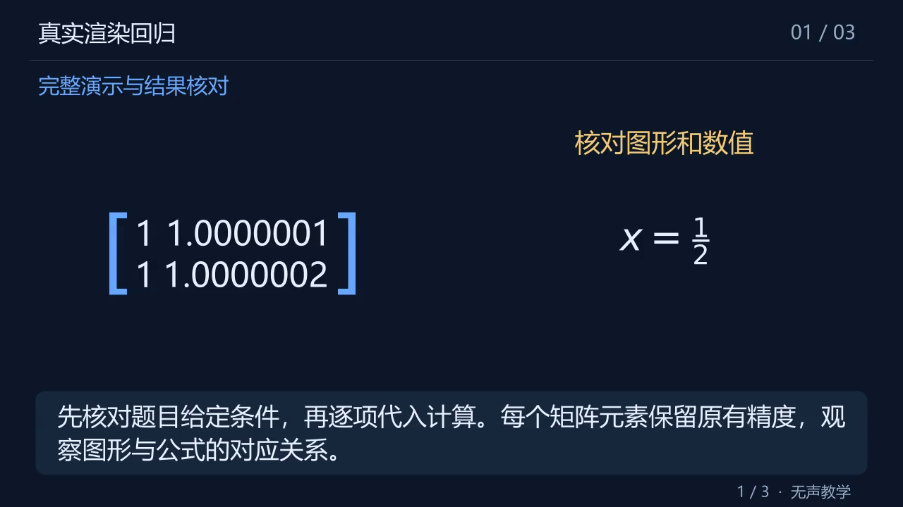
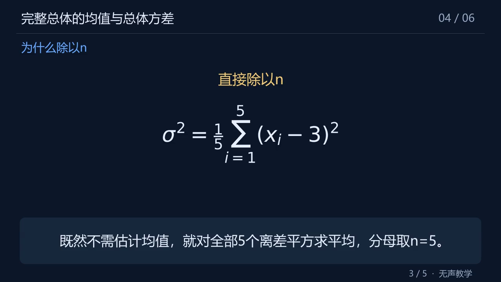
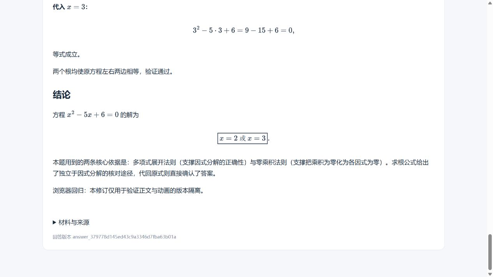

# 0.3.1 缺陷修复、代码复审与真实测试

日期：2026-11-03。基线为 main 的 `7b6d8950220d9705e7208944dd6f844f6a7dab5e`（0.3.0），对应 [issue #6](https://github.com/Zongyuan-Cai/manimagent/issues/6)。本次修复其七项确定性缺陷，清理重复／不可达逻辑，并重新运行真实 DeepSeek 与本地渲染。本机源码字节指纹（含换行符）见 [source-manifest.json](source-manifest.json)。

**七项代码缺陷已修复；文字真实工作流 110/110 通过；动画开发期间的十题首轮仅 4/10 完成。本版不能标记为生产验收通过。** 后续两份恢复／重新生成的成功视频单独计数，不回填首轮成功率。未为了提高完成率关闭内容检查、缩小到不可读字号、删除必要推理或延长既有预算。

## 1. 已修复的七项缺陷

| 编号 | 修复 | 验证 |
|---|---|---|
| R1：Windows 场景目录冲突 | scene_id 按 casefold 校验唯一性，拒绝 CON/AUX/NUL/COM/LPT 等保留名称；生成前阻断覆盖路径 | s1/S1、重复 ID、六种设备名回归；真实原生渲染使用独立场景目录 |
| R2：重复启动误中断活任务 | 启动恢复前获取私有目录的操作系统排他锁；Worker 真正退出才释放；CLI 上传前也须持锁；桌面重复启动验证 instance_id 后回到原服务 | 真实子进程持锁／强制退出／恢复；真实双桌面启动与 HTTP 健康检查；本地探测绕开系统代理 |
| R3：DOCX 默认上下标丢失 | 识别 docDefaults 的 superscript/subscript；进入模型前标 needs_review | 实际构造 DOCX、真实独立解析进程；不发布失真答案，模型调用为 0，原件下载逐字节一致 |
| R4：矩阵静默舍入 | 使用浮点值的最短可往返字符串，整数不加多余小数；记录每个单元的实际文本 | 接近值、正负、小数、科学记数回归；实际显示 1.0000001 与 1.0000002 的区别 |
| R5：矩阵元素重叠 | 按实际字形的最大列宽／行高排版，增加间距并适配括号；可读比例不足时拒绝 | 真正 Manim 渲染、关键帧与单元边界不相交断言；4×4 过密矩阵在渲染成片前被拒绝 |
| R6：视频任务刷新丢正文 | 独立视频 Job 从排队时记录 answer_id；恢复任务／视频会加载其源正文 | JS 运行中／完成后刷新测试；真实浏览器运行中和失败后刷新，正文、下载与编辑入口仍在 |
| R7：历史／分享／修订错绑 | 统一恢复优先级和页面版本；丢弃过期异步结果；播放前核对 Answer ID 和 SHA-256；修订清理旧视频与旧分享参数 | 六条 JS 行为回归覆盖延迟倒序、分享优先、ID/hash 错配、编辑时旧轮询；真实浏览器修订、刷新和错配拒绝 |

当时实现（固定修复提交）：[instance.py](https://github.com/Zongyuan-Cai/manimagent/blob/1514f217851342c8a752f5aa1bd5e78d8d69afe1/src/manimagent/instance.py)、[text_jobs.py](https://github.com/Zongyuan-Cai/manimagent/blob/1514f217851342c8a752f5aa1bd5e78d8d69afe1/src/manimagent/text_jobs.py)、[materials.py](https://github.com/Zongyuan-Cai/manimagent/blob/1514f217851342c8a752f5aa1bd5e78d8d69afe1/src/manimagent/materials.py)、[animation_models.py](https://github.com/Zongyuan-Cai/manimagent/blob/1514f217851342c8a752f5aa1bd5e78d8d69afe1/src/manimagent/animation_models.py)、[animation_driver.py](https://github.com/Zongyuan-Cai/manimagent/blob/1514f217851342c8a752f5aa1bd5e78d8d69afe1/src/manimagent/animation_driver.py)、[app.js](https://github.com/Zongyuan-Cai/manimagent/blob/1514f217851342c8a752f5aa1bd5e78d8d69afe1/src/manimagent/web/app.js)。



上图是受控数据经真实 Manim 渲染的回归画面，不是模型生成教学内容的成功率证据。排版事件见 [matrix-layout.json](matrix-layout.json)。

## 2. 真实测试中追加修复

- **预检超时：** 原排版预检仍执行动画插值和大量对象复制；改为构建真实几何并推进事件时钟。正式渲染仍执行动作，比较预检／正式渲染的矩阵边界。共享 Matplotlib 字体缓存，开启同次渲染文本 SVG 缓存。原失败输入复测约 6～8 秒，不提高 30 秒预检上限。
- **Windows 长路径：** 深层运行目录与公式摘要文件名触发原生 SVG/媒体路径失败。子进程改用短临时工作目录，完成后复制输入、日志、结果、关键帧和视频，自动回收中间素材；真实原生回归刻意使用长输出路径。
- **屏幕解释容量：** 中文字幕折行宽度调整为 32，契约上限与两行区域对齐为 64 字，推荐 25～50 字；过密仍由真实排版检查阻断。
- **公式兼容：** 约束公式为 ASCII MathText；规范化额外反斜杠、已知别名、单字符字体参数和 `\frac34` 等保持含义的 TeX 短参数。未知命令仍拒绝；贝叶斯原失败分块经真实渲染复测及续跑完成。
- **复审追加 R8，复杂公式字号：** 抽查方差成片发现原模板把每条公式统一缩到 0.58 总高度，求和上下限挤占空间后主体字形过小。改为按 SVG 字体 em 保持大小，再对整组公式施加可读缩放下限；公式区排不下时拒绝。记录实际 em 和各行边界，原生回归加入求和／分式；模板版本为 `native-manim-3`。这是十题批次之后的修复，原批次的 completed 不等于已通过本次新增的可读性检查。
- **正文切分：** 超过 42 个碎段落时，在同一章节内将相邻短段打包到最多 300 字符的精确原文区间，避免“每行公式一个段落”把普通题误判成超过 70 个教学单元；不丢字符、不截断公式／围栏。
- **有限修复：** 修复请求带回原场景；短片要求展开正文已有依据，超长片要求去掉冗余。Provider 返回具体契约字段错误供重试，schema 补充矩阵表达与 cue 精确引用说明。仍共享两次局部修复和一次额外模型重试。
- **评测记录：** 新增十题×默认三次的显式真实评测脚本；拒绝重复题目与非空输出目录，逐次记录源码指纹变化。源码变更后不继续启动新付费调用，避免混合迭代被误称为固定版本评测。

R8 还复用了真实 DeepSeek 方差场景，重新排版／渲染并完整解码 61.733 秒片段，预检 7.828 秒、渲染 45.094 秒，五拍公式 em 均为 0.6；没有重新调用模型，也未将此片段冒充完整视频。见 [formula-review.json](formula-review.json)。



这些改动提高了可复现失败的可用性，但 prompt 加强尚不能让所有模型输出符合契约，见下方失败清单。

## 3. 死代码与维护性复审

逐项检查当前第一方模块、入口、网页与脚本的调用关系，并使用 Ruff 和 Vulture 辅助检索。删除了 schema 已负责的重复场景唯一性／上界检查、前面已返回后的重复状态判断、渲染器必需方法的 hasattr 旁路、多个独立网页恢复入口及启动器重复健康探测；API 与桌面包版本改从已有版本定义读取。

未把 FastAPI 装饰器回调、Pydantic 校验器、Manim construct、CLI/子进程入口和序列化字段当作无引用代码删除。Vulture 的剩余高置信提示是框架约定参数等静态误报，没有证据支持继续删除当前模块。`legacy_mvp` 是独立可运行的冻结基线，保留隔离并重跑其回归。第三方 MathJax 压缩代码保留许可与来源，未将其作为第一方死代码扫描对象。

文档同步删除总览中过时的 `text_video` 与 `/generations/{id}/video-retries` 草案用法，按实际 `both` 和独立 `/videos` 入口重整；保留后续设计时明确标注实现边界。

## 4. 自动化与实际运行验证

本机为 Windows、Python 3.12.14、Intel Core Ultra 7 255HX。Docker 未使用。统计详见 [checks.json](checks.json)。

| 验证 | 结果 | 性质 |
|---|---:|---|
| 当前 Python 全套 | 133 passed，2 skipped；约 44 秒 | 两个原生测试默认显式跳过，下面另行启用执行 |
| 原生 Manim/PyAV/FFmpeg | 2 passed；约 121 秒 | 三场景 121.5 秒完整无声成片、全片解码、数值／几何／公式／长路径；过密矩阵拒绝 |
| 网页 JS 行为 | 6/6 | 实际 app.js + Node VM 的 DOM/fetch 替身，不冒充浏览器端到端 |
| 历史 MVP | 83 passed，1 deselected | 独立环境；Docker 测试未运行 |
| Ruff / JS 语法 / uv lock | 通过 | Python 格式与静态检查、脚本语法和锁文件一致性 |
| wheel 与 sdist | 两种均通过 | 各自在隔离环境安装，实际启动 CLI、HTTP API 并读取页面与资源 |
| 真实桌面重复启动 | 通过 | 两个独立 Python 进程，第二个复用原地址且不修改活任务 |
| 真实浏览器 | 通过所列状态／版本断言 | 视频分享恢复、修订后刷新、错配拒绝、视频任务运行中／失败后刷新，无控制台错误 |
| 真实动画 CLI | 2/2 工作流断言 | 贝叶斯分块续跑导出 342.967 秒视频，354.672 秒结束；缺字体故障注入时 7.969 秒返回 partial，完整 Markdown 已保存 |

新增 CI 的 native job 安装动画依赖及 CJK 字体，实际渲染并完整解码；它和 Windows／Linux 回归、历史回归、安装检查共同进入 `PR checks`。CI 不自动消耗付费模型。远端执行结果以本提交关联的 GitHub Actions 为准。

首次 main CI 的 Windows／Linux 回归和安装检查通过，native job 在 pytest setup 阶段发现干净 checkout 不存在 `--basetemp` 的父目录。已补充显式创建 `testresult/ci` 后重新执行；未跳过原生测试或放宽断言。



## 5. 真实文字测试：110/110

本次重新调用用户指定的 `deepseek-flash`，官方 Chat Completions 地址，thinking disabled。使用通用 system prompt，不注入个性化或长期记忆。[text-results.json](text-results.json) 保存逐用例结果。

| 分组 | 通过 | 覆盖 |
|---|---:|---|
| 核心 | 74/74 | 直接文本、TXT/Markdown、文本 PDF／选页、DOCX／表格、组合材料、数学回答、缺条件、不可信材料和不可靠输入拒绝 |
| 补充 | 31/31 | 实际地址／JSON／输出参数配置、鉴权错误、上下文／输出预算、配置持久化与角色绑定、重启、材料复用及修订 |
| CLI 文字 | 5/5 | doctor、正文与文件输出、输入故障 |

“通过”包含正确拒绝的用例，部分用例模型调用数为 0；不是 110 份答案都完成，也不是 110 份数学答案都经人工证明正确。配置覆盖多个连接／角色，真实供应商仍只有 DeepSeek，不能声称验证了所有厂商协议。

## 6. 真实动画十题首轮与恢复成本

十题各发起一次完整正文＋动画请求，两个独立实例并行，每个实例内部串行渲染。下表总耗时包含文字、规划、检查、渲染与保存；不把失败提前结束的耗时当作成功视频性能。本批在修复开发期间执行，期间加入了短分式兼容和字段提示，**不是固定最终提交的十题×三次生产基准**。启动时指纹与所有结果保留在 [animation-results.json](animation-results.json)。

| 题目 | 首轮状态 | 文字就绪 s | 总耗时 s | 成片时长 s | 终止原因 |
|---|---|---:|---:|---:|---|
| 向量投影 | partial | 11.365 | 107.203 | — | 计划检查仍发现概念／屏幕表述问题 |
| 二元方程组 | partial | 9.474 | 108.750 | — | 唯一性依据未充分上屏，提及图形却无对应图形 |
| 二次方程 | completed | 6.207 | 376.516 | 334.867 | — |
| 导数与切线 | completed | 8.728 | 302.516 | 273.467 | — |
| 定积分 | completed | 5.415 | 309.204 | 287.400 | — |
| 贝叶斯概率 | partial | 7.706 | 101.750 | — | MathText 不接受原样 `\frac34`；后续已修复 |
| 矩阵求逆 | partial | 8.165 | 22.625 | — | 生成不支持的 pmatrix 环境，契约校验失败 |
| 三角形面积 | partial | 7.159 | 89.844 | — | 生成不支持的矩阵环境，契约校验失败 |
| 等比求和 | completed | 6.559 | 330.797 | 318.600 | — |
| 总体方差 | partial | 9.388 | 38.234 | — | cue_objects 类型／对象引用无效 |

首轮完成率为 **4/10**。四个完成样本总耗时约 **5.0～6.3 分钟**，视频约 **4.6～5.6 分钟**；全部为 1280×720、30fps、H.264/yuv420p、无音轨，完整解码、Range 下载、正文 hash 与单元覆盖断言通过。样本量及并行压力条件不足以宣称 P95/SLA 达标。

追加尝试均保留原失败结果，不重写首轮分母：

| 追加尝试 | 结果 | 额外耗时 s | 成片 s | 说明 |
|---|---|---:|---:|---|
| 贝叶斯原分块续跑 | 完成 | 343.375 | 343.200 | 仅 1 次 plan_checker 调用，无 writer；与首轮合计约 445.125 秒 |
| 方差原 Answer 重新规划 | 完成 | 330.797 | 340.567 | 8 次调用；与首轮合计约 369.031 秒 |
| 矩阵原 Answer 重新规划 | 失败 | 21.625 | — | 4 次调用；仍生成不支持的符号矩阵环境 |
| 三角形原 Answer 重新规划 | needs_review | 25.203 | — | 3 次调用；同屏长公式超出几何图右侧可读区域 |
| 浏览器对导数 Answer 再生成 | 失败 | 见 JSON | — | cue_text 不是旁白的连续原文；刷新仍保留源正文与操作入口 |

当前模型质量缺口主要是：不支持的符号矩阵表达、图文区域预算、cue 精确绑定，以及语义检查后的局部修复成功率。必须改进并重新评测，不能通过放行这些结果制造完成率。

## 7. 开发探索失败同样保留

以下批次属于调试，不能合并成“固定版本三十次评测”。全部终态错误、调用与耗时均在 [animation-results.json](animation-results.json) 中：

| 批次 | 完成／已终止 | 另有中途停止 | 主要发现 |
|---|---:|---:|---|
| 两次投影 pilot | 0/2 | 0 | 排版预检超时，分别 64.750／161.156 秒结束 |
| animation-benchmark | 0/7 | 2 | Windows 长路径、碎段落单元上限、中文公式 |
| acceptance-1103 | 0/6 | 2 | 中文／矩阵公式、字体参数、坐标越界 |
| acceptance-v5-1103 | 2/5 | 0 | 发现 layout-only play 与 Wait 兼容、字幕容量及短分式问题；二次方程／导数完成 |

两批原计划三十次测试在发现可复现缺陷后被停止；未启动的请求不计作实际调用，正在执行的四次停止单列，不计作通过。修复中遇到的失败回归和已完成证据保留在本地 `runs/`，未上传私有配置或凭据。

## 8. 复现方式与验收边界

```powershell
uv sync --locked --extra dev --extra animation
uv run python -m pytest -q
node --test tests/web/*.test.cjs
$env:RUN_NATIVE_TESTS = '1'
uv run python -m pytest -q tests/native
Remove-Item Env:RUN_NATIVE_TESTS
uv run python -m scripts.review_live_text --output runs/new-text --secret-file <本机DPAPI文件>
uv run python -m scripts.review_live_supplemental --output runs/new-supplemental --secret-file <本机DPAPI文件>
uv run python -m scripts.review_live_cli --output runs/new-cli --secret-file <本机DPAPI文件>
uv run python -m scripts.review_live_animation --output runs/new-animation --secret-file <本机DPAPI文件>
```

真实脚本会消耗已配置服务用量。也可通过脚本对应的环境变量提供密钥；DPAPI 文件仅适用于原 Windows 用户。动画脚本默认十题各三次、串行，必须使用新目录且运行期间不修改代码；`--workers 2` 是额外压力条件。

本轮检查了关键帧和浏览器状态，没有完成所有视频的人工全程观看，也没有调用视觉模型。尚未完成固定最终版本的十题×三次及更多供应商验证。无真实音频，未测同步误差；TTS、个性化、长期记忆继续暂缓。issue #6 保留生产质量与人工验收待办，不能因七项代码缺陷修复就自动关闭。
