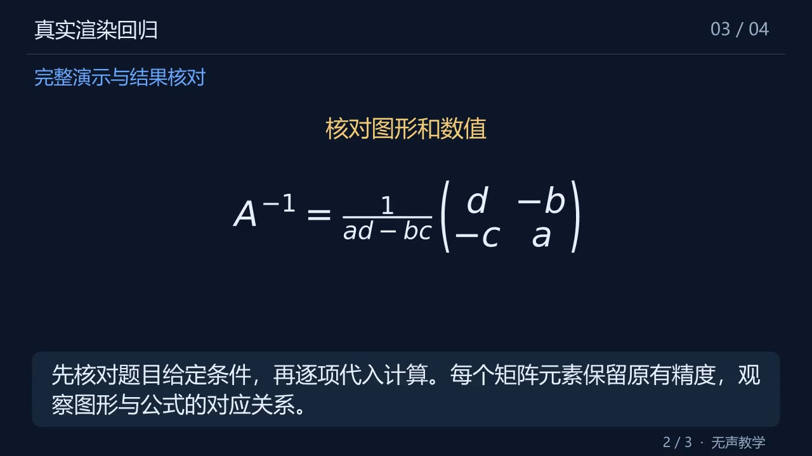
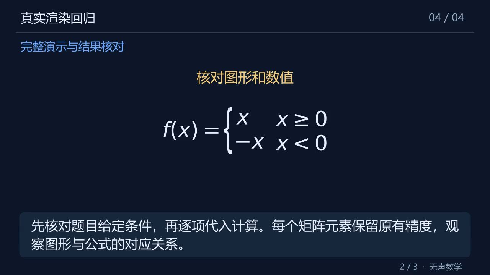
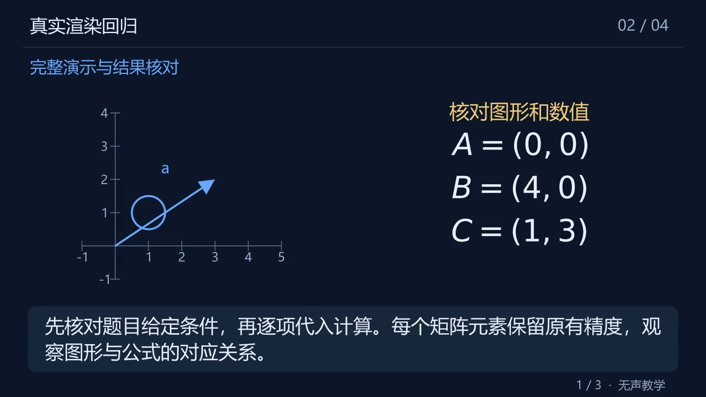

# 动画缺陷继续修复与真实复测

日期：2026-11-03～04。承接 [0.3.1 修复复审](../review-20261103/报告.md)，继续处理动画表达、局部修复、内容检查与耗时问题。使用真实 DeepSeek Flash、原生 Manim、FFmpeg/PyAV；没有 Docker、TTS 或视觉模型。版本仍为 0.3.1 的后续修复。

## 已定位并修复

| 问题 | 改动与约束 |
|---|---|
| 二阶求逆等基础内容需要符号矩阵，旧模板只允许数值图形 | 有限解析 `pmatrix/bmatrix/vmatrix/matrix`，以固定模板绘制，最多 4×4；支持矩阵上标。单元使用 MathText，无外部 TeX 或模型 Python |
| 方程组使用常见 `cases` 后被反复拒绝 | 支持最多 4 行、2 列的方程组／分段式；拒绝嵌套、宏、空单元、不等宽行和超范围表达 |
| 长坐标等式越过半屏宽度 | 在独立语句或连续等号处换行；保留全部内容，避免拆开分式、矩阵或带“或”的选择条件。整组字号下限保持 78% |
| 中英混排按 64 个字符一刀切误拒 | 校验和渲染共用两行、每行 32 列规则；中文计 1 列、ASCII 计 0.53 列。67 字符、约 46 列的真实样本不再误拒；65 个纯汉字仍拒绝 |
| 模型校验重试缺少上次候选，日志还可能被后续消息修改 | 在上下文允许时发送完整候选和有界字段反馈；超出预算不塞入候选、不截断原题。每次请求独立保存消息快照 |
| 第二次语义／排版修复在仍有额度时提前停止 | 大纲、排版、时长、语义共享两次生成修复；每次重新预检，最后一次修改后仍必须统一检查。没有增加重试、调用或时间上限 |
| 数值结论正确却保留前文错误等式与自我更正 | 加强 writer 与 checker，旧正文检查策略摘要失效。真实错误正文被拦截，修正对照通过；不在动画中悄悄改正文 |
| 切换模型或 thinking 后继续信任旧检查回执 | 回执新增 `checker_profile_hash`，同时核对正文、prompt 和检查配置；不匹配则先补检。旧格式回执也需要补检 |

原生验证图：

## 真实测试的口径

每次运行使用新目录，保存全部失败；没有在后台循环到成功。`completed` 只表示接口、内容门禁和媒体断言通过，不等于数学内容已获得人工正确性证明。正文、计划和关键帧复核另记，完整解码也不等于完整人工看片。

开发阶段四题首先完成 1/4：矩阵逆成功，成片 295.6 秒，整个测试进程 252.593 秒；三角形图文容量、方程组环境、混排字符限制失败后继续修复。见 [开发阶段四题记录](development-four.json)。这些结果不回填后续评测。

冻结中间版本的十题快速模式运行，将 `thinking=disabled` 用于全部角色；并行度为 2。源代码哈希逐例前后核对，记录全部成功和失败。这是并发运行的耗时，不能直接当单任务 P95 或生产 SLA。

媒体链路完成 **6/10**；但其中投影样本存在下节所述内容错误，不能把 6/10 报为内容合格率。成功样本视频 283.667～345.067 秒、整个测试进程耗时 241.453～292.719 秒；仅成功样本的耗时 P50=265.281 秒、P95=292.719 秒（nearest-rank，样本仅 6 个）。

| 题目 | 媒体链路 | 视频秒数 | 测试进程秒数 | 说明 |
|---|---|---:|---:|---|
| 正交投影 | completed | 332.500 | 281.516 | 抽查发现起终点表述错误，不算内容合格 |
| 二元一次方程组 | partial | — | 98.547 | 圈号公式及越界图形坐标未通过契约 |
| 二次方程 | completed | 307.067 | 265.281 | 媒体断言通过 |
| 导数与切线 | partial | — | 76.203 | 非有效 JSON |
| 定积分 | completed | 335.633 | 287.578 | 媒体断言通过 |
| 贝叶斯概率 | partial | — | 93.407 | 语义检查要求继续补全，已用完修复额度 |
| 二阶逆矩阵 | completed | 283.667 | 241.453 | 符号矩阵、逐元素验证和媒体通过 |
| 三角形面积 | partial | — | 71.406 | 中文公式及不存在的 cue 对象未通过契约 |
| 等比求和 | completed | 345.067 | 292.719 | 媒体断言通过 |
| 总体方差 | completed | 289.567 | 259.610 | 媒体断言通过 |

完整记录见 [十题运行](fixed-ten.json)、[诊断](diagnostics.json)和 [冻结代码摘要](fast-source-manifest.json)。后续改变了检查配置绑定、向量检查提示与测试默认思考模式，故这十题不冒称最终配置生产评测。

## 内容检查发现的边界

快速模式生成的投影正文将“从 A 到垂足 P”的向量写成 `a-p`，正确方向应为 `p-a`。API 完成了视频，但此处正文及沿用它的画面表述错误。因此该样本不能算内容合格。

对这一原始候选追加明确方向检查提示，快速模式仍误判通过；同一个 Flash 模型开启推理后，错误样本返回 `needs_review`（6.734 秒），只改正起终点后的对照返回 `pass`（2.172 秒）。这证明该具体缺陷能够被检出，不构成普遍正确率保证。

本轮还确认：切换检查模型配置后，旧回执只核对正文／prompt 摘要，可能跳过更严格的检查。新增回归在修复前明确失败：切换 `thinking` 后实际检查仍只有一次。修复后更换配置会补检，随后相同配置可复用新回执。

通过真实视频 API 提交上述旧错误正文及旧回执，新配置在 7.703 秒内用一次模型检查返回 `needs_review/content_uncertain`，没有调用 writer 或生成视频。测试目录与历史答案隔离，没有改写原正文。见 [旧回答补检](old-answer-recheck.json)。

## 最终代码上的推理模式重点复测

固定最终代码、所有角色 `thinking=enabled`，选择此前失败或有内容缺陷的五题，每题一次新请求，并行度 2。**4/5 完成**；该组不是随机抽样，也不能与十题快速模式直接计算总体质量提升百分比。见 [五题结果](checked-five.json)和 [检查／用量记录](checked-diagnostics.json)。

| 题目 | 结果 | 视频秒数 | 测试进程秒数 | 模型调用 |
|---|---|---:|---:|---:|
| 正交投影 | completed | 292.600 | 478.906 | 10 |
| 二元一次方程组 | completed | 330.933 | 403.484 | 10 |
| 导数与切线 | completed | 289.267 | 310.219 | 10 |
| 贝叶斯概率 | completed | 307.967 | 347.813 | 11 |
| 三角形面积 | partial | — | 365.406 | 12 |

三角形的统一计划检查消耗了 10,000 个输出 token，均为服务商报告的 reasoning tokens，未返回完整 JSON；服务以 `output_truncated` 停止，保留正文，不发布视频。没有追加隐藏续跑，也没有提高 600 秒或调用上限。后续需解决复杂图形检查的推理／报告预算分配，不能只依靠扩大总时限。

新投影正文和计划已正确区分 OP 与 PA；人工核对了该方向表述、方程组的两种消元与唯一性证明，并查看实际关键帧。此处是文本与关键帧抽查，尚未宣称对全部成片做完完整人工看片。推理模式成功样本耗时约 5.2～8.0 分钟，快于半小时，但也说明质量检查有真实成本。

## 自动化与安装验证

- 最终 Python：**157 passed / 2 skipped**（48.67 秒；跳过的两项在原生任务单独运行）。
- 真实原生渲染：**2 passed**（128.03 秒），生成 161.733 秒无声视频，完整解码 4,852 帧；验证符号矩阵、分段式、上标、混排文案、换行、精度、单元间距及拒绝过密布局。
- JS 页面行为：**6/6**；Ruff check／format 和 `git diff --check` 通过。
- 最终 wheel/sdist 均在隔离环境安装，CLI、HTTP API、页面和静态资源验证通过。
- [机器检查结果](checks.json)与 [交付代码摘要](source-manifest.json)保留对应证据。

## 交付边界

保留 120～360 秒成片、视频阶段 600 秒、单模型 60 秒、单场景渲染 90 秒、视频最多 24 次调用、一次额外结构重试及两次共享生成修复。没有加空等、整体降速或无限缩字来制造成功。

固定最终配置十题×三次、完整人工看片及跨场景约定验收仍需继续，生产跟踪 [issue #6](https://github.com/Zongyuan-Cai/manimagent/issues/6) 保持打开。
