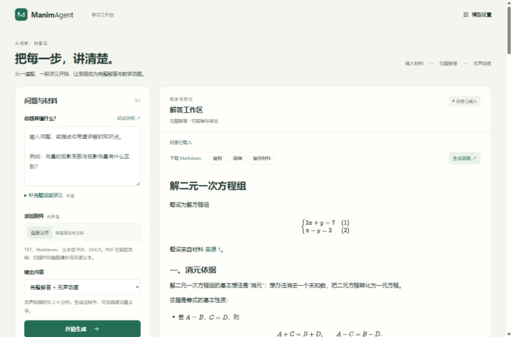
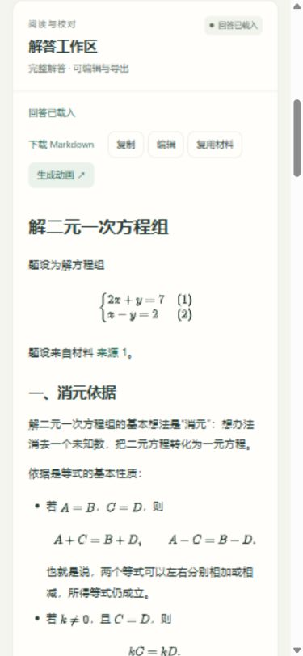

# 全代码复审、精简与前端工作台

日期：2026-11-04。审查基线：`79902ab`。范围为当前正式版的 `src/manimagent/`、`scripts/`、测试、发布入口与前端；第三方 MathJax 和独立冻结的 `legacy_mvp/` 不混入当前实现。历史实验记录保留，不能用删除测试、旧报告或压缩排版来计算业务代码精简。

## 代码收敛

| 模块 | 收敛内容 | 保留的约束 |
|---|---|---|
| 持久化 | 回答/任务、模型配置、实例信息统一 JSON 原子写入；上传、诊断、渲染产物共用流式文件发布 | Windows 读写锁、临时文件、原子替换、私有权限、哈希、上传格式验证、大小上限、异常清理 |
| 任务执行 | 删除对已验证输入的重复 dump/校验；回答和动画共用 provider 构造 | 每次任务的配置快照、凭据引用、预算和检查回执 |
| 动画 | 教学单元先合并源文本范围，再一次性构建和计算哈希；矩阵排版共用网格；计划哈希只计算一次 | 原文范围、单元覆盖、符号语义、版面检查、逐节拍帧映射 |
| 验收脚本 | 共用等待与报告写入；已发布回答只读取一次 | 超时、HTTP 错误与失败退出码都进入最终结果 |
| 前端 | 统一任务启动/恢复、忙碌状态、模型表单字段工厂和角色映射；去掉重复健康请求 | 异步视图版本保护、回答版本不可变、视频内容哈希核对 |

当前 Python 生产模块合计增加 128 行、删除 228 行，净减 **100 行**；此数字不包含新增回归测试、验收保护或前端设计。重点是删掉重复路径、重复构造和不可达分支；仓库总行数因新设计与测试而增加，不把它描述为全仓库大幅缩减。

## 修复的缺陷

- 上传附件期间修改输出模式或后续 PDF 页码，原提交可能采用修改后的值。现在提交前固定整份输入，并阻止重复提交。
- 新任务会遗留上个任务的错误、状态和诊断链接。现在切换视图时统一清理。
- 网关返回非 JSON 时只出现 JSON 解析异常。现在保留 HTTP 状态，显示可理解的错误，不把原始网关内容展示给用户。
- 复用桌面交付目录时，旧版已删除的源码可能留在新包中。现在按旧清单清理失效文件，并约束目标路径。
- 部分真实测试脚本即使样本失败仍以成功退出；动画汇总也可能只相信 `passed=true`。现在失败用非零退出码报告，动画要求结果与子进程退出码都通过。
- launcher 在探测可用端口后关闭 socket，存在被其他程序抢占的窗口；现在保留绑定 socket 交给 Uvicorn，启动失败也释放 worker。
- 动画运行期间保存修订，若新正文读取失败，两个生成按钮会永久禁用；现在错误路径也会释放控件。
- 配置重载与保存可交错，较旧 GET 响应会覆盖刚保存的界面状态。现在读写互斥，操作期间禁用相关按钮。
- 浏览器验收发现改版初稿的全局 SVG 样式破坏行内公式，已缩小作用范围，并修复短公式产生多余滚动条的问题。

## 前端变化

页面改为中文教学工作台：桌面左侧输入、右侧阅读解答，移动端顺序堆叠。模型设置折叠在次要区域，通过顶部配置入口展开。保留多文件、PDF 页码、补充材料、文字/双输出、编辑与新版本、来源、诊断、视频和下载操作。

视觉使用暖白背景、墨色正文与青绿主操作；长公式、表格和代码各自滚动，避免撑破窄屏。无外部字体、图片服务、新框架或新增前端依赖。

## 验证记录

本轮浏览器使用隔离的本地数据目录。新生成操作采用受控模型响应，验证真实 HTTP、解析、任务、保存、页面渲染和交互；历史真实 DeepSeek 生成的回答与 MP4 用于验证长正文、数学排版与播放器。受控响应不计入新的真实模型成功率。

| 验证 | 结果 |
|---|---|
| Python 完整回归 | **182 passed，2 skipped**，67.55 秒；跳过的两项原生测试另行执行 |
| JavaScript 行为回归 | **11 passed**，覆盖提交快照、重复提交、分享/恢复、旧响应隔离、修订失败解锁和配置读写互斥 |
| 原生渲染 | **2 passed**，168.04 秒；成片 161.733 秒、720p/30fps、H.264、无音轨，完整解码 **4,852 帧** |
| 切分差分 | **1,000** 组 Markdown 与基线输出完全一致，覆盖 Unicode、围栏、公式、空输入及超限 |
| 代码与依赖 | Ruff lint/format、JS 语法、Git diff、`uv lock --check` 通过 |
| 分发 | wheel 与 sdist 均在无凭据独立环境安装，CLI、HTTP、网页和静态资源验证通过 |
| 浏览器 | 模型文本/结构化测试、第二模型及检查角色保存、文字生成、TXT+PDF 多附件及页码、来源展开、修订、刷新恢复、真实视频分享链接与播放通过 |
| 响应式 | 1366×900 桌面双栏与 390×844 窄屏验证通过；窄屏可用宽度 375px，页面滚动宽度同为 375px，长公式独立滚动 |

本轮没有新增付费模型调用。UI 载入的历史真实视频长度为 330.933 秒，播放到 13.372 秒无媒体错误；本轮新渲染的完整解码测试与这一播放检查分别记录，不混为一次新模型生成。

[视频播放截图](video-desktop.jpg)。本地详细日志位于 `runs/review-ui-20261104/`；完整渲染产物位于 `testresult/review-cleanup-animation-native/`，不加入源码发行包。

此前动画稳定合格率、检查预算和未引入 TTS 的限制仍适用，不能据此宣称生产质量已经全部达标。
